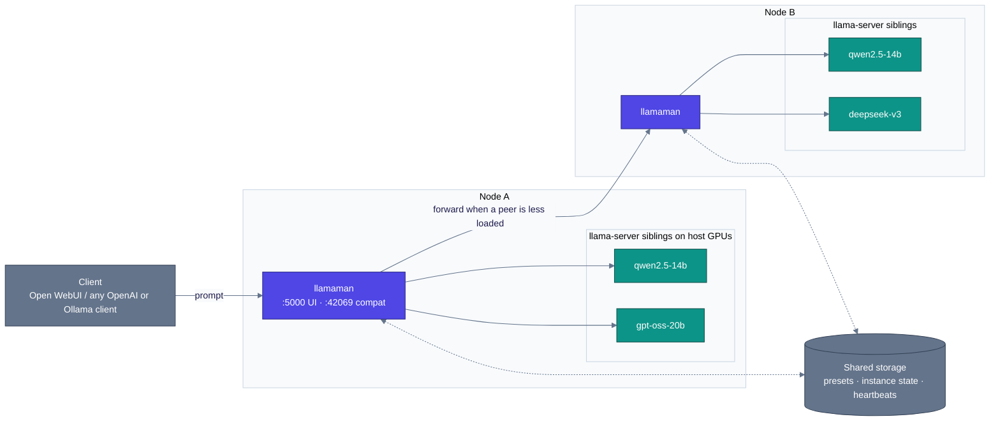

<p align="center">
  
</p>

#  llamaMan

**What it is.** A browser UI + API front-end for running multiple [llama.cpp](https://github.com/ggml-org/llama.cpp) server instances, across one machine or a small cluster of them. Ships an Ollama-compatible proxy so it drops in for [Open WebUI](https://github.com/open-webui/open-webui).

**What's different.** llamaMan itself has **no llama.cpp code and no GPU dependency** - it spawns `ghcr.io/ggml-org/llama.cpp:server-*` containers as siblings over the Docker socket. Update llama.cpp without touching llamaMan: `docker pull` a newer `server-*` image. The same spawn-and-proxy machinery is engine-agnostic: [Strata](docs/STRATA.md) instances run alongside llama.cpp ones, launched, monitored, proxied, and slept the same way.

> llama-server flag semantics are the source of truth on llama.cpp's side: **[server CLI reference](https://github.com/ggml-org/llama.cpp/blob/master/tools/server/README.md)**.

## Features

- **Universal GPU image** - one flow for NVIDIA, AMD (ROCm), Intel Arc, CPU; vendor auto-detected (Vulkan is opt-in via `GPU_TYPE=vulkan`)
- **Model library + downloader** - HuggingFace pulls with speed limits, resume, auto-retry, republish detection with atomic re-pull
- **One-click launch + presets** - every llama.cpp knob (spec-decoding, MoE offload, KV quant, mmproj, PDF input…) is a first-class UI field, with live preset updates for fields that don't need a relaunch
- **Ollama + OpenAI proxy on `:42069`** - Open WebUI drops in; models auto-start on demand and LRU-evict once `LLAMAMAN_MAX_MODELS` is hit
- **Image & PDF input** - vision models with `--mmproj`; PDFs rasterized page-by-page
- **Instance monitoring** - per-GPU VRAM, container CPU/RAM, per-instance TTFT / throughput / latency
- **Auth** - user accounts, API keys (bearer tokens), per-endpoint auth toggle
- **Multi-node clustering** *(opt-in)* - heterogeneous nodes as one logical cluster; aggregated dashboard; shared-queue load balancing
- 🆕 **Strata engine** *(opt-in, NVIDIA)* - launch [Strata](https://github.com/Niko1221/Strata) instances next to llama.cpp ones
- 🆕 **Knowledge base + MCP server** *(opt-in, MariaDB backend)* - store documents as topics, search them by meaning with your own embedding model, and expose the whole thing to any MCP client — all local

## Requirements

- Docker with access to `/var/run/docker.sock`
- **One** of:
  - [NVIDIA Container Toolkit](https://docs.nvidia.com/datacenter/cloud-native/container-toolkit/install-guide.html) for NVIDIA GPUs
  - [ROCm-compatible setup](https://rocm.docs.amd.com/projects/install-on-linux/en/latest/) for AMD GPUs
  - Intel Arc with `/dev/dri` access
  - CPU-only

## Quick Start

Edit `docker-compose.yml` first:

- Set `HOST_MODELS_DIR` / `HOST_LOGS_DIR` to the **real host paths** that back your volume mounts (llamaMan passes them to the Docker daemon when spawning sibling containers).
- `LLAMAMAN_NODE_NAME` (`srv1` in the sample compose; there is **no built-in default** - the app refuses to start without it) is **required for every install** - it's the partition key for this deployment's stored state. Pick once, keep it (changing later orphans stored state).

Pull the llama.cpp image for your GPU and start:

| GPU | `LLAMA_IMAGE` |
|---|---|
| NVIDIA | `ghcr.io/ggml-org/llama.cpp:server-cuda` |
| AMD (ROCm) | `ghcr.io/ggml-org/llama.cpp:server-rocm` |
| Intel Arc | `ghcr.io/ggml-org/llama.cpp:server-sycl` |
| Vulkan (AMD/Intel fallback) | `ghcr.io/ggml-org/llama.cpp:server-vulkan` (set `GPU_TYPE=vulkan`) |
| CPU only | `ghcr.io/ggml-org/llama.cpp:server` |

```bash
docker pull <LLAMA_IMAGE>          # from the table above
# For non-CUDA: also set LLAMA_IMAGE=... in docker-compose.yml
docker compose up --build
```

For NVIDIA native VRAM monitoring, also uncomment `deploy.resources.reservations` in `docker-compose.yml`.

- **Management UI**: <http://localhost:5000> (create admin on `/setup`)
- **Ollama-compatible API**: <http://localhost:42069>
- **llama-server instance ports**: 8000-8020

> **Security note:** the mounted `/var/run/docker.sock` gives the container full control of Docker on the host. Standard Docker-socket-access implications apply.

Running bare-metal (dev, WSL)? See [Running bare-metal](docs/CONFIGURATION.md#running-bare-metal).

## Your first model

1. **Get a model.** Either drop a `.gguf` into your models directory, or open the UI, pick a HuggingFace repo under **Downloads**, and let llamaMan pull it.
2. **Launch it.** Select the model in the sidebar, click **Launch**. llamaMan spawns a llama-server container and the instance appears with a status badge. Defaults (4096 ctx, auto GPU layers) work for most models; **Save Preset** remembers your settings. Every launch field is documented in [Launch settings](docs/LAUNCH-SETTINGS.md).
3. **Create an API key.** Under **API Keys**, create one (`llm-xxxxxxxxxx`). Model endpoints require a bearer token by default.
4. **Point your client at it.** Any OpenAI or Ollama client works against `:42069`. For Open WebUI:

```yaml
open-webui:
  environment:
    - OLLAMA_BASE_URL=http://llamaman:42069
    - OPENAI_API_BASE_URLS=http://llamaman:42069/v1
    - OPENAI_API_KEYS=llm-your-api-key-here
```

Open WebUI lists your models via `/api/tags` (by GGUF filename stem unless you set a **Display Name**); picking one auto-starts it, waits until healthy, then proxies. Set a per-model **Display Name** to show a friendly name instead of the raw quant filename.

> **Cap caveat:** the sample compose ships `LLAMAMAN_MAX_MODELS=1`. With a cap set, the Ollama connection evicts the LRU model when full, but the OpenAI connection (`OPENAI_API_BASE_URLS`) returns **503** by default - pick one path or raise the cap. Rules: [Model Eviction](docs/MODELS.md#model-eviction).

If something goes wrong, [Troubleshooting](#troubleshooting) below covers the common first-run failures.

## Authentication

Two credential types:

- **Session cookies** for the UI (created via `/setup` on first launch)
- **API keys** for external clients (`Authorization: Bearer llm-xxxxxxxxxx`), managed under **API Keys** in the UI

The **"Require authentication for all endpoints"** toggle (on by default) controls whether model-serving endpoints demand a bearer token. Details: [Authentication](docs/CONFIGURATION.md#authentication-detail).

## Architecture

llamaMan is a small Python app that never touches llama.cpp code directly. It spawns each `llama-server` as a sibling container over the Docker socket, monitors the fleet, and hands out an OpenAI/Ollama front door.



The single-node picture (default) is just the top half - one llamaman container, N `llama-server` siblings on the local Docker daemon, no cluster peers, JSON files instead of the shared DB. Clustering is opt-in and additive.

How it works in depth - request flow, queue-aware dispatch, failure behavior, design trade-offs: [Architecture](docs/ARCHITECTURE.md).

## Documentation

| Guide | What's in it |
|---|---|
| [Launch settings](docs/LAUNCH-SETTINGS.md) | Every launch-form field and its llama-server flag: ctx, KV cache, GPU layers, MoE offload, spec decoding, sampling overrides, concurrency & queueing, live preset updates, [Image & PDF input](docs/LAUNCH-SETTINGS.md#image--pdf-input), [Anti-Loop](docs/LAUNCH-SETTINGS.md#anti-loop), per-instance proxy, idle timeout |
| [Models](docs/MODELS.md) | Display names, model updates, [Decision Models](docs/MODELS.md#decision-models) (`/v1/systemone`), [Model Eviction](docs/MODELS.md#model-eviction), download settings, Docker image management, model archive, backup & restore, cleanup |
| [Configuration & storage](docs/CONFIGURATION.md) | Bare-metal installs, auth detail, GPU stats, request recording, JSON vs MariaDB backends, [surviving a DB outage](docs/CONFIGURATION.md#surviving-a-database-outage-local-mirror), and the full [Environment Variables](docs/CONFIGURATION.md#environment-variables) reference |
| [Clustering](docs/CLUSTERING.md) | Multi-node setup: shared DB, heartbeats, shared-queue load balancing |
| [Knowledge Base & MCP](docs/KNOWLEDGE-BASE.md) | Topics, embeddings, MCP endpoint, access modes |
| [Strata](docs/STRATA.md) | The second inference engine: setup, catalogue, limits, design notes |
| [REST API](docs/API.md) | Core endpoints: instances, downloads, presets, settings, request log, launch-body quirks |
| [Troubleshooting](docs/TROUBLESHOOTING.md) | The full symptom → fix table |

## Environment Variables

The ones you'll touch on day one (full reference: [Environment Variables](docs/CONFIGURATION.md#environment-variables)):

| Variable | Default | Description |
|---|---|---|
| `LLAMAMAN_NODE_NAME` | *(required)* | Unique stable identity - pick once, keep it |
| `HOST_MODELS_DIR` / `HOST_LOGS_DIR` | *(= container paths)* | Real host paths behind the volume mounts |
| `LLAMA_IMAGE` | *(auto)* | llama.cpp image; auto-selected from GPU vendor, set to pin. The sample compose pins `server-cuda` - change it for non-NVIDIA GPUs |
| `LLAMAMAN_MAX_MODELS` | `0` | Max concurrent chat models via the proxy (LRU eviction; 0 = unlimited). The sample compose sets `1` |
| `DATABASE_URL` | *(unset)* | MariaDB/MySQL connection string. Unset = JSON files |

## Troubleshooting

| Symptom | Fix |
|---|---|
| Instance stuck on **starting** | Check logs via the Logs button. Common: OOM, model path typo, corrupt GGUF, image not pulled |
| _"Docker image not found"_ | Pull the matching image: `docker pull ghcr.io/ggml-org/llama.cpp:server-cuda` (or `server-rocm` / `server-sycl` / `server`) |
| _"Docker API error"_ on launch | Ensure `/var/run/docker.sock` is mounted (default in `docker-compose.yml`) |
| No GPU / CUDA error | Ensure NVIDIA Container Toolkit is installed and `docker run --gpus all` works on the host |
| GPU stats unavailable | NVIDIA: uncomment the `deploy.resources.reservations` block. AMD/Intel: ensure `/sys/class/drm:ro` is mounted |
| Model not showing in OpenWebUI | Ensure `OLLAMA_BASE_URL=http://llamaman:42069`. Check `/api/tags` returns models |
| OpenWebUI gets 401 | `require_auth` is on (default). Create an API key and set `OPENAI_API_KEYS` in OpenWebUI |
| OpenAI client gets 503 when models are full | `LLAMAMAN_MAX_MODELS` cap reached and the OpenAI API can't evict by default. Raise the cap or enable the eviction toggles: [Model Eviction](docs/MODELS.md#model-eviction) |
| Port conflict | The form auto-suggests an unused port; adjust if needed |

Full table: [Troubleshooting](docs/TROUBLESHOOTING.md).

## Credits

This work would not be possible without [ggml-org/llama.cpp](https://github.com/ggml-org/llama.cpp).

## License

llamaMan is licensed under the [Elastic License 2.0](LICENSE). You may use, copy, distribute, and modify the software, subject to:

- No providing the software to third parties as a hosted / managed service where the service gives users access to a substantial set of its features or functionality.
- No removing or obscuring licensing, copyright, or other notices of the licensor.

### Third-party licenses

- **[Font Awesome Free 7.1.0](https://fontawesome.com/)** by Fonticons, Inc. - icons (CC BY 4.0), fonts (SIL OFL 1.1), and code (MIT). Full license text ships in [`static/fontawesome-free-7.1.0-web/LICENSE.txt`](static/fontawesome-free-7.1.0-web/LICENSE.txt).
