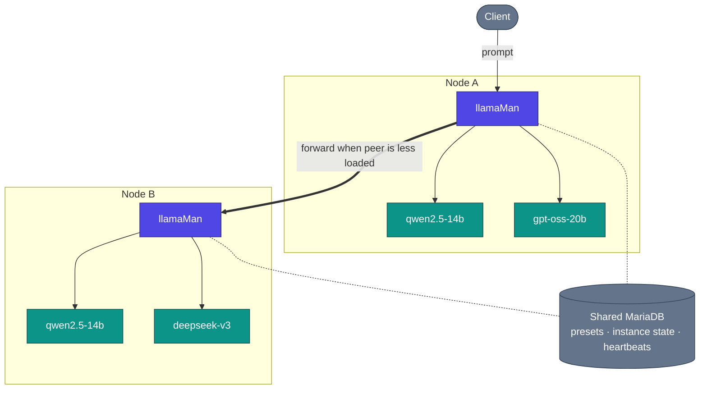

# Архитектура, поток на заявките и проектни решения

Как работи llamaMan отвътре. Картината с един възел е в [README](../../README.md#architecture); тази страница добавя изгледа на клъстера и подробностите в дълбочина.

## Съдържание

- [Изглед на клъстера](#cluster-view) · [Как работи](#how-it-works) · [Поток на заявките](#request-flow) · [Проектни решения и компромиси](#design-decisions--trade-offs)

## Изглед на клъстера

## Как работи

**В контейнер срещу bare-metal.** По подразбиране llamaMan работи в Docker (`llamaman-net`, достига съседните контейнери по име) или директно на хоста (достига стартираните контейнери през `localhost` на публикуваните им портове). Режимът се разпознава автоматично; може да се наложи с `LLAMAMAN_IN_DOCKER`.

**Разнородни клъстери.** Всеки възел има собствен хардуер (брой/производител/VRAM на GPU), собствени файлове с модели на диска, собствен llama.cpp образ и собствени хардуерно-специфични пренастройки на пресетите. Общата БД съдържа пресети, потребители, API ключове, състоянието на инстанциите по възли и heartbeat-ите на клъстера - но не и файловете с модели. Вижте [Клъстериране](CLUSTERING.md).

**Разпределение според опашките + междувъзлово „крадене“ на работа.** Когато два възела обслужват един и същ модел (или един и същ псевдоним `share_queue_group`), входяща заявка за това име се насочва към пиъра с най-малко текущи заявки. Ако избраният възел е наситен, неговият `RequestGate` все пак се опитва да предаде заявката на пиър със свободен капацитет, вместо да я сложи на опашка.

**Зареждане на модели + LRU изместване.** Съвместимото прокси на `:42069` стартира модели автоматично при поискване. Щом се достигне `LLAMAMAN_MAX_MODELS`, най-отдавна неизползваната не-админ инстанция се спира, за да се освободи място. Заспалите инстанции продължават да заемат слот; idle timeout е отделно измерение. Пълни правила: [Изместване на модели](MODELS.md#model-eviction).

**Устойчиво хранилище.** MariaDB е на критичния път на всяка заявка (удостоверяването чете настройките и ключовете при всяко извикване). Локално JSON огледало в `DATA_DIR/db_mirror/` записва паралелно всяка промяна на ниво възел; когато предпазителят се задейства, четенето минава към огледалото, а записите се журналират и се възпроизвеждат при повторно свързване. Изключено по подразбиране, включва се с една настройка: [Оцеляване при срив на базата данни](CONFIGURATION.md#surviving-a-database-outage-local-mirror).

**Мултимодалност.** Vision моделите зареждат своя `--mmproj` проектор заедно с основния GGUF. Работят и OpenAI `image_url` / `file`, и Ollama `images[]`. PDF файловете се растеризират страница по страница или минават по бърз път като извлечен текст, когато PDF-ът е създаден цифрово. Подробности: [Вход с изображения и PDF](LAUNCH-SETTINGS.md#image--pdf-input).

**Поведение при откази.** Мъртъв контейнер се засича от фоновия цикъл и се маркира, а слотът на инстанцията се освобождава на следващия тик. Убит процес на llamaman при рестарт осиновява маркираните контейнери, които още работят (тяхната порта, sidecar прокси и препращане на логовете се изграждат наново), така че не е нужна акробатика с `--restart=always`. Пиър възел, пропуснал прозореца си за heartbeat, отпада от разпределението, докато не се върне.

**Обновяване на llama.cpp без повторна компилация на llamaman:** изтеглете по-нов `server-*` образ от UI (Settings → Docker Images, вижте [Управление на Docker образи](MODELS.md#docker-image-management)) или извикайте ендпойнта за изтегляне. Новите инстанции стартират с новия образ; съществуващите продължават да работят, докато не ги рестартирате.

## Поток на заявките

Конкретна OpenAI-съвместима чат заявка към клъстер от два възела:

1. Клиентът прави `POST /v1/chat/completions` към `nodeA:42069` с модел `qwen2.5-14b`.
2. `nodeA` търси целта: това е активен модел на този възел **и** на `nodeB`. И двата принадлежат на една и съща ефективна група с обща опашка.
3. Диспечерът проверява текущото натоварване на всеки кандидат (от кеша с heartbeat-и + брояч на текущите заявки в кратък прозорец). `nodeB` е по-слабо натоварен → заявката се препраща към advertise URL-а на `nodeB` (неговия UI/API порт `:5000`) на същия път.
4. `nodeB` заема слот в портата (429, ако опашката е пълна и никой пиър няма място). Ако са включени пренастройки на семплирането, те се инжектират. Ако съществува sidecar прокси за инстанцията (idle / max-concurrent / proxy-sampling), заявката първо попада в него и то събужда контейнера, ако е заспал.
5. Sidecar-ът препраща към `llama-server` на вътрешния му порт. Потокът се връща през sidecar → `nodeB` → `nodeA` → клиента.
6. В края на потока: работникът на журнала на заявките записва TTFT / пропускателна способност / крайния брой токени; слотът в портата се освобождава; LRU времето се обновява, така че тази инстанция няма да бъде изместена следваща.

Ако `nodeB` беше излязъл офлайн между heartbeat-а и това извикване, диспечерът щеше да засече грешката при свързване и да избере следващия кандидат (в случая локално).

## Проектни решения и компромиси

- **Един gunicorn работник, `gthread`, `preload_app=False`.** Текущото състояние (инстанции, порти, изтегляния, idle проксита) е в Python речници в паметта; няколко работника биха го разпокъсали. Паралелизмът идва от нишки (`threads=32` - оразмерено за препратени в клъстера генерирания, които държат нишка през цялото си времетраене). Компромис: няма хоризонтално мащабиране в рамките на един хост; мащабира се чрез добавяне на възли в клъстера.
- **`LLAMAMAN_NODE_NAME` е задължителен.** Той е ключът за разделяне на хранилището. Смяната му след първото стартиране осиротява редовете на този възел. Компромис: една допълнителна задължителна променлива дори за инсталации с един възел, но общата БД остава подредена в целия клъстер, а старите редове се осиновяват автоматично при първото стартиране.
- **Входният възел държи връзката.** Препратената заявка заема нишка и на входния, и на целевия възел през цялото генериране - няма разпределение от страна на клиента, така че всеки OpenAI/Ollama клиент работи без промени. Компромис: пулът от нишки на входния възел ограничава едновременния междувъзлов inference.
- **Препращане на специалните стойности.** Стойности на llama.cpp като `-2 = all` за `--n-gpu-layers` или `-1 = --cpu-moe` се подават дословно, вместо да се превеждат от наша страна. Компромис: крехко, ако upstream промени значението им, но без разминаване при превода и всяка версия на llama-server работи от първия ден.
- **Състояние в паметта, БД е огледалото.** Истината по време на работа са речниците на ниво модул под заключване; БД е трайното огледало. Компромис: срив между две точки на запис губи секунди, не заявки - всяко извикване, променящо състоянието, записва моментна снимка в бекенда, преди да върне отговор.
- **`ResilientBackend` е изключен по подразбиране.** При обща MariaDB една настройка включва локално JSON огледало + журнал на записите, така че срив на БД да не води до 500 при всяка заявка или до неуспешен старт. Изключено е по подразбиране, за да запазят внедряванията с една БД по-простия път в кода. Компромис: режимът с огледало синхронизира изцяло редовете на ниво възел при повторно свързване, така че не пасва на клъстер, в който два възела едновременно променят едни и същи разделени данни (по замисъл те не го правят).
