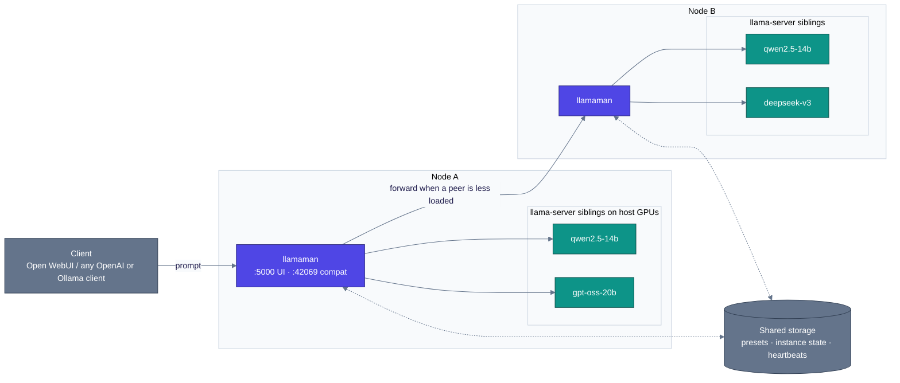

<p align="center">
  
</p>

#  llamaMan

[English](../../README.md) · [简体中文](../zh-CN/README.md) · [日本語](../ja/README.md) · [Deutsch](../de/README.md) · [Français](../fr/README.md) · [Español](../es/README.md) · [Português](../pt-BR/README.md) · [Русский](../ru/README.md) · **Български**

**Какво е.** Браузърен UI + API фронтенд за пускане на няколко инстанции на сървъра на [llama.cpp](https://github.com/ggml-org/llama.cpp), на една машина или на малък клъстер от такива. Включва Ollama-съвместимо прокси, така че се включва директно вместо Ollama в [Open WebUI](https://github.com/open-webui/open-webui).

**Какво е различното.** Самият llamaMan **няма код от llama.cpp и няма зависимост от GPU** - той стартира контейнери `ghcr.io/ggml-org/llama.cpp:server-*` като съседни през Docker сокета. Обновявайте llama.cpp, без да пипате llamaMan: `docker pull` на по-нов образ `server-*`. Същата машинария за стартиране и проксиране не зависи от двигателя: инстанции на [Strata](STRATA.md) работят до llama.cpp инстанциите и се стартират, наблюдават, проксират и приспиват по същия начин.

> Семантиката на флаговете на llama-server се определя от страната на llama.cpp: **[CLI справочник на сървъра](https://github.com/ggml-org/llama.cpp/blob/master/tools/server/README.md)**.

## Възможности

- **Универсален GPU образ** - един и същ поток за NVIDIA, AMD (ROCm), Intel Arc, CPU; производителят се разпознава автоматично (Vulkan е по избор чрез `GPU_TYPE=vulkan`)
- **Библиотека с модели + изтегляне** - изтегляне от HuggingFace с лимити на скоростта, продължаване, автоматичен повторен опит, засичане на повторно публикуване с атомарно повторно изтегляне
- **Стартиране с едно щракване + пресети** - всяка настройка на llama.cpp (spec-decoding, MoE offload, KV квантуване, mmproj, вход с PDF…) е пълноценно поле в UI, с обновяване на пресетите на живо за полетата, които не изискват рестарт
- **Ollama + OpenAI прокси на `:42069`** - Open WebUI се включва директно; моделите стартират автоматично при поискване и се изместват по LRU, щом се достигне `LLAMAMAN_MAX_MODELS`
- **Вход с изображения и PDF** - vision модели с `--mmproj`; PDF файловете се растеризират страница по страница
- **Наблюдение на инстанциите** - VRAM по GPU, CPU/RAM на контейнера, TTFT / пропускателна способност / латентност по инстанция
- **Удостоверяване** - потребителски акаунти, API ключове (bearer токени), превключвател за удостоверяване по ендпойнти
- **Клъстер от няколко възела** *(по избор)* - разнородни възли като един логически клъстер; обединено табло; балансиране на натоварването чрез обща опашка
- 🆕 **Двигател Strata** *(по избор, NVIDIA)* - стартирайте инстанции на [Strata](https://github.com/Niko1221/Strata) до llama.cpp инстанциите
- 🆕 **База знания + MCP сървър** *(по избор, бекенд MariaDB)* - съхранявайте документи като теми, търсете в тях по смисъл със собствен ембединг модел и предоставете всичко на всеки MCP клиент — изцяло локално

## Изисквания

- Docker с достъп до `/var/run/docker.sock`
- **Едно** от:
  - [NVIDIA Container Toolkit](https://docs.nvidia.com/datacenter/cloud-native/container-toolkit/install-guide.html) за NVIDIA GPU
  - [Съвместима с ROCm среда](https://rocm.docs.amd.com/projects/install-on-linux/en/latest/) за AMD GPU
  - Intel Arc с достъп до `/dev/dri`
  - Само CPU

## Бърз старт

Първо редактирайте `docker-compose.yml`:

- Задайте `HOST_MODELS_DIR` / `HOST_LOGS_DIR` на **реалните пътища на хоста**, които стоят зад монтираните томове (llamaMan ги подава на Docker демона, когато стартира съседни контейнери).
- `LLAMAMAN_NODE_NAME` (`srv1` в примерния compose; **няма вградена стойност по подразбиране** - приложението отказва да стартира без нея) е **задължителна за всяка инсталация** - това е ключът за разделяне на съхраненото състояние на това внедряване. Изберете веднъж и не я сменяйте (по-късна смяна осиротява съхраненото състояние).

Изтеглете llama.cpp образа за вашето GPU и стартирайте:

| GPU | `LLAMA_IMAGE` |
|---|---|
| NVIDIA | `ghcr.io/ggml-org/llama.cpp:server-cuda` |
| AMD (ROCm) | `ghcr.io/ggml-org/llama.cpp:server-rocm` |
| Intel Arc | `ghcr.io/ggml-org/llama.cpp:server-sycl` |
| Vulkan (резервен вариант за AMD/Intel) | `ghcr.io/ggml-org/llama.cpp:server-vulkan` (задайте `GPU_TYPE=vulkan`) |
| Само CPU | `ghcr.io/ggml-org/llama.cpp:server` |

```bash
docker pull <LLAMA_IMAGE>          # from the table above
# For non-CUDA: also set LLAMA_IMAGE=... in docker-compose.yml
docker compose up --build
```

За нативно наблюдение на VRAM при NVIDIA разкоментирайте и `deploy.resources.reservations` в `docker-compose.yml`.

- **UI за управление**: <http://localhost:5000> (създайте администратор на `/setup`)
- **Ollama-съвместим API**: <http://localhost:42069>
- **Портове на инстанциите на llama-server**: 8000-8020

> **Бележка за сигурността:** монтираният `/var/run/docker.sock` дава на контейнера пълен контрол над Docker на хоста. Важат обичайните последици от достъпа до Docker сокета.

Работите директно на хоста (разработка, WSL)? Вижте [Работа директно на хоста](CONFIGURATION.md#running-bare-metal).

## Вашият първи модел

1. **Сдобийте се с модел.** Или поставете `.gguf` в директорията с модели, или отворете UI, изберете HuggingFace хранилище в **Downloads** и оставете llamaMan да го изтегли.
2. **Стартирайте го.** Изберете модела в страничната лента и щракнете **Launch**. llamaMan стартира контейнер с llama-server и инстанцията се появява със значка за статус. Стойностите по подразбиране (ctx 4096, автоматични GPU слоеве) работят за повечето модели; **Save Preset** запомня настройките ви. Всяко поле за стартиране е описано в [Настройки при стартиране](LAUNCH-SETTINGS.md).
3. **Създайте API ключ.** В **API Keys** създайте ключ (`llm-xxxxxxxxxx`). По подразбиране ендпойнтите за модели изискват bearer токен.
4. **Насочете клиента си към него.** Всеки OpenAI или Ollama клиент работи с `:42069`. За Open WebUI:

```yaml
open-webui:
  environment:
    - OLLAMA_BASE_URL=http://llamaman:42069
    - OPENAI_API_BASE_URLS=http://llamaman:42069/v1
    - OPENAI_API_KEYS=llm-your-api-key-here
```

Open WebUI изброява моделите ви чрез `/api/tags` (по основата на името на GGUF файла, освен ако не зададете **Display Name**); изборът на модел го стартира автоматично, изчаква да стане здрав и след това проксира. Задайте **Display Name** за всеки модел, за да се показва удобно име вместо суровото име на файла с квантуването.

> **Уговорка за лимита:** примерният compose идва с `LLAMAMAN_MAX_MODELS=1`. При зададен лимит Ollama връзката измества LRU модела, когато е пълно, но OpenAI връзката (`OPENAI_API_BASE_URLS`) по подразбиране връща **503** - изберете един от двата пътя или вдигнете лимита. Правила: [Изместване на модели](MODELS.md#model-eviction).

Ако нещо се обърка, [Отстраняване на проблеми](#отстраняване-на-проблеми) по-долу покрива честите неуспехи при първо стартиране.

## Удостоверяване

Два вида идентификационни данни:

- **Сесийни бисквитки** за UI (създават се през `/setup` при първо стартиране)
- **API ключове** за външни клиенти (`Authorization: Bearer llm-xxxxxxxxxx`), управлявани в **API Keys** в UI

Превключвателят **"Require authentication for all endpoints"** (включен по подразбиране) определя дали ендпойнтите, обслужващи модели, изискват bearer токен. Подробности: [Удостоверяване](CONFIGURATION.md#authentication-detail).

## Архитектура

llamaMan е малко Python приложение, което никога не докосва директно кода на llama.cpp. То стартира всеки `llama-server` като съседен контейнер през Docker сокета, наблюдава всички тях и предоставя входна врата, съвместима с OpenAI/Ollama.


Картината с един възел (по подразбиране) е само горната половина - един контейнер llamaman, N съседни `llama-server` на локалния Docker демон, без пиъри в клъстер, JSON файлове вместо общата БД. Клъстерирането е по избор и само добавя функционалност.

Как работи в дълбочина - поток на заявките, разпределение според опашките, поведение при откази, проектни компромиси: [Архитектура](ARCHITECTURE.md).

## Документация

| Ръководство | Съдържание |
|---|---|
| [Настройки при стартиране](LAUNCH-SETTINGS.md) | Всяко поле от формата за стартиране и неговия флаг на llama-server: ctx, KV кеш, GPU слоеве, MoE offload, спекулативно декодиране, пренастройки на семплирането, паралелизъм и опашки, обновяване на пресетите на живо, [вход с изображения и PDF](LAUNCH-SETTINGS.md#image--pdf-input), [Anti-Loop](LAUNCH-SETTINGS.md#anti-loop), прокси за всяка инстанция, idle timeout |
| [Модели](MODELS.md) | Показвани имена, обновяване на модели, [Decision модели](MODELS.md#decision-models) (`/v1/systemone`), [изместване на модели](MODELS.md#model-eviction), настройки за изтегляне, управление на Docker образи, архив на модели, резервно копие и възстановяване, почистване |
| [Конфигурация и съхранение](CONFIGURATION.md) | Инсталации директно на хоста, подробно за удостоверяването, статистика за GPU, записване на заявки, бекенди JSON срещу MariaDB, [оцеляване при срив на БД](CONFIGURATION.md#surviving-a-database-outage-local-mirror) и пълният справочник на [променливите на средата](CONFIGURATION.md#environment-variables) |
| [Клъстериране](CLUSTERING.md) | Настройка с няколко възела: обща БД, heartbeat-и, балансиране на натоварването чрез обща опашка |
| [База знания и MCP](KNOWLEDGE-BASE.md) | Теми, ембединги, MCP ендпойнт, режими на достъп |
| [Strata](STRATA.md) | Вторият inference двигател: настройка, каталог, ограничения, бележки по дизайна |
| [REST API](API.md) | Основни ендпойнти: инстанции, изтегляния, пресети, настройки, журнал на заявките, особености на тялото на стартирането |
| [Отстраняване на проблеми](TROUBLESHOOTING.md) | Пълната таблица симптом → решение |

## Променливи на средата

Тези, които ще пипнете още първия ден (пълен справочник: [Променливи на средата](CONFIGURATION.md#environment-variables)):

| Променлива | По подразбиране | Описание |
|---|---|---|
| `LLAMAMAN_NODE_NAME` | *(задължителна)* | Уникална стабилна идентичност - изберете веднъж и не я сменяйте |
| `HOST_MODELS_DIR` / `HOST_LOGS_DIR` | *(= пътищата в контейнера)* | Реалните пътища на хоста зад монтираните томове |
| `LLAMA_IMAGE` | *(авто)* | Образ на llama.cpp; избира се автоматично според производителя на GPU, задайте го, за да го фиксирате. Примерният compose фиксира `server-cuda` - сменете го за GPU, различни от NVIDIA |
| `LLAMAMAN_MAX_MODELS` | `0` | Максимален брой едновременни чат модели през проксито (LRU изместване; 0 = без лимит). Примерният compose задава `1` |
| `DATABASE_URL` | *(не е зададена)* | Низ за връзка с MariaDB/MySQL. Не е зададена = JSON файлове |

## Отстраняване на проблеми

| Симптом | Решение |
|---|---|
| Инстанцията е заседнала на **starting** | Проверете логовете с бутона Logs. Чести причини: OOM, грешка в пътя на модела, повреден GGUF, неизтеглен образ |
| _"Docker image not found"_ | Изтеглете съответния образ: `docker pull ghcr.io/ggml-org/llama.cpp:server-cuda` (или `server-rocm` / `server-sycl` / `server`) |
| _"Docker API error"_ при стартиране | Уверете се, че `/var/run/docker.sock` е монтиран (по подразбиране в `docker-compose.yml`) |
| Няма GPU / CUDA грешка | Уверете се, че NVIDIA Container Toolkit е инсталиран и `docker run --gpus all` работи на хоста |
| Няма статистика за GPU | NVIDIA: разкоментирайте блока `deploy.resources.reservations`. AMD/Intel: уверете се, че `/sys/class/drm:ro` е монтиран |
| Моделът не се показва в OpenWebUI | Уверете се, че `OLLAMA_BASE_URL=http://llamaman:42069`. Проверете дали `/api/tags` връща модели |
| OpenWebUI получава 401 | `require_auth` е включено (по подразбиране). Създайте API ключ и задайте `OPENAI_API_KEYS` в OpenWebUI |
| OpenAI клиент получава 503, когато моделите са пълни | Достигнат е лимитът `LLAMAMAN_MAX_MODELS`, а OpenAI API по подразбиране не може да измества. Вдигнете лимита или включете превключвателите за изместване: [Изместване на модели](MODELS.md#model-eviction) |
| Конфликт на портове | Формата сама предлага свободен порт; коригирайте при нужда |

Пълна таблица: [Отстраняване на проблеми](TROUBLESHOOTING.md).

## Благодарности

Тази работа не би била възможна без [ggml-org/llama.cpp](https://github.com/ggml-org/llama.cpp).

## Лиценз

llamaMan е лицензиран под [Elastic License 2.0](../../LICENSE). Можете да използвате, копирате, разпространявате и променяте софтуера при следните условия:

- Забранено е предоставянето на софтуера на трети страни като хостнат / управляван сервиз, при който сервизът дава на потребителите достъп до съществена част от неговите функции или функционалност.
- Забранено е премахването или скриването на лицензионни, авторски или други известия на лицензодателя.

### Лицензи на трети страни

- **[Font Awesome Free 7.1.0](https://fontawesome.com/)** от Fonticons, Inc. - икони (CC BY 4.0), шрифтове (SIL OFL 1.1) и код (MIT). Пълният текст на лиценза е в [`static/fontawesome-free-7.1.0-web/LICENSE.txt`](../../static/fontawesome-free-7.1.0-web/LICENSE.txt).
