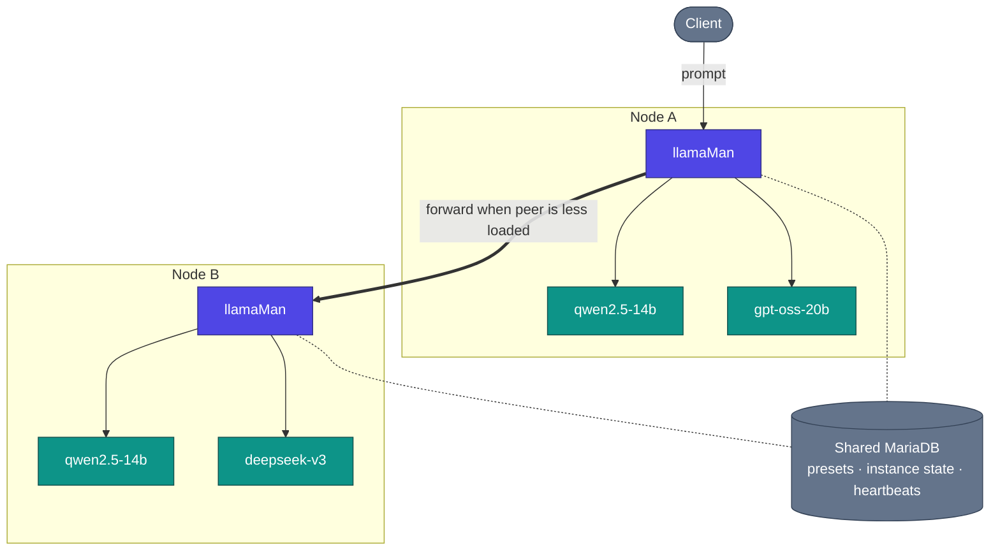

# Architektur, Request-Flow & Design-Entscheidungen

Wie llamaMan unter der Haube funktioniert. Die Single-Node-Übersicht befindet sich in der [README](../../README.md#architecture); diese Seite ergänzt die Cluster-Perspektive sowie detaillierte Einblicke.

## Inhalt

- [Cluster-Ansicht](#cluster-ansicht) · [Funktionsweise](#funktionsweise) · [Request-Flow](#request-flow) · [Design-Entscheidungen und Trade-offs](#design-entscheidungen-und-trade-offs)

## Cluster-Ansicht

## Funktionsweise

**Containerisiert vs. Bare-Metal.** llamaMan läuft standardmäßig in Docker (`llamaman-net`, erreicht Geschwister-Container über deren Containernamen) oder als Bare-Metal-Prozess auf dem Host (erreicht gestartete Container über `localhost` auf deren publizierten Ports). Der Modus wird automatisch erkannt; erzwingen über `LLAMAMAN_IN_DOCKER`.

**Heterogene Cluster.** Jeder Node besitzt seine eigene Hardware (GPU-Anzahl/-Hersteller/-VRAM), seine eigenen Modelldateien auf der Festplatte, sein eigenes llama.cpp-Image und seine eigenen hardwarebezogenen Preset-Overrides. Die gemeinsame Datenbank enthält Presets, Benutzer, API-Keys, knotenbezogene Instanzzustände und Cluster-Heartbeats – nicht die Modelldateien selbst. Siehe [Clustering](CLUSTERING.md).

**Queue-bewusstes Dispatching + knotenübergreifendes Work-Stealing.** Wenn zwei Nodes dasselbe Modell (oder denselben `share_queue_group`-Alias) bereitstellen, wird ein eingehender Request für diesen Namen an denjenigen Peer geroutet, der aktuell die wenigsten laufenden Requests verarbeitet. Ist der ausgewählte Node ausgelastet, versucht sein `RequestGate` weiterhin, den Request an einen Peer mit freien Kapazitäten zu übergeben, anstatt ihn in die Warteschlange zu stellen.

**Modell-Laden + LRU-Eviction.** Der `:42069`-Kompatibilitätsproxy startet Modelle bei Bedarf automatisch. Sobald `LLAMAMAN_MAX_MODELS` erreicht ist, wird die am längsten nicht genutzte Nicht-Admin-Instanz gestoppt, um Platz zu schaffen. Schlafende Instanzen belegen weiterhin einen Slot; der Idle-Timeout ist eine separate Achse. Vollständige Regeln: [Modell-Eviction](MODELS.md#model-eviction).

**Resilienter Speicher.** MariaDB liegt auf dem kritischen Pfad jedes Requests (die Authentifizierung liest Einstellungen und Keys bei jedem Aufruf). Ein lokaler JSON-Spiegel in `DATA_DIR/db_mirror/` schreibt jedes knotenbezogene Update direkt durch (Write-Through); öffnet der Schutzschalter (Circuit Breaker), fallen Lesezugriffe auf den Spiegel zurück und Schreibzugriffe werden protokolliert und bei Wiederverbindung nachgespielt. Standardmäßig deaktiviert, Aktivierung über eine einzelne Einstellung: [Surviving a database outage](CONFIGURATION.md#surviving-a-database-outage-local-mirror).

**Multimodal.** Vision-Modelle laden ihren `--mmproj`-Projektor parallel zum Haupt-GGUF. Sowohl OpenAI `image_url` / `file` als auch Ollama `images[]` funktionieren. PDFs werden seitenweise gerastert oder über den Fast-Path als extrahierter Text verarbeitet, wenn das PDF digital erzeugt wurde. Details: [Bild- & PDF-Input](LAUNCH-SETTINGS.md#image--pdf-input).

**Fehlerverhalten.** Ein ausgefallener Container wird vom Poller erkannt und markiert; der Instanz-Slot wird beim nächsten Tick freigegeben. Ein beendeter llamaman-Prozess übernimmt beim Neustart markierte Container, die noch laufen (Gate, Sidecar-Proxy und Log-Tail-Relay werden neu aufgebaut), sodass keine `--restart=always`-Verrenkungen nötig sind. Ein Peer-Node, der sein Heartbeat-Fenster verpasst, wird vom Dispatching ausgeschlossen, bis er zurückkehrt.

**llama.cpp ohne Rebuild von llamaman aktualisieren:** Ziehen Sie ein neueres `server-*`-Image über die Benutzeroberfläche (Settings → Docker Images, siehe [Docker-Image-Verwaltung](MODELS.md#docker-image-management)) oder rufen Sie den Pull-Endpoint auf. Neue Instanzen starten mit dem neuen Image; bestehende Instanzen laufen weiter, bis Sie sie neustarten.

## Request-Flow

Ein konkreter OpenAI-kompatibler Chat-Request in einem Zwei-Knoten-Cluster:

1. Client sendet `POST /v1/chat/completions` an `nodeA:42069` mit dem Modell `qwen2.5-14b`.
2. `nodeA` schlägt das Ziel nach: Es ist ein aktives Modell auf diesem Node **und** auf `nodeB`. Beide gehören zur selben effektiven Queue-Gruppe.
3. Der Dispatcher fragt die aktuelle Auslastung jedes Kandidaten ab (aus dem Heartbeat-Cache + dem Kurzzeit-Inflight-Zähler). `nodeB` ist weniger ausgelastet → der Request wird an die Advertise-URL von `nodeB` (dessen `:5000`-UI/API-Port) auf demselben Pfad weitergeleitet.
4. `nodeB` belegt einen Gate-Slot (429, falls die Queue voll ist und kein Peer Kapazitäten frei hat). Wenn Sampling-Overrides aktiv sind, werden sie injiziert. Falls ein instanzspezifischer Sidecar existiert (Idle / Max-Concurrent / Proxy-Sampling), landet der Request zuerst beim Sidecar, der den Container aufweckt, falls dieser schläft.
5. Der Sidecar leitet an `llama-server` auf dessen internem Port weiter. Der Stream fließt über den Sidecar → `nodeB` → `nodeA` → Client zurück.
6. Beim Ende des Streams: Der Request-Log-Worker erfasst TTFT / Durchsatz / finale Token-Anzahl; der Gate-Slot wird freigegeben; der LRU-Zeitstempel wird aktualisiert, damit diese Instanz nicht als nächste verdrängt wird.

Wäre `nodeB` zwischen dem Heartbeat und diesem Aufruf offline gegangen, hätte der Dispatcher den Verbindungsfehler erkannt und den nächsten Kandidaten neu ausgewählt (in diesem Fall lokal).

## Design-Entscheidungen und Trade-offs

- **Ein Gunicorn-Worker, `gthread`, `preload_app=False`.** Der Live-Status (Instanzen, Gates, Downloads, Idle-Proxies) liegt in In-Memory-Python-Dictionaries; mehrere Worker würden diesen fragmentieren. Nebenläufigkeit wird über Threads realisiert (`threads=32` – dimensioniert für cluster-weitergeleitete Generierungen, die einen Thread für ihre gesamte Dauer belegen). Trade-off: Keine horizontale Skalierung innerhalb eines Hosts; Skalierung erfolgt stattdessen durch das Hinzufügen weiterer Cluster-Nodes.
- **`LLAMAMAN_NODE_NAME` ist verpflichtend.** Er fungiert als Partitions-Key des Speichers. Eine nachträgliche Änderung trennt die Datensätze dieses Nodes ab. Trade-off: Eine zusätzliche Umgebungsvariable selbst bei Single-Node-Installationen, aber eine gemeinsame Datenbank bleibt clusterweit konsistent und Altdaten werden beim ersten Start automatisch übernommen.
- **Der Entry-Node hält die Verbindung.** Ein weitergeleiteter Request belegt sowohl auf dem Entry-Node als auch auf dem Ziel-Node für die gesamte Dauer der Generierung einen Thread – kein clientseitiges Dispatching, sodass jeder OpenAI-/Ollama-Client unverändert funktioniert. Trade-off: Der Thread-Pool des Entry-Nodes begrenzt die maximale Anzahl gleichzeitiger knotenübergreifender Inferenzen.
- **Sentinel-Weiterleitung.** llama.cpp-Werte wie `-2 = all` für `--n-gpu-layers` oder `-1 = --cpu-moe` werden unverändert durchgereicht, anstatt sie auf unserer Seite zu übersetzen. Trade-off: Anfällig für vorgelagerte Bedeutungsänderungen dieser Sentinel-Werte, aber keine Übersetzungsabweichungen und jedes llama-server-Release ist sofort am selben Tag nutzbar.
- **In-Memory-Status, DB als Spiegel.** Die maßgebliche Wahrheit zur Laufzeit sind die Dictionaries auf Modulebene unter einem Lock; die Datenbank ist ein persistenter Spiegel. Trade-off: Ein Absturz zwischen Speicherpunkten verliert Sekunden, keine Requests – jeder zustandsändernde Aufruf erstellt vor der Rückgabe einen Snapshot im Backend.
- **`ResilientBackend` ist standardmäßig deaktiviert.** Bei einer geteilten MariaDB aktiviert eine einzelne Einstellung einen lokalen JSON-Spiegel + Schreibjournal, sodass ein DB-Ausfall nicht jeden Request mit 500 quittiert oder den Start verhindert. Standardmäßig deaktiviert, damit Single-DB-Deployments den einfacheren Codepfad behalten. Trade-off: Der Spiegelmodus gleicht beim Wiederverbinden knotenbezogene Zeilen vollständig ab; er eignet sich daher nicht für Cluster, in denen zwei Nodes dieselben partitionierten Daten gleichzeitig verändern (was designbedingt ohnehin nicht vorkommt).
