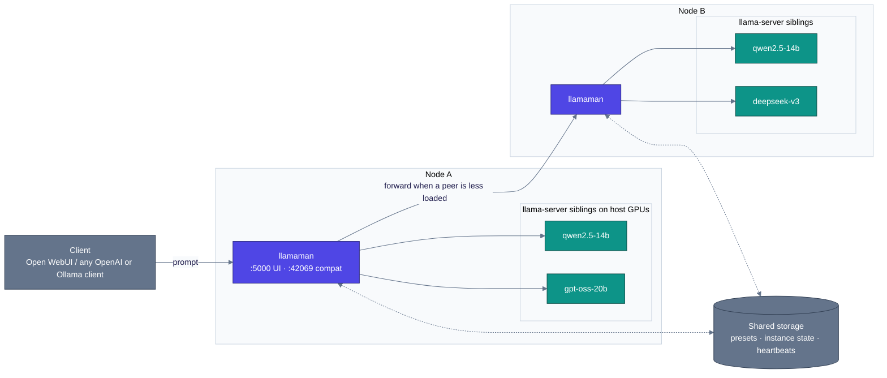

<p align="center">
  
</p>

#  llamaMan

[English](../../README.md) · [简体中文](../zh-CN/README.md) · [日本語](../ja/README.md) · **Deutsch** · [Français](../fr/README.md) · [Español](../es/README.md) · [Português](../pt-BR/README.md) · [Русский](../ru/README.md)

**Was es ist.** Ein Browser-UI + API-Frontend zum Betreiben mehrerer [llama.cpp](https://github.com/ggml-org/llama.cpp)-Server-Instanzen, auf einem Rechner oder einem kleinen Cluster aus mehreren. Bringt einen Ollama-kompatiblen Proxy mit, sodass es sich direkt in [Open WebUI](https://github.com/open-webui/open-webui) einbinden lässt.

**Was anders ist.** llamaMan selbst enthält **keinen llama.cpp-Code und hat keine GPU-Abhängigkeit** - es spawnt `ghcr.io/ggml-org/llama.cpp:server-*`-Container als Geschwister über den Docker-Socket. llama.cpp aktualisieren, ohne llamaMan anzufassen: `docker pull` eines neueren `server-*`-Images. Dieselbe Spawn-und-Proxy-Maschinerie ist engine-agnostisch: [Strata](STRATA.md)-Instanzen laufen neben llama.cpp-Instanzen, gestartet, überwacht, proxyt und schlafen gelegt, auf exakt dieselbe Weise.

> Die Flag-Semantik von llama-server ist die maßgebliche Quelle auf llama.cpp-Seite: **[server CLI reference](https://github.com/ggml-org/llama.cpp/blob/master/tools/server/README.md)**.

## Funktionen

- **Universelles GPU-Image** - ein Ablauf für NVIDIA, AMD (ROCm), Intel Arc, CPU; Hersteller wird automatisch erkannt (Vulkan ist opt-in über `GPU_TYPE=vulkan`)
- **Modellbibliothek + Downloader** - HuggingFace-Downloads mit Speed-Limits, Fortsetzung, Auto-Retry, Republish-Erkennung mit atomarem Re-Pull
- **One-Click-Launch + Presets** - jeder llama.cpp-Regler (Spec-Decoding, MoE-Offload, KV-Quant, mmproj, PDF-Input …) ist ein vollwertiges UI-Feld, mit Live-Preset-Updates für Felder, die keinen Neustart brauchen
- **Ollama + OpenAI Proxy auf `:42069`** - Open WebUI lässt sich direkt anbinden; Modelle starten bei Bedarf automatisch und werden per LRU verdrängt, sobald `LLAMAMAN_MAX_MODELS` erreicht ist
- **Bild- & PDF-Input** - Vision-Modelle mit `--mmproj`; PDFs werden seitenweise gerastert
- **Instanz-Monitoring** - VRAM pro GPU, Container-CPU/RAM, TTFT / Durchsatz / Latenz pro Instanz
- **Auth** - Benutzerkonten, API-Keys (Bearer-Tokens), Auth-Umschalter pro Endpoint
- **Multi-Node-Clustering** *(opt-in)* - heterogene Nodes als ein logischer Cluster; aggregiertes Dashboard; Load Balancing über gemeinsame Warteschlangen
- 🆕 **Strata-Engine** *(opt-in, NVIDIA)* - [Strata](https://github.com/Niko1221/Strata)-Instanzen neben llama.cpp-Instanzen starten
- 🆕 **Knowledge Base + MCP-Server** *(opt-in, MariaDB-Backend)* - Dokumente als Topics ablegen, mit dem eigenen Embedding-Modell nach Bedeutung durchsuchen und das Ganze für jeden MCP-Client bereitstellen - alles lokal

## Voraussetzungen

- Docker mit Zugriff auf `/var/run/docker.sock`
- **Eine** der folgenden Optionen:
  - [NVIDIA Container Toolkit](https://docs.nvidia.com/datacenter/cloud-native/container-toolkit/install-guide.html) für NVIDIA-GPUs
  - [ROCm-kompatibles Setup](https://rocm.docs.amd.com/projects/install-on-linux/en/latest/) für AMD-GPUs
  - Intel Arc mit Zugriff auf `/dev/dri`
  - Nur CPU

## Schnellstart

Bearbeiten Sie zuerst `docker-compose.yml`:

- Setzen Sie `HOST_MODELS_DIR` / `HOST_LOGS_DIR` auf die **tatsächlichen Host-Pfade**, die Ihren Volume-Mounts zugrunde liegen (llamaMan gibt sie beim Spawnen von Geschwister-Containern an den Docker-Daemon weiter).
- `LLAMAMAN_NODE_NAME` (`srv1` in der Beispiel-Compose-Datei; es gibt **keinen eingebauten Standardwert** - die App startet ohne ihn nicht) ist **für jede Installation erforderlich** - er ist der Partitionsschlüssel für den gespeicherten Zustand dieses Deployments. Einmal wählen, beibehalten (eine spätere Änderung verwaist den gespeicherten Zustand).

Ziehen Sie das llama.cpp-Image für Ihre GPU und starten Sie:

| GPU | `LLAMA_IMAGE` |
|---|---|
| NVIDIA | `ghcr.io/ggml-org/llama.cpp:server-cuda` |
| AMD (ROCm) | `ghcr.io/ggml-org/llama.cpp:server-rocm` |
| Intel Arc | `ghcr.io/ggml-org/llama.cpp:server-sycl` |
| Vulkan (AMD/Intel-Fallback) | `ghcr.io/ggml-org/llama.cpp:server-vulkan` (setzen Sie `GPU_TYPE=vulkan`) |
| Nur CPU | `ghcr.io/ggml-org/llama.cpp:server` |

```bash
docker pull <LLAMA_IMAGE>          # from the table above
# For non-CUDA: also set LLAMA_IMAGE=... in docker-compose.yml
docker compose up --build
```

Für natives NVIDIA-VRAM-Monitoring zusätzlich `deploy.resources.reservations` in `docker-compose.yml` einkommentieren.

- **Management-UI**: <http://localhost:5000> (Admin auf `/setup` anlegen)
- **Ollama-kompatible API**: <http://localhost:42069>
- **llama-server-Instanzports**: 8000-8020

> **Sicherheitshinweis:** Das gemountete `/var/run/docker.sock` gibt dem Container die volle Kontrolle über Docker auf dem Host. Es gelten die üblichen Implikationen von Docker-Socket-Zugriff.

Bare-Metal-Betrieb (Dev, WSL)? Siehe [Bare-Metal-Betrieb](CONFIGURATION.md#running-bare-metal).

## Ihr erstes Modell

1. **Modell besorgen.** Entweder eine `.gguf` in Ihr Modellverzeichnis legen, oder das UI öffnen, ein HuggingFace-Repository unter **Downloads** wählen und llamaMan es ziehen lassen.
2. **Starten.** Modell in der Seitenleiste auswählen, **Launch** klicken. llamaMan spawnt einen llama-server-Container, und die Instanz erscheint mit einem Status-Badge. Die Defaults (4096 ctx, automatische GPU-Layer) funktionieren für die meisten Modelle; **Save Preset** merkt sich Ihre Einstellungen. Jedes Launch-Feld ist in [Launch settings](LAUNCH-SETTINGS.md) dokumentiert.
3. **API-Key anlegen.** Unter **API Keys** einen anlegen (`llm-xxxxxxxxxx`). Modell-Endpoints verlangen standardmäßig ein Bearer-Token.
4. **Client darauf zeigen.** Jeder OpenAI- oder Ollama-Client funktioniert gegen `:42069`. Für Open WebUI:

```yaml
open-webui:
  environment:
    - OLLAMA_BASE_URL=http://llamaman:42069
    - OPENAI_API_BASE_URLS=http://llamaman:42069/v1
    - OPENAI_API_KEYS=llm-your-api-key-here
```

Open WebUI listet Ihre Modelle über `/api/tags` (nach GGUF-Dateinamen-Stem, sofern Sie keinen **Display Name** setzen); die Auswahl startet es automatisch, wartet bis healthy und proxyt dann. Setzen Sie pro Modell einen **Display Name**, um einen freundlichen Namen statt des rohen Quant-Dateinamens zu zeigen.

> **Cap-Hinweis:** Die Beispiel-Compose-Datei liefert `LLAMAMAN_MAX_MODELS=1`. Mit gesetztem Cap verdrängt die Ollama-Verbindung bei vollen Slots das LRU-Modell, die OpenAI-Verbindung (`OPENAI_API_BASE_URLS`) liefert jedoch standardmäßig **503** - wählen Sie einen der beiden Wege oder erhöhen Sie das Cap. Regeln: [Modell-Eviction](MODELS.md#model-eviction).

Wenn etwas schiefgeht, deckt [Fehlerbehebung](#fehlerbehebung) unten die häufigsten Erststart-Fehler ab.

## Authentifizierung

Zwei Anmeldeinformations-Typen:

- **Session-Cookies** für das UI (über `/setup` beim ersten Start angelegt)
- **API-Keys** für externe Clients (`Authorization: Bearer llm-xxxxxxxxxx`), verwaltet unter **API Keys** im UI

Der Umschalter **„Require authentication for all endpoints“** (standardmäßig aktiv) steuert, ob modellbereitstellende Endpoints ein Bearer-Token verlangen. Details: [Authentication](CONFIGURATION.md#authentication-detail).

## Architektur

llamaMan ist eine kleine Python-App, die llama.cpp-Code niemals direkt anfasst. Sie spawnt jedes `llama-server` als Geschwister-Container über den Docker-Socket, überwacht die Flotte und stellt eine OpenAI/Ollama-Vordertür bereit.



Das Single-Node-Bild (Standard) ist nur die obere Hälfte - ein llamaman-Container, N `llama-server`-Geschwister auf dem lokalen Docker-Daemon, keine Cluster-Peers, JSON-Dateien statt der gemeinsamen DB. Clustering ist opt-in und additiv.

Wie es im Detail funktioniert - Request-Flow, Queue-bewusstes Dispatching, Fehlerverhalten, Design-Trade-offs: [Architecture](ARCHITECTURE.md).

## Dokumentation

| Leitfaden | Inhalt |
|---|---|
| [Launch settings](LAUNCH-SETTINGS.md) | Jedes Launch-Formular-Feld und sein llama-server-Flag: ctx, KV-Cache, GPU-Layer, MoE-Offload, Spec-Decoding, Sampling-Overrides, Nebenläufigkeit & Queueing, Live-Preset-Updates, [Image & PDF input](LAUNCH-SETTINGS.md#image--pdf-input), [Anti-Loop](LAUNCH-SETTINGS.md#anti-loop), Proxy pro Instanz, Idle-Timeout |
| [Models](MODELS.md) | Display Names, Modell-Updates, [Entscheidungsmodelle](MODELS.md#decision-models) (`/v1/systemone`), [Modell-Eviction](MODELS.md#model-eviction), Download-Einstellungen, Docker-Image-Verwaltung, Modell-Archiv, Backup & Restore, Bereinigung |
| [Configuration & storage](CONFIGURATION.md) | Bare-Metal-Installationen, Auth-Details, GPU-Stats, Request-Aufzeichnung, JSON- vs. MariaDB-Backends, [einen DB-Ausfall überstehen](CONFIGURATION.md#surviving-a-database-outage-local-mirror) und die vollständige [Umgebungsvariablen](CONFIGURATION.md#environment-variables)-Referenz |
| [Clustering](CLUSTERING.md) | Multi-Node-Setup: gemeinsame DB, Heartbeats, Load Balancing über gemeinsame Warteschlangen |
| [Knowledge Base & MCP](KNOWLEDGE-BASE.md) | Topics, Embeddings, MCP-Endpoint, Zugriffsmodi |
| [Strata](STRATA.md) | Die zweite Inferenz-Engine: Setup, Katalog, Grenzen, Design-Notizen |
| [REST API](API.md) | Kern-Endpoints: Instanzen, Downloads, Presets, Einstellungen, Request-Log, Eigenheiten des Launch-Bodies |
| [Troubleshooting](TROUBLESHOOTING.md) | Die vollständige Symptom → Fix-Tabelle |

## Umgebungsvariablen

Die, die Sie am ersten Tag anfassen (vollständige Referenz: [Umgebungsvariablen](CONFIGURATION.md#environment-variables)):

| Variable | Standard | Beschreibung |
|---|---|---|
| `LLAMAMAN_NODE_NAME` | *(erforderlich)* | Eindeutige stabile Identität - einmal wählen, beibehalten |
| `HOST_MODELS_DIR` / `HOST_LOGS_DIR` | *(= Container-Pfade)* | Tatsächliche Host-Pfade hinter den Volume-Mounts |
| `LLAMA_IMAGE` | *(auto)* | llama.cpp-Image; automatisch nach GPU-Hersteller gewählt, zum Festlegen setzen. Die Beispiel-Compose-Datei pinnt `server-cuda` - für Nicht-NVIDIA-GPUs ändern |
| `LLAMAMAN_MAX_MODELS` | `0` | Maximale gleichzeitige Chat-Modelle über den Proxy (LRU-Eviction; 0 = unbegrenzt). Die Beispiel-Compose-Datei setzt `1` |
| `DATABASE_URL` | *(nicht gesetzt)* | MariaDB/MySQL-Verbindungsstring. Nicht gesetzt = JSON-Dateien |

## Fehlerbehebung

| Symptom | Fix |
|---|---|
| Instanz hängt bei **starting** | Logs über den Logs-Button prüfen. Üblich: OOM, Tippfehler im Modellpfad, defektes GGUF, Image nicht gezogen |
| _"Docker image not found"_ | Passendes Image ziehen: `docker pull ghcr.io/ggml-org/llama.cpp:server-cuda` (oder `server-rocm` / `server-sycl` / `server`) |
| _"Docker API error"_ beim Start | Sicherstellen, dass `/var/run/docker.sock` gemountet ist (Standard in `docker-compose.yml`) |
| Keine GPU / CUDA-Fehler | Sicherstellen, dass das NVIDIA Container Toolkit installiert ist und `docker run --gpus all` auf dem Host funktioniert |
| GPU-Stats nicht verfügbar | NVIDIA: den Block `deploy.resources.reservations` einkommentieren. AMD/Intel: sicherstellen, dass `/sys/class/drm:ro` gemountet ist |
| Modell erscheint nicht in OpenWebUI | Sicherstellen, dass `OLLAMA_BASE_URL=http://llamaman:42069`. Prüfen, ob `/api/tags` Modelle liefert |
| OpenWebUI bekommt 401 | `require_auth` ist aktiv (Standard). API-Key anlegen und `OPENAI_API_KEYS` in OpenWebUI setzen |
| OpenAI-Client bekommt 503, wenn Modelle voll sind | `LLAMAMAN_MAX_MODELS`-Cap erreicht und die OpenAI-API kann standardmäßig nicht verdrängen. Cap erhöhen oder Eviction-Umschalter aktivieren: [Modell-Eviction](MODELS.md#model-eviction) |
| Portkonflikt | Das Formular schlägt automatisch einen freien Port vor; bei Bedarf anpassen |

Vollständige Tabelle: [Troubleshooting](TROUBLESHOOTING.md).

## Danksagungen

Diese Arbeit wäre ohne [ggml-org/llama.cpp](https://github.com/ggml-org/llama.cpp) nicht möglich.

## Lizenz

llamaMan ist unter der [Elastic License 2.0](../../LICENSE) lizenziert. Sie dürfen die Software nutzen, kopieren, verbreiten und ändern, vorbehaltlich:

- Keine Bereitstellung der Software für Dritte als gehosteter / verwalteter Dienst, bei dem der Dienst Nutzern Zugriff auf einen wesentlichen Teil seiner Funktionen oder Funktionalität gibt.
- Kein Entfernen oder Verschleiern von Lizenz-, Urheberrechts- oder sonstigen Hinweisen des Lizenzgebers.

### Drittanbieter-Lizenzen

- **[Font Awesome Free 7.1.0](https://fontawesome.com/)** von Fonticons, Inc. - Icons (CC BY 4.0), Fonts (SIL OFL 1.1) und Code (MIT). Der vollständige Lizenztext liegt bei in [`static/fontawesome-free-7.1.0-web/LICENSE.txt`](../../static/fontawesome-free-7.1.0-web/LICENSE.txt).
