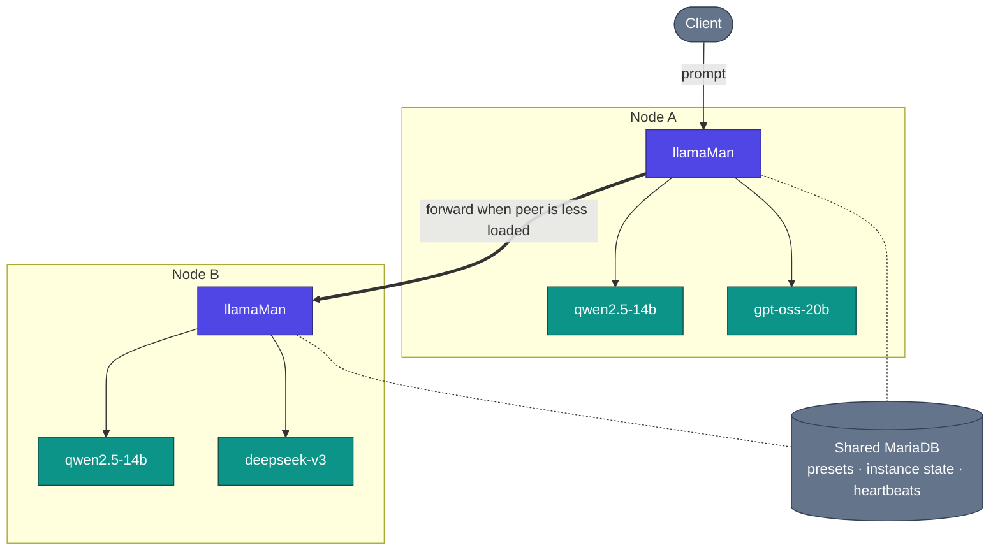

# Architecture, request flow & design decisions

How llamaMan works under the hood. The single-node picture is in the [README](../../README.md#architecture); this page adds the cluster view plus the deep detail.

## Contents

- [Cluster view](#cluster-view) · [How it works](#how-it-works) · [Request Flow](#request-flow) · [Design Decisions & Trade-offs](#design-decisions--trade-offs)

## Cluster view

## How it works

**Containerized vs bare-metal.** llamaMan runs in Docker by default (`llamaman-net`, reaching siblings by container name) or bare-metal on the host (reaches spawned containers via `localhost` on their published ports). Mode is auto-detected; force with `LLAMAMAN_IN_DOCKER`.

**Heterogeneous clusters.** Every node has its own hardware (GPU count/vendor/VRAM), its own model files on disk, its own llama.cpp image, and its own hardware-scoped preset overrides. The shared DB carries presets, users, API keys, per-node instance state, and cluster heartbeats - not the model files. See [Clustering](CLUSTERING.md).

**Queue-aware dispatch + cross-node work stealing.** When two nodes serve the same model (or the same `share_queue_group` alias), an inbound request for that name gets routed to whichever peer has the fewest in-flight requests. If the picked node is saturated its `RequestGate` still tries to hand the request off to a peer with free capacity instead of queueing.

**Model loading + LRU eviction.** The `:42069` compat proxy auto-launches models on demand. Once `LLAMAMAN_MAX_MODELS` is hit, the least-recently-used non-admin instance is stopped to make room. Sleeping instances still count against the slot; idle timeout is a separate axis. Full rules: [Model Eviction](MODELS.md#model-eviction).

**Resilient storage.** MariaDB is on the critical path of every request (auth reads settings and keys per call). A local JSON mirror in `DATA_DIR/db_mirror/` write-throughs each node-scoped update; when the breaker opens, reads fall back to the mirror and writes are journalled + replayed on reconnect. Off by default, one setting to turn on: [Surviving a database outage](CONFIGURATION.md#surviving-a-database-outage-local-mirror).

**Multimodal.** Vision models load their `--mmproj` projector alongside the main GGUF. OpenAI `image_url` / `file` and Ollama `images[]` both work. PDFs are rasterized page-by-page, or fast-pathed as extracted text when the PDF is born-digital. Details: [Image & PDF Input](LAUNCH-SETTINGS.md#image--pdf-input).

**Failure behavior.** A dead container is detected by the poller and marked, and the instance's slot is freed on the next tick. A killed llamaman process, on restart, re-adopts labelled containers that are still up (their gate, sidecar proxy, and log-tail relay are all rebuilt), so no `--restart=always` gymnastics needed. A peer node that misses its heartbeat window drops out of dispatch until it comes back.

**Update llama.cpp without rebuilding llamaman:** pull a newer `server-*` image from the UI (Settings → Docker Images, see [Docker Image Management](MODELS.md#docker-image-management)), or hit the pull endpoint. New instances launch on the new image; existing ones keep running until you restart them.

## Request Flow

A concrete OpenAI-compatible chat request against a two-node cluster:

1. Client `POST /v1/chat/completions` to `nodeA:42069` with model `qwen2.5-14b`.
2. `nodeA` looks up the target: it's a live model on this node **and** on `nodeB`. Both belong to the same effective queue group.
3. Dispatcher polls each candidate's live load (from the heartbeat cache + short-window inflight counter). `nodeB` is less loaded → the request is forwarded to `nodeB`'s advertise URL (its `:5000` UI/API port) on the same path.
4. `nodeB` claims a gate slot (429 if the queue is full and no peer has room). If sampling overrides are on, they're injected. If a per-instance sidecar exists (idle / max-concurrent / proxy-sampling), the request lands on the sidecar first, which wakes the container if it's sleeping.
5. Sidecar forwards to `llama-server` on its internal port. Stream flows back through the sidecar → `nodeB` → `nodeA` → client.
6. On stream end: the request-log worker records TTFT / throughput / final token count; the gate slot is released; the LRU timestamp is bumped so this instance won't get evicted next.

If `nodeB` had gone offline between the heartbeat and this call, the dispatcher would have detected the connection error and re-picked the next candidate (locally in this case).

## Design Decisions & Trade-offs

- **One gunicorn worker, `gthread`, `preload_app=False`.** Live state (instances, gates, downloads, idle proxies) is in-memory Python dicts; multi-worker would fragment it. Concurrency comes from threads (`threads=32` - sized for cluster-forwarded generations holding a thread for their whole duration). Trade-off: no horizontal scale within one host; scale by adding cluster nodes instead.
- **`LLAMAMAN_NODE_NAME` is mandatory.** It's the storage partition key. Changing it after first boot orphans that node's rows. Trade-off: one extra env var required for even single-node installs, but a shared DB stays sane across a cluster and legacy rows are auto-adopted on first boot.
- **Entry node holds the connection.** A forwarded request keeps a thread on both the entry node and the target for the whole generation - no client-side dispatch, so any OpenAI/Ollama client works unchanged. Trade-off: the entry node's thread pool caps concurrent cross-node inference.
- **Sentinel forwarding.** llama.cpp values like `-2 = all` for `--n-gpu-layers` or `-1 = --cpu-moe` are passed through verbatim rather than being translated on our side. Trade-off: fragile against upstream changing what those sentinels mean, but zero translation drift and every llama-server release lands the same day.
- **In-memory state, DB is the mirror.** Runtime truth is the module-level dicts under a lock; the DB is a durable mirror. Trade-off: a crash between save points loses seconds, not requests - every state-changing call snapshots to the backend before returning.
- **`ResilientBackend` is off by default.** With a shared MariaDB, one setting turns on a local JSON mirror + write journal so a DB outage doesn't 500 every request or fail startup. Off by default so single-DB deployments keep the simpler code path. Trade-off: mirror mode reconciles wholesale for node-scoped rows on reconnect, so it doesn't fit a cluster where two nodes concurrently mutate the same partitioned data (they don't, by design).
