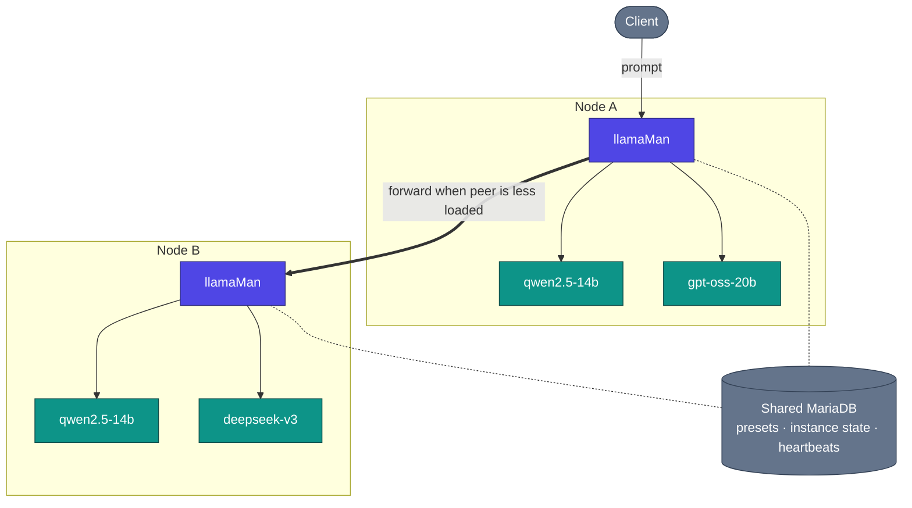

# Arquitectura, flujo de peticiones y decisiones de diseño

Cómo funciona llamaMan bajo el capó. La vista de un solo node está en el [README](../../README.md#architecture); esta página añade la vista de cluster y el detalle profundo.

## Contenido

- [Vista de cluster](#cluster-view) · [Cómo funciona](#how-it-works) · [Flujo de peticiones](#request-flow) · [Decisiones de diseño y compromisos](#design-decisions--trade-offs)

## Vista de cluster

## Cómo funciona

**Containerizado vs bare-metal.** llamaMan se ejecuta en Docker por defecto (`llamaman-net`, alcanzando a los hermanos por nombre de container) o bare-metal en el host (alcanza los containers spawnados vía `localhost` en sus puertos publicados). El modo se autodetecta; fuérzalo con `LLAMAMAN_IN_DOCKER`.

**Clusters heterogéneos.** Cada node tiene su propio hardware (número/fabricante/VRAM de GPU), sus propios archivos de modelos en disco, su propia imagen llama.cpp, y sus propios overrides de preset delimitados al hardware. La DB compartida lleva presets, usuarios, claves API, estado de instancia por node y heartbeats del cluster - no los archivos de modelos. Ver [Clustering](CLUSTERING.md).

**Dispatch consciente de colas + robo de trabajo entre nodes.** Cuando dos nodes sirven el mismo modelo (o el mismo alias `share_queue_group`), una petición entrante para ese nombre se enruta al peer con menos peticiones en vuelo. Si el node elegido está saturado, su `RequestGate` igualmente intenta pasar la petición a un peer con capacidad libre en lugar de encolar.

**Carga de modelos + desalojo LRU.** El proxy de compatibilidad `:42069` auto-lanza modelos a demanda. Una vez alcanzado `LLAMAMAN_MAX_MODELS`, se detiene la instancia no-admin menos recientemente usada para hacer sitio. Las instancias dormidas siguen contando contra el slot; el idle timeout es un eje separado. Reglas completas: [Desalojo de modelos](MODELS.md#model-eviction).

**Almacenamiento resiliente.** MariaDB está en la ruta crítica de cada petición (la autenticación lee ajustes y claves en cada llamada). Un espejo JSON local en `DATA_DIR/db_mirror/` replica cada actualización de ámbito node; cuando se abre el circuit breaker, las lecturas se repliegan al espejo y las escrituras se registran en un journal y se reproducen al reconectar. Desactivado por defecto, un solo ajuste para activarlo: [Surviving a database outage](CONFIGURATION.md#surviving-a-database-outage-local-mirror).

**Multimodal.** Los modelos de visión cargan su proyector `--mmproj` junto al GGUF principal. OpenAI `image_url` / `file` y Ollama `images[]` funcionan ambos. Los PDF se rasterizan página por página, o toman un atajo como texto extraído cuando el PDF es nativo digital. Detalles: [Entrada de imagen y PDF](LAUNCH-SETTINGS.md#image--pdf-input).

**Comportamiento ante fallos.** Un container muerto lo detecta el poller y se marca, y el slot de la instancia se libera en el siguiente tick. Un proceso llamaman matado, al reiniciar, readopta los containers etiquetados que siguen up (su gate, proxy sidecar y relé de cola de registros se reconstruyen todos), así que no hacen falta gimnasias de `--restart=always`. Un node peer que pierde su ventana de heartbeat sale del despacho hasta que vuelve.

**Actualizar llama.cpp sin reconstruir llamaman:** descarga una imagen `server-*` más reciente desde la UI (Settings → Docker Images, ver [Gestión de imágenes Docker](MODELS.md#docker-image-management)), o llama al endpoint de pull. Las instancias nuevas se lanzan con la imagen nueva; las existentes siguen corriendo hasta que las reinicies.

## Flujo de peticiones

Una petición de chat OpenAI-compatible concreta contra un cluster de dos nodes:

1. El cliente hace `POST /v1/chat/completions` a `nodeA:42069` con el modelo `qwen2.5-14b`.
2. `nodeA` busca el destino: es un modelo vivo en este node **y** en `nodeB`. Ambos pertenecen al mismo grupo de cola efectivo.
3. El despachador sondea la carga viva de cada candidato (desde la caché de heartbeats + un contador inflight de ventana corta). `nodeB` está menos cargado → la petición se reenvía a la URL de anuncio de `nodeB` (su puerto `:5000` de UI/API) en la misma ruta.
4. `nodeB` reclama un slot de gate (429 si la cola está llena y ningún peer tiene sitio). Si los overrides de muestreo están activados, se inyectan. Si existe un sidecar por instancia (idle / max-concurrent / proxy-sampling), la petición cae primero en el sidecar, que despierta el container si está dormido.
5. El sidecar reenvía a `llama-server` en su puerto interno. El stream fluye de vuelta por el sidecar → `nodeB` → `nodeA` → cliente.
6. Al terminar el stream: el worker del request-log registra TTFT / throughput / conteo final de tokens; se libera el slot de gate; se actualiza el timestamp LRU para que esta instancia no sea desalojada la próxima.

Si `nodeB` se hubiera desconectado entre el heartbeat y esta llamada, el despachador habría detectado el error de conexión y reelegido el siguiente candidato (localmente en este caso).

## Decisiones de diseño y compromisos

- **Un solo worker gunicorn, `gthread`, `preload_app=False`.** El estado vivo (instancias, gates, descargas, proxies idle) son dicts de Python en memoria; multi-worker lo fragmentaría. La concurrencia viene de los threads (`threads=32` - dimensionado para generaciones reenviadas por el cluster que retienen un thread durante toda su duración). Compromiso: sin escala horizontal dentro de un solo host; escala añadiendo nodes al cluster.
- **`LLAMAMAN_NODE_NAME` es obligatorio.** Es la clave de partición de almacenamiento. Cambiarlo tras el primer arranque deja huérfanas las filas de ese node. Compromiso: una variable de entorno extra requerida incluso para instalaciones de un solo node, pero una DB compartida sigue siendo coherente a través de un cluster y las filas heredadas se autoadoptan en el primer arranque.
- **El node de entrada retiene la conexión.** Una petición reenviada mantiene un thread tanto en el node de entrada como en el destino durante toda la generación - sin despacho en el cliente, así que cualquier cliente OpenAI/Ollama funciona sin cambios. Compromiso: el pool de threads del node de entrada limita la inferencia cross-node concurrente.
- **Reenvío de centinelas.** Valores llama.cpp como `-2 = all` para `--n-gpu-layers` o `-1 = --cpu-moe` se transmiten literalmente en lugar de traducirse de nuestro lado. Compromiso: frágil si upstream cambia lo que significan esos centinelas, pero cero deriva de traducción y cada release de llama-server aterriza el mismo día.
- **Estado en memoria, la DB es el espejo.** La verdad runtime son los dicts de nivel de módulo bajo un lock; la DB es un espejo durable. Compromiso: un fallo entre puntos de guardado pierde segundos, no peticiones - cada llamada que cambia estado hace snapshot al backend antes de volver.
- **`ResilientBackend` está desactivado por defecto.** Con una MariaDB compartida, un ajuste activa un espejo JSON local + journal de escrituras para que una caída de la DB no devuelva 500 a cada petición ni falle el arranque. Desactivado por defecto para que los despliegues de DB única conserven la ruta de código más simple. Compromiso: el modo espejo reconcilia en bloque las filas de ámbito node al reconectar, así que no encaja en un cluster donde dos nodes mutan concurrentemente los mismos datos particionados (no lo hacen, por diseño).
