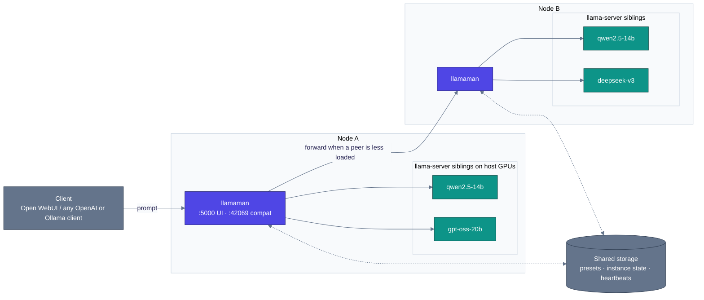

<p align="center">
  
</p>

#  llamaMan

[English](../../README.md) · [简体中文](../zh-CN/README.md) · [日本語](../ja/README.md) · [Deutsch](../de/README.md) · [Français](../fr/README.md) · **Español** · [Português](../pt-BR/README.md) · [Русский](../ru/README.md) · [Български](../bg/README.md)

**Qué es.** Una UI de navegador + API front-end para ejecutar múltiples instancias de servidor [llama.cpp](https://github.com/ggml-org/llama.cpp), en una máquina o un pequeño cluster de ellas. Incluye un proxy compatible con Ollama para integrarse directamente con [Open WebUI](https://github.com/open-webui/open-webui).

**Qué lo diferencia.** llamaMan mismo **no tiene código de llama.cpp ni dependencia de GPU** - spawnea containers `ghcr.io/ggml-org/llama.cpp:server-*` como hermanos a través del socket de Docker. Actualiza llama.cpp sin tocar llamaMan: `docker pull` de una imagen `server-*` más reciente. La misma maquinaria de spawn-and-proxy es agnóstica del motor: instancias [Strata](STRATA.md) corren junto a las de llama.cpp, lanzadas, monitorizadas, proxyadas y dormidas exactamente igual.

> La semántica de flags de llama-server es la fuente de verdad del lado de llama.cpp: **[referencia CLI del servidor](https://github.com/ggml-org/llama.cpp/blob/master/tools/server/README.md)**.

## Características

- **Imagen universal de GPU** - un solo flujo para NVIDIA, AMD (ROCm), Intel Arc, CPU; fabricante autodetectado (Vulkan es opt-in vía `GPU_TYPE=vulkan`)
- **Biblioteca de modelos + descargador** - pulls de HuggingFace con límites de velocidad, reanudación, auto-reintento, detección de republicación con re-pull atómico
- **Lanzamiento en un clic + presets** - cada mando de llama.cpp (spec-decoding, MoE offload, KV quant, mmproj, PDF input…) es un campo de primera clase en la UI, con actualizaciones en vivo de preset para los campos que no requieren relanzar
- **Proxy Ollama + OpenAI en `:42069`** - Open WebUI se conecta directamente; los modelos auto-arrancan a demanda y se desalojan por LRU una vez alcanzado `LLAMAMAN_MAX_MODELS`
- **Entrada de imagen y PDF** - modelos de visión con `--mmproj`; PDF rasterizados página por página
- **Monitorización de instancias** - VRAM por GPU, CPU/RAM de container, TTFT / throughput / latencia por instancia
- **Auth** - cuentas de usuario, claves API (tokens bearer), interruptor de auth por endpoint
- **Clustering multi-node** *(opt-in)* - nodes heterogéneos como un único cluster lógico; dashboard agregado; balanceo de carga de cola compartida
- 🆕 **Motor Strata** *(opt-in, NVIDIA)* - lanza instancias [Strata](https://github.com/Niko1221/Strata) junto a las de llama.cpp
- 🆕 **Base de conocimiento + servidor MCP** *(opt-in, backend MariaDB)* - almacena documentos como topics, búscalos por significado con tu propio modelo de embedding, y expón todo ello a cualquier cliente MCP — todo local

## Requisitos

- Docker con acceso a `/var/run/docker.sock`
- **Uno** de:
  - [NVIDIA Container Toolkit](https://docs.nvidia.com/datacenter/cloud-native/container-toolkit/install-guide.html) para GPUs NVIDIA
  - Una configuración [compatible con ROCm](https://rocm.docs.amd.com/projects/install-on-linux/en/latest/) para GPUs AMD
  - Intel Arc con acceso a `/dev/dri`
  - Solo CPU

## Inicio rápido

Edita `docker-compose.yml` primero:

- Define `HOST_MODELS_DIR` / `HOST_LOGS_DIR` a las **rutas reales del host** que respaldan tus montajes de volúmenes (llamaMan las pasa al daemon de Docker al spawnear containers hermanos).
- `LLAMAMAN_NODE_NAME` (`srv1` en el compose de ejemplo; **no hay valor por defecto integrado** - la app se niega a arrancar sin él) es **requerido para toda instalación** - es la clave de partición del estado almacenado de este despliegue. Elige una vez, consérvalo (cambiarlo después deja huérfano el estado almacenado).

Haz pull de la imagen llama.cpp para tu GPU y arranca:

| GPU | `LLAMA_IMAGE` |
|---|---|
| NVIDIA | `ghcr.io/ggml-org/llama.cpp:server-cuda` |
| AMD (ROCm) | `ghcr.io/ggml-org/llama.cpp:server-rocm` |
| Intel Arc | `ghcr.io/ggml-org/llama.cpp:server-sycl` |
| Vulkan (repliegue AMD/Intel) | `ghcr.io/ggml-org/llama.cpp:server-vulkan` (define `GPU_TYPE=vulkan`) |
| Solo CPU | `ghcr.io/ggml-org/llama.cpp:server` |

```bash
docker pull <LLAMA_IMAGE>          # from the table above
# For non-CUDA: also set LLAMA_IMAGE=... in docker-compose.yml
docker compose up --build
```

Para la monitorización nativa de VRAM NVIDIA, descomenta también `deploy.resources.reservations` en `docker-compose.yml`.

- **UI de gestión**: <http://localhost:5000> (crea el admin en `/setup`)
- **API compatible con Ollama**: <http://localhost:42069>
- **Puertos de instancia llama-server**: 8000-8020

> **Nota de seguridad:** el `/var/run/docker.sock` montado da al container control total de Docker en el host. Se aplican las implicaciones estándar del acceso al socket de Docker.

¿Corriendo en bare-metal (dev, WSL)? Ver [Ejecución en bare-metal](CONFIGURATION.md#running-bare-metal).

## Tu primer modelo

1. **Consigue un modelo.** Suelta un `.gguf` en tu directorio de modelos, o abre la UI, elige un repositorio HuggingFace bajo **Downloads**, y deja que llamaMan lo descargue.
2. **Lánzalo.** Selecciona el modelo en la barra lateral, haz clic en **Launch**. llamaMan spawnea un container llama-server y la instancia aparece con una insignia de estado. Los valores por defecto (4096 ctx, GPU layers auto) funcionan para la mayoría de modelos; **Save Preset** recuerda tus ajustes. Cada campo de lanzamiento está documentado en [Launch settings](LAUNCH-SETTINGS.md).
3. **Crea una clave API.** Bajo **API Keys**, crea una (`llm-xxxxxxxxxx`). Los endpoints de modelos exigen un token bearer por defecto.
4. **Apunta tu cliente a ella.** Cualquier cliente OpenAI u Ollama funciona contra `:42069`. Para Open WebUI:

```yaml
open-webui:
  environment:
    - OLLAMA_BASE_URL=http://llamaman:42069
    - OPENAI_API_BASE_URLS=http://llamaman:42069/v1
    - OPENAI_API_KEYS=llm-your-api-key-here
```

Open WebUI lista tus modelos vía `/api/tags` (por el nombre base del archivo GGUF salvo que definas un **Display Name**); elegir uno lo auto-arranca, espera a que esté healthy, y luego reenvía las peticiones. Define un **Display Name** por modelo para mostrar un nombre amigable en lugar del nombre de archivo de cuantización en bruto.

> **Advertencia de tope:** el compose de ejemplo trae `LLAMAMAN_MAX_MODELS=1`. Con un tope definido, la conexión Ollama desaloja el modelo LRU cuando está llena, pero la conexión OpenAI (`OPENAI_API_BASE_URLS`) devuelve **503** por defecto - elige uno de los dos caminos o sube el tope. Reglas: [Desalojo de modelos](MODELS.md#model-eviction).

Si algo va mal, [Solución de problemas](#solución-de-problemas) abajo cubre los fallos comunes del primer arranque.

## Autenticación

Dos tipos de credenciales:

- **Cookies de sesión** para la UI (creadas vía `/setup` en el primer lanzamiento)
- **Claves API** para clientes externos (`Authorization: Bearer llm-xxxxxxxxxx`), gestionadas bajo **API Keys** en la UI

El interruptor **"Require authentication for all endpoints"** (activado por defecto) controla si los endpoints de servicio de modelos exigen un token bearer. Detalles: [Authentication](CONFIGURATION.md#authentication-detail).

## Arquitectura

llamaMan es una pequeña app Python que nunca toca el código de llama.cpp directamente. Spawnea cada `llama-server` como un container hermano a través del socket de Docker, monitoriza la flota, y reparte una puerta de entrada OpenAI/Ollama.



La vista de un solo node (por defecto) es solo la mitad superior - un container llamaman, N hermanos `llama-server` en el daemon Docker local, sin peers de cluster, archivos JSON en lugar de la DB compartida. El clustering es opt-in y aditivo.

Cómo funciona en profundidad - flujo de peticiones, dispatch consciente de colas, comportamiento ante fallos, compromisos de diseño: [Architecture](ARCHITECTURE.md).

## Documentación

| Guía | Qué contiene |
|---|---|
| [Launch settings](LAUNCH-SETTINGS.md) | Cada campo del formulario de lanzamiento y su flag llama-server: ctx, caché KV, GPU layers, MoE offload, spec decoding, sampling overrides, concurrencia y encolado, actualizaciones en vivo de preset, [Image & PDF input](LAUNCH-SETTINGS.md#image--pdf-input), [Anti-Loop](LAUNCH-SETTINGS.md#anti-loop), proxy por instancia, idle timeout |
| [Models](MODELS.md) | Display names, actualizaciones de modelos, [Modelos de decisión](MODELS.md#decision-models) (`/v1/systemone`), [Desalojo de modelos](MODELS.md#model-eviction), ajustes de descarga, gestión de imágenes Docker, archivo de modelos, backup & restore, limpieza |
| [Configuration & storage](CONFIGURATION.md) | Instalaciones bare-metal, detalle de auth, stats de GPU, registro de peticiones, backends JSON vs MariaDB, [sobrevivir a una caída de la DB](CONFIGURATION.md#surviving-a-database-outage-local-mirror), y la referencia completa de [Variables de entorno](CONFIGURATION.md#environment-variables) |
| [Clustering](CLUSTERING.md) | Configuración multi-node: DB compartida, heartbeats, balanceo de carga de cola compartida |
| [Knowledge Base & MCP](KNOWLEDGE-BASE.md) | Topics, embeddings, endpoint MCP, modos de acceso |
| [Strata](STRATA.md) | El segundo motor de inferencia: setup, catálogo, límites, notas de diseño |
| [REST API](API.md) | Endpoints núcleo: instancias, descargas, presets, ajustes, request log, rarezas del cuerpo de lanzamiento |
| [Troubleshooting](TROUBLESHOOTING.md) | La tabla completa síntoma → corrección |

## Variables de entorno

Las que tocarás el primer día (referencia completa: [Variables de entorno](CONFIGURATION.md#environment-variables)):

| Variable | Por defecto | Descripción |
|---|---|---|
| `LLAMAMAN_NODE_NAME` | *(requerida)* | Identidad única estable - elige una vez, consérvala |
| `HOST_MODELS_DIR` / `HOST_LOGS_DIR` | *(= rutas de container)* | Rutas reales del host detrás de los montajes de volúmenes |
| `LLAMA_IMAGE` | *(auto)* | Imagen llama.cpp; auto-seleccionada del fabricante GPU, defínela para fijarla. El compose de ejemplo fija `server-cuda` - cámbialo para GPUs no-NVIDIA |
| `LLAMAMAN_MAX_MODELS` | `0` | Máximo de modelos de chat concurrentes vía el proxy (desalojo LRU; 0 = ilimitado). El compose de ejemplo define `1` |
| `DATABASE_URL` | *(sin definir)* | Cadena de conexión MariaDB/MySQL. Sin definir = archivos JSON |

## Solución de problemas

| Síntoma | Corrección |
|---|---|
| Instancia atascada en **starting** | Revisa los registros con el botón Logs. Comunes: OOM, errata en la ruta del modelo, GGUF corrupto, imagen no descargada |
| _"Docker image not found"_ | Descarga la imagen correspondiente: `docker pull ghcr.io/ggml-org/llama.cpp:server-cuda` (o `server-rocm` / `server-sycl` / `server`) |
| _"Docker API error"_ al lanzar | Asegúrate de que `/var/run/docker.sock` está montado (por defecto en `docker-compose.yml`) |
| Sin GPU / error CUDA | Asegúrate de que NVIDIA Container Toolkit está instalado y que `docker run --gpus all` funciona en el host |
| Estadísticas de GPU no disponibles | NVIDIA: descomenta el bloque `deploy.resources.reservations`. AMD/Intel: asegúrate de que `/sys/class/drm:ro` está montado |
| El modelo no aparece en OpenWebUI | Asegúrate de `OLLAMA_BASE_URL=http://llamaman:42069`. Verifica que `/api/tags` devuelve modelos |
| OpenWebUI recibe 401 | `require_auth` está activado (por defecto). Crea una clave API y define `OPENAI_API_KEYS` en OpenWebUI |
| Un cliente OpenAI recibe 503 cuando los modelos están llenos | Alcanzado el tope de `LLAMAMAN_MAX_MODELS` y la API OpenAI no puede desalojar por defecto. Sube el tope o activa los interruptores de desalojo: [Desalojo de modelos](MODELS.md#model-eviction) |
| Conflicto de puerto | El formulario sugiere automáticamente un puerto libre; ajusta si es necesario |

Tabla completa: [Troubleshooting](TROUBLESHOOTING.md).

## Créditos

Este trabajo no habría sido posible sin [ggml-org/llama.cpp](https://github.com/ggml-org/llama.cpp).

## Licencia

llamaMan está licenciado bajo la [Elastic License 2.0](../../LICENSE). Puedes usar, copiar, distribuir y modificar el software, con sujeción a:

- No proporcionar el software a terceros como un servicio alojado / gestionado donde el servicio dé a los usuarios acceso a un conjunto sustancial de sus características o funcionalidad.
- No eliminar u oscurecer avisos de licencia, de derechos de autor u otros avisos del licenciante.

### Licencias de terceros

- **[Font Awesome Free 7.1.0](https://fontawesome.com/)** de Fonticons, Inc. - iconos (CC BY 4.0), fuentes (SIL OFL 1.1), y código (MIT). El texto completo de la licencia se incluye en [`static/fontawesome-free-7.1.0-web/LICENSE.txt`](../../static/fontawesome-free-7.1.0-web/LICENSE.txt).
