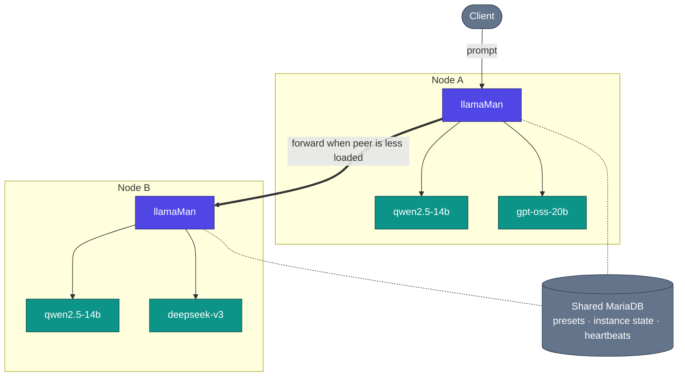

# Architecture, flux de requêtes et décisions de conception

Comment llamaMan fonctionne en coulisses. La vue mono-node est dans le [README](../../README.md#architecture) ; cette page ajoute la vue cluster et les détails profonds.

## Sommaire

- [Vue cluster](#vue-cluster) · [Fonctionnement](#fonctionnement) · [Flux de requêtes](#flux-de-requêtes) · [Décisions de conception et compromis](#décisions-de-conception-et-compromis)

## Vue cluster

## Fonctionnement

**Conteneurisé vs bare-metal.** llamaMan tourne dans Docker par défaut (`llamaman-net`, atteignant les frères par nom de conteneur) ou en bare-metal sur l'hôte (atteint les conteneurs spawnés via `localhost` sur leurs ports publiés). Le mode est auto-détecté ; forcez avec `LLAMAMAN_IN_DOCKER`.

**Clusters hétérogènes.** Chaque node a son propre matériel (nombre/fabricant/VRAM de GPU), ses propres fichiers de modèles sur disque, sa propre image llama.cpp, et ses propres overrides de préréglage liés au matériel. La DB partagée porte les préréglages, utilisateurs, clés API, l'état d'instance par node et les heartbeats cluster - pas les fichiers de modèles. Voir [Clustering](CLUSTERING.md).

**Dispatch conscient des files + vol de travail inter-nodes.** Quand deux nodes servent le même modèle (ou le même alias `share_queue_group`), une requête entrante pour ce nom est routée vers le peer ayant le moins de requêtes en vol. Si le node choisi est saturé, son `RequestGate` essaie quand même de confier la requête à un peer ayant de la capacité libre au lieu de la mettre en file.

**Chargement de modèles + éviction LRU.** Le proxy de compatibilité `:42069` auto-lance les modèles à la demande. Une fois `LLAMAMAN_MAX_MODELS` atteint, l'instance non-admin la moins récemment utilisée est stoppée pour faire de la place. Les instances endormies comptent toujours dans le slot ; l'idle timeout est un axe séparé. Règles complètes : [Éviction de modèles](MODELS.md#model-eviction).

**Stockage résilient.** MariaDB est sur le chemin critique de chaque requête (l'auth lit réglages et clés à chaque appel). Un miroir JSON local dans `DATA_DIR/db_mirror/` répercute chaque mise à jour de portée node ; quand le disjoncteur s'ouvre, les lectures se rabattent sur le miroir et les écritures sont journalisées + rejouées à la reconnexion. Désactivé par défaut, un seul réglage pour l'activer : [Surviving a database outage](CONFIGURATION.md#surviving-a-database-outage-local-mirror).

**Multimodal.** Les modèles de vision chargent leur projecteur `--mmproj` à côté du GGUF principal. OpenAI `image_url` / `file` et Ollama `images[]` fonctionnent tous les deux. Les PDF sont rastérisés page par page, ou traités par raccourci en texte extrait quand le PDF est nativement numérique. Détails : [Entrée image et PDF](LAUNCH-SETTINGS.md#image--pdf-input).

**Comportement en cas de panne.** Un conteneur mort est détecté par le poller et marqué, et le slot de l'instance est libéré au tick suivant. Un processus llamaman tué ré-adopte au redémarrage les conteneurs étiquetés encore up (leur gate, proxy sidecar et relais de log sont tous reconstruits), donc pas de gymnastique `--restart=always` nécessaire. Un node peer qui rate sa fenêtre de heartbeat sort du dispatch jusqu'à son retour.

**Mettre à jour llama.cpp sans reconstruire llamaman :** tirez une image `server-*` plus récente depuis l'UI (Settings → Docker Images, voir [Gestion des images Docker](MODELS.md#docker-image-management)), ou appelez l'endpoint de pull. Les nouvelles instances se lancent sur la nouvelle image ; les existantes continuent de tourner jusqu'à ce que vous les redémarriez.

## Flux de requêtes

Une requête de chat OpenAI-compatible concrète contre un cluster à deux nodes :

1. Le client `POST /v1/chat/completions` sur `nodeA:42069` avec le modèle `qwen2.5-14b`.
2. `nodeA` cherche la cible : c'est un modèle live sur ce node **et** sur `nodeB`. Les deux appartiennent au même groupe de file effectif.
3. Le dispatcher interroge la charge live de chaque candidat (depuis le cache de heartbeats + un compteur inflight sur fenêtre courte). `nodeB` est moins chargé → la requête est transférée vers l'URL d'annonce de `nodeB` (son port UI/API `:5000`) sur le même chemin.
4. `nodeB` réclame un slot de gate (429 si la file est pleine et qu'aucun peer n'a de place). Si les overrides d'échantillonnage sont activés, ils sont injectés. Si un sidecar par instance existe (idle / max-concurrent / proxy-sampling), la requête arrive d'abord sur le sidecar, qui réveille le conteneur s'il est endormi.
5. Le sidecar transfère à `llama-server` sur son port interne. Le stream revient à travers le sidecar → `nodeB` → `nodeA` → client.
6. À la fin du stream : le worker du request-log enregistre TTFT / débit / nombre final de tokens ; le slot de gate est libéré ; l'horodatage LRU est mis à jour pour que cette instance ne soit pas la prochaine évincée.

Si `nodeB` était passé hors ligne entre le heartbeat et cet appel, le dispatcher aurait détecté l'erreur de connexion et re-choisi le candidat suivant (en local dans ce cas).

## Décisions de conception et compromis

- **Un seul worker gunicorn, `gthread`, `preload_app=False`.** L'état live (instances, gates, téléchargements, proxies idle) est dans des dicts Python en mémoire ; multi-worker le fragmenterait. La concurrence vient des threads (`threads=32` - dimensionné pour les générations transférées par le cluster qui détiennent un thread pendant toute leur durée). Compromis : pas de scale horizontal au sein d'un seul hôte ; scalez en ajoutant des nodes au cluster.
- **`LLAMAMAN_NODE_NAME` est obligatoire.** C'est la clé de partition de stockage. Le changer après le premier amorçage rend orphelines les lignes de ce node. Compromis : une variable d'environnement de plus requise même pour les installations mono-node, mais une DB partagée reste saine à travers un cluster et les lignes héritées sont adoptées automatiquement au premier amorçage.
- **Le node d'entrée détient la connexion.** Une requête transférée garde un thread sur le node d'entrée et sur la cible pendant toute la génération - pas de dispatch côté client, donc n'importe quel client OpenAI/Ollama fonctionne sans changement. Compromis : le pool de threads du node d'entrée plafonne l'inférence cross-node concurrente.
- **Forwarding des sentinelles.** Les valeurs llama.cpp comme `-2 = all` pour `--n-gpu-layers` ou `-1 = --cpu-moe` sont transmises telles quelles plutôt que traduites de notre côté. Compromis : fragile si upstream change la signification de ces sentinelles, mais zéro dérive de traduction et chaque release de llama-server arrive le jour même.
- **État en mémoire, la DB est le miroir.** La vérité runtime est les dicts de niveau module sous un verrou ; la DB est un miroir durable. Compromis : un crash entre les points de sauvegarde perd des secondes, pas des requêtes - chaque appel modifiant l'état écrit un snapshot dans le backend avant de retourner.
- **`ResilientBackend` est désactivé par défaut.** Avec une MariaDB partagée, un seul réglage active un miroir JSON local + journal d'écritures pour qu'une panne DB ne mette pas toutes les requêtes en 500 ou ne fasse échouer le démarrage. Désactivé par défaut pour que les déploiements à DB unique gardent le chemin de code le plus simple. Compromis : le mode miroir réconcilie par bloc complet les lignes de portée node à la reconnexion, donc il ne convient pas à un cluster où deux nodes modifient simultanément les mêmes données partitionnées (ils ne le font pas, par conception).
