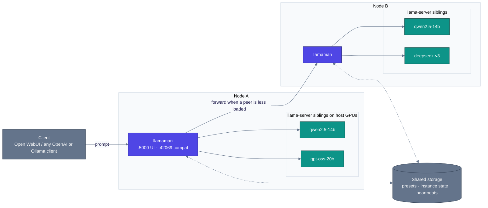

<p align="center">
  
</p>

#  llamaMan

[English](../../README.md) · [简体中文](../zh-CN/README.md) · [日本語](../ja/README.md) · [Deutsch](../de/README.md) · **Français** · [Español](../es/README.md) · [Português](../pt-BR/README.md) · [Русский](../ru/README.md)

**Ce que c'est.** Une UI navigateur + une API front-end pour faire tourner plusieurs instances serveur [llama.cpp](https://github.com/ggml-org/llama.cpp), sur une machine ou un petit cluster de machines. Livré avec un proxy compatible Ollama pour s'intégrer directement à [Open WebUI](https://github.com/open-webui/open-webui).

**Ce qui est différent.** llamaMan lui-même n'a **aucun code llama.cpp et aucune dépendance GPU** - il lance des conteneurs `ghcr.io/ggml-org/llama.cpp:server-*` en frères via le socket Docker. Mettez à jour llama.cpp sans toucher llamaMan : `docker pull` d'une image `server-*` plus récente. La même machinerie de spawn-et-proxy est agnostique du moteur : des instances [Strata](STRATA.md) tournent à côté de celles de llama.cpp, lancées, surveillées, proxyisées et endormies exactement de la même façon.

> La sémantique des flags llama-server fait foi du côté de llama.cpp : **[référence CLI du serveur](https://github.com/ggml-org/llama.cpp/blob/master/tools/server/README.md)**.

## Fonctionnalités

- **Image GPU universelle** - un seul parcours pour NVIDIA, AMD (ROCm), Intel Arc, CPU ; fabricant auto-détecté (Vulkan est opt-in via `GPU_TYPE=vulkan`)
- **Bibliothèque de modèles + downloader** - pulls HuggingFace avec plafonds de vitesse, reprise, auto-retry, détection de republication avec re-pull atomique
- **Lancement en un clic + préréglages** - chaque réglage llama.cpp (spec-decoding, MoE offload, quant KV, mmproj, entrée PDF…) est un champ UI de premier plan, avec des mises à jour live de préréglage pour les champs qui n'ont pas besoin d'un relancement
- **Proxy Ollama + OpenAI sur `:42069`** - Open WebUI s'y branche directement ; les modèles s'auto-démarrent à la demande et sont évincés en LRU une fois `LLAMAMAN_MAX_MODELS` atteint
- **Entrée image & PDF** - modèles de vision avec `--mmproj` ; PDF rastérisés page par page
- **Surveillance d'instances** - VRAM par GPU, CPU/RAM du conteneur, TTFT / débit / latence par instance
- **Auth** - comptes utilisateurs, clés API (jetons bearer), interrupteur d'auth par endpoint
- **Clustering multi-nodes** *(opt-in)* - des nodes hétérogènes comme un seul cluster logique ; dashboard agrégé ; équilibrage de charge par file partagée
- 🆕 **Moteur Strata** *(opt-in, NVIDIA)* - lancez des instances [Strata](https://github.com/Niko1221/Strata) à côté de celles de llama.cpp
- 🆕 **Knowledge base + serveur MCP** *(opt-in, backend MariaDB)* - stockez des documents en topics, cherchez-les par le sens avec votre propre modèle d'embedding, et exposez le tout à n'importe quel client MCP — le tout en local

## Prérequis

- Docker avec accès à `/var/run/docker.sock`
- **Un** de :
  - [NVIDIA Container Toolkit](https://docs.nvidia.com/datacenter/cloud-native/container-toolkit/install-guide.html) pour les GPUs NVIDIA
  - Une configuration [compatible ROCm](https://rocm.docs.amd.com/projects/install-on-linux/en/latest/) pour les GPUs AMD
  - Intel Arc avec accès `/dev/dri`
  - CPU uniquement

## Démarrage rapide

Éditez d'abord `docker-compose.yml` :

- Définissez `HOST_MODELS_DIR` / `HOST_LOGS_DIR` aux **vrais chemins hôtes** qui soutiennent vos montages de volumes (llamaMan les passe au démon Docker en spawnant les conteneurs frères).
- `LLAMAMAN_NODE_NAME` (`srv1` dans le compose d'exemple ; il n'y a **aucun défaut intégré** - l'appli refuse de démarrer sans lui) est **requis pour toute installation** - c'est la clé de partition de l'état stocké de ce déploiement. Choisissez une fois, gardez (le changer plus tard rend orphelin l'état stocké).

Tirez l'image llama.cpp pour votre GPU et démarrez :

| GPU | `LLAMA_IMAGE` |
|---|---|
| NVIDIA | `ghcr.io/ggml-org/llama.cpp:server-cuda` |
| AMD (ROCm) | `ghcr.io/ggml-org/llama.cpp:server-rocm` |
| Intel Arc | `ghcr.io/ggml-org/llama.cpp:server-sycl` |
| Vulkan (repli AMD/Intel) | `ghcr.io/ggml-org/llama.cpp:server-vulkan` (définissez `GPU_TYPE=vulkan`) |
| CPU seulement | `ghcr.io/ggml-org/llama.cpp:server` |

```bash
docker pull <LLAMA_IMAGE>          # from the table above
# For non-CUDA: also set LLAMA_IMAGE=... in docker-compose.yml
docker compose up --build
```

Pour la surveillance native de la VRAM NVIDIA, décommentez aussi `deploy.resources.reservations` dans `docker-compose.yml`.

- **UI de gestion** : <http://localhost:5000> (créez l'admin sur `/setup`)
- **API compatible Ollama** : <http://localhost:42069>
- **Ports d'instances llama-server** : 8000-8020

> **Note de sécurité :** le `/var/run/docker.sock` monté donne au conteneur le contrôle total de Docker sur l'hôte. Les implications standards d'un accès au socket Docker s'appliquent.

En bare-metal (dev, WSL) ? Voir [Exécution en bare-metal](CONFIGURATION.md#running-bare-metal).

## Votre premier modèle

1. **Obtenez un modèle.** Déposez un `.gguf` dans votre répertoire de modèles, ou ouvrez l'UI, choisissez un dépôt HuggingFace sous **Downloads**, et laissez llamaMan le tirer.
2. **Lancez-le.** Sélectionnez le modèle dans la barre latérale, cliquez **Launch**. llamaMan lance un conteneur llama-server et l'instance apparaît avec un badge de statut. Les défauts (4096 ctx, GPU layers auto) conviennent à la plupart des modèles ; **Save Preset** retient vos réglages. Chaque champ de lancement est documenté dans [Launch settings](LAUNCH-SETTINGS.md).
3. **Créez une clé API.** Sous **API Keys**, créez-en une (`llm-xxxxxxxxxx`). Les endpoints de modèles exigent un jeton bearer par défaut.
4. **Pointez votre client dessus.** N'importe quel client OpenAI ou Ollama fonctionne contre `:42069`. Pour Open WebUI :

```yaml
open-webui:
  environment:
    - OLLAMA_BASE_URL=http://llamaman:42069
    - OPENAI_API_BASE_URLS=http://llamaman:42069/v1
    - OPENAI_API_KEYS=llm-your-api-key-here
```

Open WebUI liste vos modèles via `/api/tags` (par racine de nom de fichier GGUF sauf si vous définissez un **Display Name**) ; en choisir un l'auto-démarre, attend qu'il soit healthy, puis relaie les requêtes. Définissez un **Display Name** par modèle pour afficher un nom convivial au lieu du nom de fichier quant brut.

> **Avertissement plafond :** le compose d'exemple livre `LLAMAMAN_MAX_MODELS=1`. Avec un plafond défini, la connexion Ollama évince le modèle LRU quand elle est pleine, mais la connexion OpenAI (`OPENAI_API_BASE_URLS`) renvoie **503** par défaut - choisissez un des deux chemins ou augmentez le plafond. Règles : [Éviction de modèles](MODELS.md#model-eviction).

Si quelque chose tourne mal, [Dépannage](#dépannage) ci-dessous couvre les échecs de premier lancement courants.

## Authentification

Deux types d'identifiants :

- **Cookies de session** pour l'UI (créés via `/setup` au premier lancement)
- **Clés API** pour les clients externes (`Authorization: Bearer llm-xxxxxxxxxx`), gérées sous **API Keys** dans l'UI

L'interrupteur **"Require authentication for all endpoints"** (activé par défaut) contrôle si les endpoints de service de modèles exigent un jeton bearer. Détails : [Authentication](CONFIGURATION.md#authentication-detail).

## Architecture

llamaMan est une petite appli Python qui ne touche jamais le code llama.cpp directement. Elle lance chaque `llama-server` comme un conteneur frère via le socket Docker, surveille la flotte, et distribue une porte d'entrée OpenAI/Ollama.



La vue mono-node (par défaut) n'est que la moitié haute - un conteneur llamaman, N frères `llama-server` sur le démon Docker local, pas de peers cluster, des fichiers JSON à la place de la DB partagée. Le clustering est opt-in et additif.

Le fonctionnement en profondeur - flux de requêtes, dispatch conscient des files, comportement en cas de panne, compromis de conception : [Architecture](ARCHITECTURE.md).

## Documentation

| Guide | Ce qu'il contient |
|---|---|
| [Launch settings](LAUNCH-SETTINGS.md) | Chaque champ du formulaire de lancement et son flag llama-server : ctx, cache KV, GPU layers, MoE offload, spec decoding, sampling overrides, concurrence & file d'attente, mises à jour live de préréglage, [Image & PDF input](LAUNCH-SETTINGS.md#image--pdf-input), [Anti-Loop](LAUNCH-SETTINGS.md#anti-loop), proxy par instance, idle timeout |
| [Models](MODELS.md) | Display names, mises à jour de modèles, [Modèles de décision](MODELS.md#decision-models) (`/v1/systemone`), [Éviction de modèles](MODELS.md#model-eviction), réglages de téléchargement, gestion des images Docker, archive de modèles, backup & restore, nettoyage |
| [Configuration & storage](CONFIGURATION.md) | Installations bare-metal, détails d'auth, stats GPU, enregistrement des requêtes, backends JSON vs MariaDB, [survivre à une panne DB](CONFIGURATION.md#surviving-a-database-outage-local-mirror), et la référence complète des [Variables d'environnement](CONFIGURATION.md#environment-variables) |
| [Clustering](CLUSTERING.md) | Setup multi-nodes : DB partagée, heartbeats, équilibrage de charge par file partagée |
| [Knowledge Base & MCP](KNOWLEDGE-BASE.md) | Topics, embeddings, endpoint MCP, modes d'accès |
| [Strata](STRATA.md) | Le second moteur d'inférence : setup, catalogue, limites, notes de conception |
| [REST API](API.md) | Endpoints cœur : instances, téléchargements, préréglages, réglages, request log, particularités du corps de lancement |
| [Troubleshooting](TROUBLESHOOTING.md) | Le tableau complet symptôme → correctif |

## Variables d'environnement

Celles que vous toucherez au premier jour (référence complète : [Variables d'environnement](CONFIGURATION.md#environment-variables)) :

| Variable | Défaut | Description |
|---|---|---|
| `LLAMAMAN_NODE_NAME` | *(requis)* | Identité unique stable - choisissez une fois, gardez |
| `HOST_MODELS_DIR` / `HOST_LOGS_DIR` | *(= chemins conteneur)* | Vrais chemins hôtes derrière les montages de volumes |
| `LLAMA_IMAGE` | *(auto)* | Image llama.cpp ; auto-sélectionnée depuis le fabricant GPU, définissez pour épingler. Le compose d'exemple épingle `server-cuda` - changez-le pour les GPUs non-NVIDIA |
| `LLAMAMAN_MAX_MODELS` | `0` | Max de modèles de chat concurrents via le proxy (éviction LRU ; 0 = illimité). Le compose d'exemple définit `1` |
| `DATABASE_URL` | *(non défini)* | Chaîne de connexion MariaDB/MySQL. Non défini = fichiers JSON |

## Dépannage

| Symptôme | Correctif |
|---|---|
| Instance bloquée sur **starting** | Consultez les logs via le bouton Logs. Courants : OOM, faute de frappe dans le chemin du modèle, GGUF corrompu, image non tirée |
| _"Docker image not found"_ | Tirez l'image correspondante : `docker pull ghcr.io/ggml-org/llama.cpp:server-cuda` (ou `server-rocm` / `server-sycl` / `server`) |
| _"Docker API error"_ au lancement | Vérifiez que `/var/run/docker.sock` est monté (par défaut dans `docker-compose.yml`) |
| Pas de GPU / erreur CUDA | Vérifiez que le NVIDIA Container Toolkit est installé et que `docker run --gpus all` fonctionne sur l'hôte |
| Stats GPU indisponibles | NVIDIA : décommentez le bloc `deploy.resources.reservations`. AMD/Intel : vérifiez que `/sys/class/drm:ro` est monté |
| Modèle absent d'OpenWebUI | Vérifiez que `OLLAMA_BASE_URL=http://llamaman:42069`. Vérifiez que `/api/tags` renvoie des modèles |
| OpenWebUI reçoit 401 | `require_auth` est activé (défaut). Créez une clé API et définissez `OPENAI_API_KEYS` dans OpenWebUI |
| Un client OpenAI reçoit 503 quand les modèles sont pleins | Plafond `LLAMAMAN_MAX_MODELS` atteint et l'API OpenAI ne peut pas évincer par défaut. Augmentez le plafond ou activez les interrupteurs d'éviction : [Éviction de modèles](MODELS.md#model-eviction) |
| Conflit de port | Le formulaire suggère automatiquement un port libre ; ajustez si besoin |

Tableau complet : [Troubleshooting](TROUBLESHOOTING.md).

## Crédits

Ce travail n'aurait pas été possible sans [ggml-org/llama.cpp](https://github.com/ggml-org/llama.cpp).

## Licence

llamaMan est sous [Elastic License 2.0](../../LICENSE). Vous pouvez utiliser, copier, distribuer et modifier le logiciel, sous réserve de :

- Ne pas fournir le logiciel à des tiers en tant que service hébergé / managé où le service donne aux utilisateurs l'accès à un ensemble substantiel de ses fonctionnalités.
- Ne pas supprimer ou obscurcir les mentions de licence, de droit d'auteur ou autres avis du concédant.

### Licences tierces

- **[Font Awesome Free 7.1.0](https://fontawesome.com/)** par Fonticons, Inc. - icônes (CC BY 4.0), polices (SIL OFL 1.1), et code (MIT). Le texte complet de la licence est livré dans [`static/fontawesome-free-7.1.0-web/LICENSE.txt`](../../static/fontawesome-free-7.1.0-web/LICENSE.txt).
