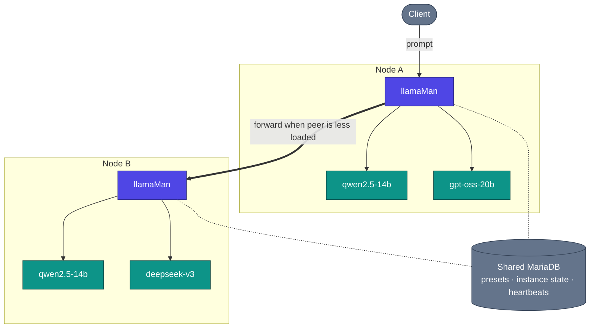

# アーキテクチャ、リクエストフロー、設計上の決定

llamaMan の内部動作の仕組み。単一ノードの概要は [README](../../README.md#architecture) に記載されています。このページでは、クラスタ構成の視点と詳細な内部構造を説明します。

## 目次

- [クラスタ構成図](#クラスタ構成図) · [動作原理](#動作原理) · [リクエストフロー](#リクエストフロー) · [設計上の決定とトレードオフ](#設計上の決定とトレードオフ)

## クラスタ構成図

## 動作原理

**コンテナ化 vs ベアメタル。** llamaMan はデフォルトで Docker 内で実行されるか（`llamaman-net` ネットワーク、コンテナ名で兄弟コンテナに到達）、ホスト上で直接ベアメタル実行されます（公開されたポート経由で `localhost` を介して生成されたコンテナに到達）。モードは自動検出されますが、`LLAMAMAN_IN_DOCKER` で強制設定することも可能です。

**異種混在クラスタ。** すべてのノードが独自のハードウェア（GPU 数/ベンダー/VRAM）、ディスク上のモデルファイル、llama.cpp イメージ、およびハードウェアスコープのプリセットオーバーライドを持ちます。共有 DB はプリセット、ユーザー、API キー、ノードごとのインスタンス状態、クラスタハートビートを保持しますが、モデルファイル自体は保持しません。[Clustering](CLUSTERING.md) を参照してください。

**キュー認識ディスパッチ + クロスノードのワークスティーリング。** 2つのノードが同じモデル（または同じ `share_queue_group` エイリアス）を提供している場合、その名前に対する受信リクエストは処理中（in-flight）のリクエストが最も少ないピアにルーティングされます。選択されたノードが飽和している場合、その `RequestGate` はキューに並べる代わりに、空き容量のあるピアにリクエストを引き渡そうと試みます。

**モデルの読み込み + LRU エビクション。** `:42069` の互換プロキシは、オンデマンドでモデルを自動起動します。`LLAMAMAN_MAX_MODELS` に達すると、空きスロットを確保するために最近最も使われていない（LRU）非管理者インスタンスが停止されます。スリープ中のインスタンスもスロット数としてカウントされます。アイドルタイムアウトはこれとは別の軸です。完全なルール: [Model Eviction](MODELS.md#model-eviction)。

**耐障害性の高いストレージ。** MariaDB はすべてのリクエストのクリティカルパス上にあります（認証では呼び出しごとに設定とキーを読み取ります）。`DATA_DIR/db_mirror/` 内のローカル JSON ミラーは、各ノードスコープの更新をライトスルーします。サーキットブレーカーが開くと、読み取りはミラーにフォールバックし、書き込みはジャーナルに記録され、再接続時に再生されます。デフォルトではオフですが、1つの設定でオンにできます: [Surviving a database outage](CONFIGURATION.md#surviving-a-database-outage-local-mirror)。

**マルチモーダル。** ビジョンモデルは、メインの GGUF とともに `--mmproj` プロジェクターを読み込みます。OpenAI の `image_url` / `file` と Ollama の `images[]` の両方が機能します。PDF はページごとにラスタライズされるか、デジタルネイティブな PDF の場合は抽出テキストとして高速パスで処理されます。詳細: [Image & PDF Input](LAUNCH-SETTINGS.md#image--pdf-input)。

**障害時の挙動。** 停止したコンテナはポーラーによって検出されてフラグが付けられ、インスタンスのスロットは次のティックで解放されます。強制終了された llamaman プロセスは、再起動時にまだ稼働しているラベル付きコンテナを再引き取り（ゲート、サイドカープロキシ、ログ追跡リレーのすべてが再構築されます）するため、面倒な `--restart=always` の設定は不要です。ハートビートウィンドウを逃したピアノードは、復帰するまでディスパッチ対象から外されます。

**llamaman を再ビルドせずに llama.cpp を更新:** UI（Settings → Docker Images、[Docker Image Management](MODELS.md#docker-image-management) を参照）から新しい `server-*` イメージをプルするか、プルエンドポイントを呼び出します。新しいインスタンスは新しいイメージで起動し、既存のインスタンスは再起動するまで稼働を続けます。

## リクエストフロー

2ノードクラスタに対する具体的な OpenAI 互換チャットリクエストの流れ:

1. クライアントが `nodeA:42069` にモデル `qwen2.5-14b` を指定して `POST /v1/chat/completions` を送信。
2. `nodeA` がターゲットを検索: そのモデルはこのノード**および** `nodeB` 上でアクティブです。両者は同じ有効なキューグループに属しています。
3. ディスパッチャが各候補のリアルタイム負荷（ハートビートキャッシュ + 短周期の処理中リクエストカウンタから）をポーリング。`nodeB` の方が低負荷 → リクエストは同じパスで `nodeB` のアドバタイズ URL（その `:5000` UI/API ポート）に転送されます。
4. `nodeB` がゲートスロットを確保（キューが満杯でどのピアにも空きがない場合は 429）。サンプリングオーバーライドがオンの場合、それらが挿入されます。インスタンスごとのサイドカー（アイドル / 最大同時実行数 / プロキシサンプリング）が存在する場合、リクエストはまずサイドカーに到達し、コンテナがスリープ中であれば起動します。
5. サイドカーが内部ポート上の `llama-server` に転送。ストリームはサイドカー → `nodeB` → `nodeA` → クライアントへと逆順に流れます。
6. ストリーム終了時: リクエストログワーカーが TTFT / スループット / 最終トークン数を記録。ゲートスロットが解放され、このインスタンスが次回エビクション対象にならないよう LRU タイムスタンプが更新されます。

ハートビートとこの呼び出しの間に `nodeB` がオフラインになっていた場合、ディスパッチャは接続エラーを検出し、次の候補（この場合はローカル）を再選択します。

## 設計上の決定とトレードオフ

- **単一の gunicorn ワーカー、`gthread`、`preload_app=False`。** リアルタイム状態（インスタンス、ゲート、ダウンロード、アイドルプロキシ）はインメモリの Python 辞書に保持されます。マルチワーカーにすると断片化します。並行性はスレッド（`threads=32` — クラスタ転送された生成処理が全期間スレッドを保持することに対応）によって確保されます。トレードオフ: 単一ホスト内での水平スケーリングは不可。代わりにクラスタノードを追加してスケールします。
- **`LLAMAMAN_NODE_NAME` は必須。** これはストレージのパーティションキーです。初回起動後にこれを変更すると、そのノードの行が孤立します。トレードオフ: シングルノードのインストールであっても環境変数が1つ追加で必要になりますが、共有 DB がクラスタ全体で健全に保たれ、初回起動時に従来の行が自動的に引き取られます。
- **エントリノードが接続を保持。** 転送されたリクエストは、生成の全期間にわたってエントリノードとターゲットノードの両方でスレッドを保持します — クライアント側のディスパッチを行わないため、任意の OpenAI/Ollama クライアントがそのまま動作します。トレードオフ: エントリノードのスレッドプールが、クロスノードの同時推論数の上限となります。
- **センチネル値の直接転送。** `--n-gpu-layers` に対する `-2 = all` や、`-1 = --cpu-moe` などの llama.cpp の値は、こちら側で変換されることなくそのまま渡されます。トレードオフ: 上流がこれらのセンチネル値の意味を変更した場合に脆弱ですが、変換による乖離がゼロになり、すべての llama-server リリースが即日利用可能になります。
- **インメモリが主状態、DB はミラー。** ランタイムの真実の情報源はロック下のモジュールレベルの辞書であり、DB は永続的なミラーです。トレードオフ: 保存ポイント間のクラッシュでは数秒分の状態が失われますが、リクエストは失われません — 状態を変更するすべての呼び出しは、復帰する前にバックエンドにスナップショットを保存します。
- **`ResilientBackend` はデフォルトでオフ。** 共有 MariaDB を使用する場合、1つの設定でローカル JSON ミラー + 書き込みジャーナルが有効になり、DB の停止によってすべてのリクエストが 500 になったり起動に失敗したりするのを防ぎます。単一 DB デプロイメントでコードパスをシンプルに保つため、デフォルトではオフになっています。トレードオフ: ミラーモードは再接続時にノードスコープの行を一括で照合するため、2つのノードが同じパーティションデータを同時に変更するクラスタには適していません（設計上、そうした変更は行われません）。
