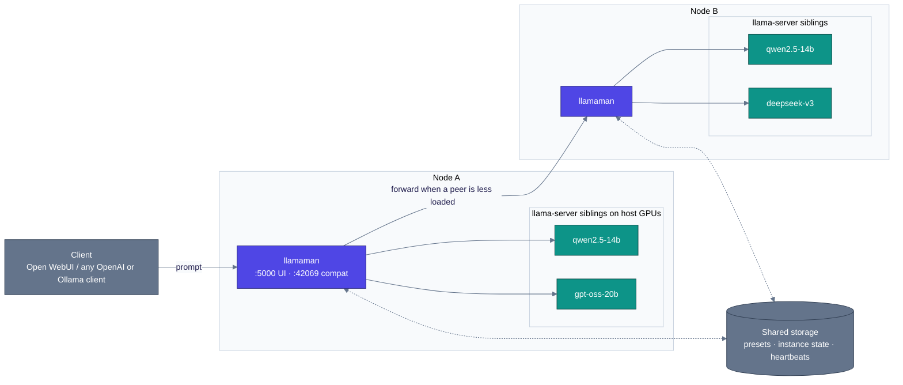

<p align="center">
  
</p>

#  llamaMan

[English](../../README.md) · [简体中文](../zh-CN/README.md) · **日本語** · [Deutsch](../de/README.md) · [Français](../fr/README.md) · [Español](../es/README.md) · [Português](../pt-BR/README.md) · [Русский](../ru/README.md)

**概要:** 単一のマシンまたは小規模なクラスタ全体で、複数の [llama.cpp](https://github.com/ggml-org/llama.cpp) サーバーインスタンスを実行するためのブラウザ UI + API フロントエンド。[Open WebUI](https://github.com/open-webui/open-webui) にそのまま組み込める Ollama 互換プロキシを同梱しています。

**特徴・相違点:** llamaMan 自体には **llama.cpp のコードも GPU への依存関係も一切ありません** - Docker ソケット経由で `ghcr.io/ggml-org/llama.cpp:server-*` コンテナを兄弟コンテナとして起動します。llamaMan に手を加えることなく llama.cpp を更新可能: より新しい `server-*` イメージを `docker pull` するだけです。このコンテナ生成とプロキシの仕組みはエンジンに依存しません。[Strata](STRATA.md) インスタンスは llama.cpp インスタンスと並んで実行され、まったく同じ方法で起動、監視、プロキシ転送、スリープが行われます。

> llama-server フラグのセマンティクスは llama.cpp 側が一次情報源です: **[server CLI reference](https://github.com/ggml-org/llama.cpp/blob/master/tools/server/README.md)**

## 機能

- **ユニバーサル GPU イメージ** - NVIDIA、AMD (ROCm)、Intel Arc、CPU を単一のフローでサポート。ハードウェアベンダーを自動検出（`GPU_TYPE=vulkan` によるオプトインで Vulkan も利用可能）
- **モデルライブラリ + ダウンローダー** - 速度制限、レジューム（中断再開）、自動リトライ、アトミックな再プルを伴う再公開検出に対応して Hugging Face からプル
- **ワンクリック起動 + プリセット** - llama.cpp のすべての調整パラメータ（投機的デコード、MoE オフロード、KV キャッシュ量子化、mmproj、PDF 入力…）を第一級の UI フィールドとして用意。再起動が不要なフィールドはプリセットのリアルタイム更新に対応
- **`:42069` での Ollama + OpenAI プロキシ** - Open WebUI にそのまま組み込み可能。モデルをオンデマンドで自動起動し、`LLAMAMAN_MAX_MODELS` 到達後は LRU でエビクション
- **画像および PDF 入力** - `--mmproj` によるビジョンモデル対応。PDF をページ単位でラスタライズ
- **インスタンス監視** - GPU ごとの VRAM、コンテナの CPU/RAM、インスタンスごとの TTFT / スループット / レイテンシ
- **認証** - ユーザーアカウント、API キー（Bearer トークン）、エンドポイントごとの認証切り替えトグル
- **マルチノードクラスタリング** *(オプトイン)* - 異種ノードを 1 つの論理クラスタとして統合。集約ダッシュボード、共有キューによる負荷分散
- 🆕 **Strata エンジン** *(オプトイン、NVIDIA)* - llama.cpp インスタンスと並んで [Strata](https://github.com/Niko1221/Strata) インスタンスを起動
- 🆕 **ナレッジベース + MCP サーバー** *(オプトイン、MariaDB バックエンド)* - ドキュメントをトピックとして保存し、独自の埋め込みモデルで意味検索を行い、あらゆる MCP クライアントに機能全体を公開（すべてローカル完結）

## 要件

- `/var/run/docker.sock` へのアクセス権を持つ Docker
- **次のいずれか:**
  - NVIDIA GPU 用の [NVIDIA Container Toolkit](https://docs.nvidia.com/datacenter/cloud-native/container-toolkit/install-guide.html)
  - AMD GPU 用の [ROCm 互換セットアップ](https://rocm.docs.amd.com/projects/install-on-linux/en/latest/)
  - `/dev/dri` へのアクセス権を持つ Intel Arc
  - CPU のみ

## クイックスタート

最初に `docker-compose.yml` を編集します:

- `HOST_MODELS_DIR` / `HOST_LOGS_DIR` に、ボリュームマウントの背後にある**実際のホストパス**を設定します（llamaMan は兄弟コンテナを生成する際にこれらを Docker デーモンに渡します）。
- `LLAMAMAN_NODE_NAME`（サンプルの compose では `srv1`。**組み込みのデフォルト値はありません** - これがないとアプリの起動が拒否されます）は**すべてのインストールで必須**です - このデプロイの保存された状態のパーティションキーとなります。一度決めたら保持してください（後で変更すると保存された状態が孤立します）。

お使いの GPU に適した llama.cpp イメージをプルして起動します:

| GPU | `LLAMA_IMAGE` |
|---|---|
| NVIDIA | `ghcr.io/ggml-org/llama.cpp:server-cuda` |
| AMD (ROCm) | `ghcr.io/ggml-org/llama.cpp:server-rocm` |
| Intel Arc | `ghcr.io/ggml-org/llama.cpp:server-sycl` |
| Vulkan (AMD/Intel フォールバック) | `ghcr.io/ggml-org/llama.cpp:server-vulkan` (`GPU_TYPE=vulkan` を設定) |
| CPU のみ | `ghcr.io/ggml-org/llama.cpp:server` |

```bash
docker pull <LLAMA_IMAGE>          # from the table above
# For non-CUDA: also set LLAMA_IMAGE=... in docker-compose.yml
docker compose up --build
```

NVIDIA ネイティブ VRAM 監視を行う場合は、`docker-compose.yml` 内の `deploy.resources.reservations` のコメントアウトも解除してください。

- **管理 UI**: <http://localhost:5000>（`/setup` で管理者を作成）
- **Ollama 互換 API**: <http://localhost:42069>
- **llama-server インスタンスポート**: 8000-8020

> **セキュリティに関する注意:** マウントされた `/var/run/docker.sock` は、コンテナにホスト上の Docker に対する完全な制御権を与えます。Docker ソケットへのアクセスに関する標準的な安全上の影響が適用されます。

ベアメタル（開発環境、WSL）で実行しますか？[ベアメタル実行](CONFIGURATION.md#running-bare-metal) を参照してください。

## 初めてのモデル起動

1. **モデルの取得:** models ディレクトリに `.gguf` ファイルを配置するか、UI を開き、**Downloads** で Hugging Face リポジトリを選択して llamaMan にプルさせます。
2. **モデルの起動:** サイドバーでモデルを選択し、**Launch** をクリックします。llamaMan は llama-server コンテナを生成し、インスタンスがステータスバッジとともに表示されます。デフォルト設定（4096 ctx、自動 GPU レイヤー）はほとんどのモデルで機能します。**Save Preset** で設定が記憶されます。すべての起動フィールドは [起動設定](LAUNCH-SETTINGS.md) に記載されています。
3. **API キーの作成:** **API Keys** でキーを作成します（`llm-xxxxxxxxxx`）。モデルエンドポイントはデフォルトで Bearer トークンを要求します。
4. **クライアントの設定:** 任意の OpenAI または Ollama クライアントが `:42069` に対して動作します。Open WebUI の場合:

```yaml
open-webui:
  environment:
    - OLLAMA_BASE_URL=http://llamaman:42069
    - OPENAI_API_BASE_URLS=http://llamaman:42069/v1
    - OPENAI_API_KEYS=llm-your-api-key-here
```

Open WebUI は `/api/tags` 経由でモデルを一覧表示します（**Display Name** を設定していない限り GGUF ファイル名語幹で表示）。モデルを選択すると自動的に起動し、正常（healthy）になるまで待機してからプロキシ転送します。生の量子化ファイル名の代わりにわかりやすい名前を表示するには、モデルごとに **Display Name** を設定してください。

> **上限に関する注意点:** サンプルの compose には `LLAMAMAN_MAX_MODELS=1` が設定されています。上限が設定されている場合、満杯になると Ollama 接続は LRU モデルをエビクションしますが、OpenAI 接続（`OPENAI_API_BASE_URLS`）はデフォルトで **503** を返します - どちらかのパスを選択するか、上限を引き上げてください。ルール: [モデルのエビクション](MODELS.md#model-eviction)

問題が発生した場合は、後述の [トラブルシューティング](#トラブルシューティング) で初回のよくある失敗事例をカバーしています。

## 認証

2 種類の認証情報:

- UI 用の **セッション cookie**（初回起動時に `/setup` 経由で作成）
- 外部クライアント用の **API キー**（`Authorization: Bearer llm-xxxxxxxxxx`）、UI の **API Keys** で管理

**"Require authentication for all endpoints"** トグル（デフォルトで有効）は、モデル配信エンドポイントで Bearer トークンを要求するかどうかを制御します。詳細: [認証](CONFIGURATION.md#authentication-detail)

## アーキテクチャ

llamaMan は llama.cpp のコードに直接触れることのない軽量な Python アプリです。Docker ソケット経由で各 `llama-server` を兄弟コンテナとして起動し、フリートを監視して、OpenAI/Ollama の統合エントランスを提供します。



単一ノードの構成（デフォルト）は上半分のみです - 1 つの llamaman コンテナ、ローカル Docker デーモン上の N 個の `llama-server` 兄弟コンテナ、クラスタピアなし、共有 DB の代わりに JSON ファイル。クラスタリングはオプトインかつ追加機能です。

リクエストフロー、キュー対応ディスパッチ、障害時の動作、設計上のトレードオフなど、詳細な動作原理: [アーキテクチャ](ARCHITECTURE.md)

## ドキュメント

| ガイド | 内容 |
|---|---|
| [起動設定](LAUNCH-SETTINGS.md) | 起動フォームのすべてのフィールドと対応する llama-server フラグ: ctx、KV キャッシュ、GPU レイヤー、MoE オフロード、投機的デコード、サンプリングの上書き、同時実行とキューイング、プリセットのライブ更新、[画像および PDF 入力](LAUNCH-SETTINGS.md#image--pdf-input)、[Anti-Loop](LAUNCH-SETTINGS.md#anti-loop)、インスタンス別プロキシ、アイドルタイムアウト |
| [モデル](MODELS.md) | 表示名、モデルの更新、[意思決定モデル](MODELS.md#decision-models) (`/v1/systemone`)、[モデルのエビクション](MODELS.md#model-eviction)、ダウンロード設定、Docker イメージ管理、モデルアーカイブ、バックアップと復元、クリーンアップ |
| [設定とストレージ](CONFIGURATION.md) | ベアメタルインストール、認証の詳細、GPU 統計情報、リクエストの記録、JSON と MariaDB バックエンド、[データベース障害の克服](CONFIGURATION.md#surviving-a-database-outage-local-mirror)、および完全な [環境変数](CONFIGURATION.md#environment-variables) リファレンス |
| [クラスタリング](CLUSTERING.md) | マルチノードセットアップ: 共有 DB、ハートビート、共有キューによる負荷分散 |
| [ナレッジベース & MCP](KNOWLEDGE-BASE.md) | トピック、埋め込み、MCP エンドポイント、アクセスモード |
| [Strata](STRATA.md) | 第 2 の推論エンジン: セットアップ、カタログ、制限事項、設計ノート |
| [REST API](API.md) | コアエンドポイント: インスタンス、ダウンロード、プリセット、設定、リクエストログ、起動リクエスト本文の特殊動作 |
| [トラブルシューティング](TROUBLESHOOTING.md) | 完全な「症状 → 解決策」対応表 |

## 環境変数

初日に使用する主要な変数（完全なリファレンス: [環境変数](CONFIGURATION.md#environment-variables)）:

| 変数名 | デフォルト値 | 説明 |
|---|---|---|
| `LLAMAMAN_NODE_NAME` | *(必須)* | 一意で安定した識別子 - 一度決めたら保持してください |
| `HOST_MODELS_DIR` / `HOST_LOGS_DIR` | *(= コンテナパス)* | ボリュームマウントの背後にある実際のホストパス |
| `LLAMA_IMAGE` | *(自動)* | llama.cpp イメージ。GPU ベンダーから自動選択、固定する場合に設定。サンプルの compose は `server-cuda` を固定 - NVIDIA 以外の GPU では変更してください |
| `LLAMAMAN_MAX_MODELS` | `0` | プロキシ経由の最大同時チャットモデル数（LRU エビクション、0 = 無制限）。サンプルの compose では `1` に設定 |
| `DATABASE_URL` | *(未設定)* | MariaDB/MySQL 接続文字列。未設定 = JSON ファイル |

## トラブルシューティング

| 症状 | 解決策 |
|---|---|
| インスタンスが **starting** のまま停止する | Logs ボタンからログを確認してください。よくある原因: OOM、モデルパスの誤字、壊れた GGUF、イメージ未プル |
| _"Docker image not found"_ | 対応するイメージをプルしてください: `docker pull ghcr.io/ggml-org/llama.cpp:server-cuda`（または `server-rocm` / `server-sycl` / `server`） |
| 起動時に _"Docker API error"_ | `/var/run/docker.sock` がマウントされていることを確認してください（`docker-compose.yml` のデフォルト） |
| GPU が認識されない / CUDA エラー | NVIDIA Container Toolkit がインストールされており、ホスト上で `docker run --gpus all` が機能することを確認してください |
| GPU 統計情報が利用できない | NVIDIA: `deploy.resources.reservations` ブロックのコメントアウトを解除。AMD/Intel: `/sys/class/drm:ro` がマウントされていることを確認 |
| OpenWebUI にモデルが表示されない | `OLLAMA_BASE_URL=http://llamaman:42069` を確認。`/api/tags` がモデルを返すか確認 |
| OpenWebUI で 401 が発生する | `require_auth` が有効（デフォルト）。API キーを作成し、OpenWebUI で `OPENAI_API_KEYS` を設定 |
| モデル満杯時に OpenAI クライアントで 503 が発生する | `LLAMAMAN_MAX_MODELS` の上限に達しており、OpenAI API はデフォルトでエビクションを実行できません。上限を引き上げるか、エビクショントグルを有効にしてください: [モデルのエビクション](MODELS.md#model-eviction) |
| ポートの競合 | フォームが未使用のポートを自動提案します。必要に応じて調整してください |

完全な対応表: [トラブルシューティング](TROUBLESHOOTING.md)

## クレジット

この成果は [ggml-org/llama.cpp](https://github.com/ggml-org/llama.cpp) なしには実現できませんでした。

## ライセンス

llamaMan は [Elastic License 2.0](../../LICENSE) の下でライセンスされています。以下の条件に従って、ソフトウェアを使用、複製、頒布、改変することができます:

- 本ソフトウェアの機能または実質的な機能セットへのアクセスをユーザーに提供するホスティングサービス / マネージドサービスとして、本ソフトウェアを第三者に提供しないこと。
- ライセンサーのライセンス表示、著作権表示、その他の通知を削除または不鮮明にしないこと。

### サードパーティライセンス

- Fonticons, Inc. による **[Font Awesome Free 7.1.0](https://fontawesome.com/)** - アイコン (CC BY 4.0)、フォント (SIL OFL 1.1)、コード (MIT)。完全なライセンス本文は [`static/fontawesome-free-7.1.0-web/LICENSE.txt`](../../static/fontawesome-free-7.1.0-web/LICENSE.txt) に同梱されています。
