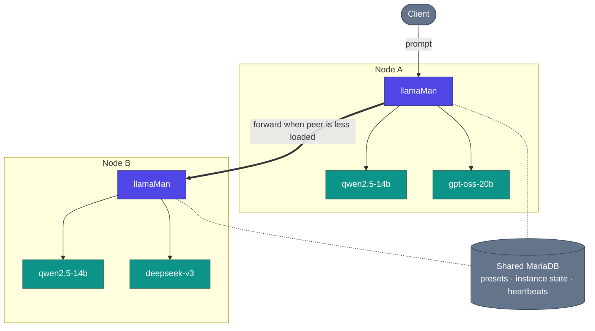

# Arquitetura, fluxo de requisições e decisões de design

Como o llamaMan funciona por baixo dos panos. A visão de node único está no [README](../../README.md#architecture); esta página acrescenta a visão de cluster mais o detalhe profundo.

## Índice

- [Visão do cluster](#cluster-view) · [Como funciona](#how-it-works) · [Fluxo de requisições](#request-flow) · [Decisões de design e trade-offs](#design-decisions--trade-offs)

## Visão do cluster

## Como funciona

**Containerizado vs bare-metal.** O llamaMan roda em Docker por padrão (`llamaman-net`, alcançando irmãos por nome de container) ou bare-metal no host (alcança os containers spawnados via `localhost` nas portas publicadas). O modo é autodetectado; force com `LLAMAMAN_IN_DOCKER`.

**Clusters heterogêneos.** Cada node tem seu próprio hardware (contagem/fabricante/VRAM de GPU), seus próprios arquivos de modelo no disco, sua própria imagem llama.cpp, e seus próprios overrides de preset com escopo de hardware. O DB compartilhado carrega presets, usuários, chaves API, estado de instâncias por node e heartbeats de cluster - não os arquivos de modelo. Veja [Clustering](CLUSTERING.md).

**Dispatch consciente de fila + roubo de trabalho entre nodes.** Quando dois nodes servem o mesmo modelo (ou o mesmo alias `share_queue_group`), uma requisição recebida para esse nome é roteada ao peer com menos requisições em voo. Se o node escolhido estiver saturado, seu `RequestGate` ainda tenta passar a requisição a um peer com capacidade livre em vez de enfileirá-la.

**Carregamento de modelos + desalojo LRU.** O proxy de compatibilidade `:42069` auto-lança modelos a demanda. Uma vez atingido `LLAMAMAN_MAX_MODELS`, a instância não-admin menos usada recentemente é parada para abrir espaço. Instâncias dormindo ainda contam contra a vaga; o idle timeout é um eixo separado. Regras completas: [Desalojo de modelos](MODELS.md#model-eviction).

**Armazenamento resiliente.** O MariaDB está no caminho crítico de toda requisição (a auth lê configurações e chaves a cada chamada). Um espelho JSON local em `DATA_DIR/db_mirror/` grava write-through cada atualização com escopo de node; quando o breaker abre, as leituras recorrem ao espelho e as escritas são registradas em journal e reaplicadas na reconexão. Desligado por padrão, um ajuste para ligar: [Surviving a database outage](CONFIGURATION.md#surviving-a-database-outage-local-mirror).

**Multimodal.** Modelos de visão carregam o projetor `--mmproj` junto ao GGUF principal. OpenAI `image_url` / `file` e Ollama `images[]` ambos funcionam. PDFs são rasterizados página por página, ou tomam um atalho como texto extraído quando o PDF é nativamente digital. Detalhes: [Entrada de imagem e PDF](LAUNCH-SETTINGS.md#image--pdf-input).

**Comportamento ante falhas.** Um container morto é detectado pelo poller e marcado, e a vaga da instância é liberada no próximo tick. Um processo llamaman morto, ao reiniciar, readota containers rotulados que ainda estão de pé (seu gate, proxy sidecar e relay de cauda de log são todos reconstruídos), então nenhuma ginástica de `--restart=always` é necessária. Um node peer que perde sua janela de heartbeat sai do dispatch até voltar.

**Atualize o llama.cpp sem reconstruir o llamaman:** baixe uma imagem `server-*` mais recente pela UI (Settings → Docker Images, veja [Gerenciamento de imagens Docker](MODELS.md#docker-image-management)), ou chame o endpoint de pull. Novas instâncias lançam na imagem nova; as existentes seguem rodando até você reiniciá-las.

## Fluxo de requisições

Uma requisição de chat compatível com OpenAI concreta contra um cluster de dois nodes:

1. O cliente faz `POST /v1/chat/completions` para `nodeA:42069` com o modelo `qwen2.5-14b`.
2. O `nodeA` procura o alvo: é um modelo vivo neste node **e** no `nodeB`. Ambos pertencem ao mesmo grupo de fila efetivo.
3. O dispatcher consulta a carga viva de cada candidato (do cache de heartbeat + contador inflight de janela curta). O `nodeB` está menos carregado → a requisição é encaminhada à URL de anúncio do `nodeB` (sua porta `:5000` de UI/API) no mesmo caminho.
4. O `nodeB` reivindica uma vaga de gate (429 se a fila está cheia e nenhum peer tem espaço). Se os sampling overrides estão ligados, eles são injetados. Se existe um sidecar por instância (idle / max-concurrent / proxy-sampling), a requisição chega primeiro ao sidecar, que acorda o container se ele está dormindo.
5. O sidecar encaminha ao `llama-server` na porta interna. O stream volta pelo sidecar → `nodeB` → `nodeA` → cliente.
6. No fim do stream: o worker do request-log registra TTFT / throughput / contagem final de tokens; a vaga de gate é liberada; o timestamp LRU é atualizado para que esta instância não seja desalojada em seguida.

Se o `nodeB` tivesse caído entre o heartbeat e esta chamada, o dispatcher teria detectado o erro de conexão e reescolhido o próximo candidato (localmente neste caso).

## Decisões de design e trade-offs

- **Um worker gunicorn, `gthread`, `preload_app=False`.** O estado vivo (instâncias, gates, downloads, proxies ociosos) são dicts Python em memória; multi-worker o fragmentaria. A concorrência vem de threads (`threads=32` - dimensionado para gerações encaminhadas de cluster segurando uma thread durante toda a sua duração). Compromisso: sem escala horizontal dentro de um host; escale adicionando nodes de cluster.
- **`LLAMAMAN_NODE_NAME` é obrigatório.** É a chave de particionamento do armazenamento. Mudá-lo após o primeiro boot deixa as linhas daquele node órfãs. Compromisso: uma variável de ambiente extra exigida até para instalações de node único, mas um DB compartilhado permanece consistente em todo o cluster e linhas legadas são adotadas automaticamente no primeiro boot.
- **O node de entrada segura a conexão.** Uma requisição encaminhada mantém uma thread tanto no node de entrada quanto no alvo durante toda a geração - sem dispatch no lado do cliente, assim qualquer cliente OpenAI/Ollama funciona sem mudanças. Compromisso: o pool de threads do node de entrada limita a inferência cross-node concorrente.
- **Encaminhamento de sentinelas.** Valores llama.cpp como `-2 = all` para `--n-gpu-layers` ou `-1 = --cpu-moe` são repassados literalmente em vez de traduzidos do nosso lado. Compromisso: frágil contra o upstream mudar o que essas sentinelas significam, mas zero deriva de tradução e cada release do llama-server aterrissa no mesmo dia.
- **Estado em memória, o DB é o espelho.** A verdade de runtime são os dicts de nível de módulo sob um lock; o DB é um espelho durável. Compromisso: um crash entre pontos de save perde segundos, não requisições - cada chamada que muda estado tira um snapshot para o backend antes de retornar.
- **O `ResilientBackend` é desligado por padrão.** Com um MariaDB compartilhado, um ajuste liga um espelho JSON local + journal de escrita para que uma queda do DB não dê 500 em toda requisição nem falhe o startup. Desligado por padrão para que deployments de DB único mantenham o caminho de código mais simples. Compromisso: o modo espelho reconcilia em bloco as linhas com escopo de node na reconexão, então não serve a um cluster onde dois nodes mutam concorrentemente os mesmos dados particionados (eles não mutam, por design).
