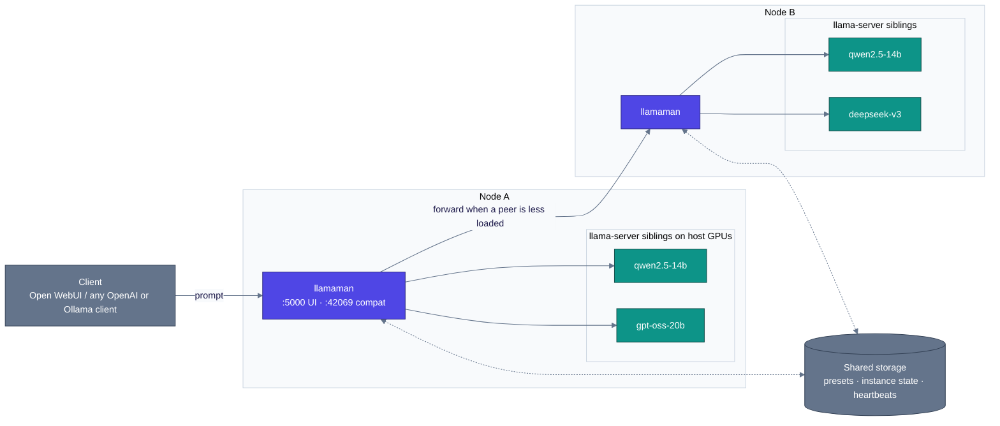

<p align="center">
  
</p>

#  llamaMan

[English](../../README.md) · [简体中文](../zh-CN/README.md) · [日本語](../ja/README.md) · [Deutsch](../de/README.md) · [Français](../fr/README.md) · [Español](../es/README.md) · **Português** · [Русский](../ru/README.md)

**O que é.** Uma UI de navegador + front-end de API para executar múltiplas instâncias de servidor [llama.cpp](https://github.com/ggml-org/llama.cpp), numa máquina ou num pequeno cluster delas. Vem com um proxy compatível com Ollama para se integrar diretamente ao [Open WebUI](https://github.com/open-webui/open-webui).

**O que é diferente.** O próprio llamaMan **não tem código de llama.cpp nem dependência de GPU** - ele spawna containers `ghcr.io/ggml-org/llama.cpp:server-*` como irmãos pelo socket Docker. Atualize o llama.cpp sem tocar no llamaMan: `docker pull` de uma imagem `server-*` mais nova. O mesmo mecanismo de spawn-e-proxy é agnóstico de motor: instâncias [Strata](STRATA.md) rodam ao lado das de llama.cpp, lançadas, monitoradas, proxyadas e postas para dormir do mesmo jeito.

> A semântica das flags do llama-server é a fonte da verdade no lado do llama.cpp: **[referência CLI do server](https://github.com/ggml-org/llama.cpp/blob/master/tools/server/README.md)**.

## Recursos

- **Imagem GPU universal** - um fluxo para NVIDIA, AMD (ROCm), Intel Arc, CPU; fabricante autodetectado (Vulkan é opt-in via `GPU_TYPE=vulkan`)
- **Biblioteca de modelos + baixador** - pulls do HuggingFace com limites de velocidade, retomada, auto-retry, detecção de republicação com re-pull atômico
- **Lançamento em um clique + presets** - cada ajuste do llama.cpp (spec-decoding, MoE offload, KV quant, mmproj, PDF input…) é um campo de primeira classe na UI, com atualizações ao vivo de preset para campos que não exigem relançamento
- **Proxy Ollama + OpenAI em `:42069`** - o Open WebUI se conecta diretamente; os modelos auto-iniciam sob demanda e são desalojados por LRU ao atingir `LLAMAMAN_MAX_MODELS`
- **Entrada de imagem & PDF** - modelos de visão com `--mmproj`; PDFs rasterizados página por página
- **Monitoramento de instâncias** - VRAM por GPU, CPU/RAM de container, TTFT / throughput / latência por instância
- **Auth** - contas de usuário, chaves de API (tokens bearer), toggle de auth por endpoint
- **Clustering multi-node** *(opt-in)* - nodes heterogêneos como um cluster lógico único; dashboard agregado; balanceamento de fila compartilhada
- 🆕 **Motor Strata** *(opt-in, NVIDIA)* - lance instâncias [Strata](https://github.com/Niko1221/Strata) ao lado das de llama.cpp
- 🆕 **Base de conhecimento + servidor MCP** *(opt-in, backend MariaDB)* - armazene documentos como tópicos, busque-os por significado com seu próprio modelo de embedding, e exponha tudo isso a qualquer cliente MCP — tudo local

## Requisitos

- Docker com acesso a `/var/run/docker.sock`
- **Um** de:
  - [NVIDIA Container Toolkit](https://docs.nvidia.com/datacenter/cloud-native/container-toolkit/install-guide.html) para GPUs NVIDIA
  - [Configuração compatível com ROCm](https://rocm.docs.amd.com/projects/install-on-linux/en/latest/) para GPUs AMD
  - Intel Arc com acesso a `/dev/dri`
  - Só CPU

## Início rápido

Edite o `docker-compose.yml` primeiro:

- Defina `HOST_MODELS_DIR` / `HOST_LOGS_DIR` para os **caminhos reais do host** que embasam seus mounts de volume (o llamaMan os passa ao daemon Docker ao spawnar containers irmãos).
- O `LLAMAMAN_NODE_NAME` (`srv1` no compose de exemplo; **não há padrão embutido** - a app recusa iniciar sem ele) é **obrigatório em toda instalação** - é a chave de partição do estado armazenado desta implantação. Escolha uma vez, mantenha (mudá-lo depois deixa o estado armazenado órfão).

Puxe a imagem llama.cpp para sua GPU e inicie:

| GPU | `LLAMA_IMAGE` |
|---|---|
| NVIDIA | `ghcr.io/ggml-org/llama.cpp:server-cuda` |
| AMD (ROCm) | `ghcr.io/ggml-org/llama.cpp:server-rocm` |
| Intel Arc | `ghcr.io/ggml-org/llama.cpp:server-sycl` |
| Vulkan (fallback AMD/Intel) | `ghcr.io/ggml-org/llama.cpp:server-vulkan` (defina `GPU_TYPE=vulkan`) |
| Só CPU | `ghcr.io/ggml-org/llama.cpp:server` |

```bash
docker pull <LLAMA_IMAGE>          # from the table above
# For non-CUDA: also set LLAMA_IMAGE=... in docker-compose.yml
docker compose up --build
```

Para monitoramento nativa de VRAM NVIDIA, descomente também `deploy.resources.reservations` no `docker-compose.yml`.

- **UI de gerenciamento**: <http://localhost:5000> (crie o admin em `/setup`)
- **API compatível com Ollama**: <http://localhost:42069>
- **Portas de instância llama-server**: 8000-8020

> **Nota de segurança:** o `/var/run/docker.sock` montado dá ao container controle total do Docker no host. Aplicam-se as implicações padrão de acesso ao socket Docker.

Rodando bare-metal (dev, WSL)? Veja [Execução bare-metal](CONFIGURATION.md#running-bare-metal).

## Seu primeiro modelo

1. **Consiga um modelo.** Ou solte um `.gguf` no seu diretório de modelos, ou abra a UI, escolha um repositório HuggingFace sob **Downloads**, e deixe o llamaMan puxá-lo.
2. **Lance-o.** Selecione o modelo na barra lateral, clique em **Launch**. O llamaMan spawna um container llama-server e a instância aparece com um badge de status. Os padrões (ctx 4096, GPU layers auto) funcionam para a maioria dos modelos; **Save Preset** lembra suas configurações. Cada campo de lançamento está documentado em [Launch settings](LAUNCH-SETTINGS.md).
3. **Crie uma chave de API.** Sob **API Keys**, crie uma (`llm-xxxxxxxxxx`). Os endpoints de modelos exigem um token bearer por padrão.
4. **Aponte seu cliente para ele.** Qualquer cliente OpenAI ou Ollama funciona contra a `:42069`. Para o Open WebUI:

```yaml
open-webui:
  environment:
    - OLLAMA_BASE_URL=http://llamaman:42069
    - OPENAI_API_BASE_URLS=http://llamaman:42069/v1
    - OPENAI_API_KEYS=llm-your-api-key-here
```

O Open WebUI lista seus modelos via `/api/tags` (pelo radical do nome de arquivo GGUF a menos que você defina um **Display Name**); escolher um o auto-inicia, espera ficar healthy e então faz o proxy das requisições. Defina um **Display Name** por modelo para mostrar um nome amigável em vez do nome de arquivo de quant bruto.

> **Ressalva do teto:** o compose de exemplo vem com `LLAMAMAN_MAX_MODELS=1`. Com um teto definido, a conexão Ollama desaloja o modelo LRU quando cheio, mas a conexão OpenAI (`OPENAI_API_BASE_URLS`) retorna **503** por padrão - escolha um caminho ou aumente o teto. Regras: [Desalojo de modelos](MODELS.md#model-eviction).

Se algo der errado, [Solução de problemas](#solução-de-problemas) abaixo cobre as falhas comuns da primeira inicialização.

## Autenticação

Dois tipos de credencial:

- **Cookies de sessão** para a UI (criados via `/setup` na primeira inicialização)
- **Chaves de API** para clientes externos (`Authorization: Bearer llm-xxxxxxxxxx`), gerenciadas sob **API Keys** na UI

O toggle **"Require authentication for all endpoints"** (ligado por padrão) controla se os endpoints de serviço de modelos exigem um token bearer. Detalhes: [Authentication](CONFIGURATION.md#authentication-detail).

## Arquitetura

O llamaMan é uma pequena app Python que nunca toca no código llama.cpp diretamente. Ele spawna cada `llama-server` como um container irmão pelo socket Docker, monitora a frota, e entrega uma porta da frente OpenAI/Ollama.



O cenário de node único (padrão) é só a metade de cima - um container llamaman, N irmãos `llama-server` no daemon Docker local, sem peers de cluster, arquivos JSON em vez do banco compartilhado. O clustering é opt-in e aditivo.

Como funciona em profundidade - fluxo de requisição, despacho consciente de fila, comportamento de falha, escolhas de design: [Architecture](ARCHITECTURE.md).

## Documentação

| Guia | O que há nele |
|---|---|
| [Launch settings](LAUNCH-SETTINGS.md) | Cada campo do formulário de lançamento e sua flag llama-server: ctx, cache KV, GPU layers, MoE offload, spec decoding, sampling overrides, concorrência & enfileiramento, atualizações ao vivo de preset, [Entrada de imagem e PDF](LAUNCH-SETTINGS.md#image--pdf-input), [Anti-Loop](LAUNCH-SETTINGS.md#anti-loop), proxy por instância, idle timeout |
| [Models](MODELS.md) | Display names, atualizações de modelo, [Modelos de decisão](MODELS.md#decision-models) (`/v1/systemone`), [Desalojo de modelos](MODELS.md#model-eviction), configurações de download, gerenciamento de imagens Docker, arquivamento de modelos, backup & restore, limpeza |
| [Configuration & storage](CONFIGURATION.md) | Instalações bare-metal, detalhe de auth, estatísticas GPU, gravação de requisições, backends JSON vs MariaDB, [sobreviver a uma queda do banco](CONFIGURATION.md#surviving-a-database-outage-local-mirror), e a referência completa de [Variáveis de ambiente](CONFIGURATION.md#environment-variables) |
| [Clustering](CLUSTERING.md) | Configuração multi-node: banco compartilhado, heartbeats, balanceamento de fila compartilhada |
| [Knowledge Base & MCP](KNOWLEDGE-BASE.md) | Tópicos, embeddings, endpoint MCP, modos de acesso |
| [Strata](STRATA.md) | O segundo motor de inferência: configuração, catálogo, limites, notas de design |
| [REST API](API.md) | Endpoints centrais: instâncias, downloads, presets, configurações, request log, esquisitices do corpo de lançamento |
| [Troubleshooting](TROUBLESHOOTING.md) | A tabela completa sintoma → correção |

## Variáveis de Ambiente

As que você mexerá no primeiro dia (referência completa: [Variáveis de ambiente](CONFIGURATION.md#environment-variables)):

| Variável | Padrão | Descrição |
|---|---|---|
| `LLAMAMAN_NODE_NAME` | *(obrigatório)* | Identidade estável única - escolha uma vez, mantenha |
| `HOST_MODELS_DIR` / `HOST_LOGS_DIR` | *(= caminhos do container)* | Caminhos reais do host por trás dos mounts de volume |
| `LLAMA_IMAGE` | *(auto)* | Imagem llama.cpp; auto-selecionada do fabricante GPU, defina para fixar. O compose de exemplo fixa `server-cuda` - mude-o para GPUs não-NVIDIA |
| `LLAMAMAN_MAX_MODELS` | `0` | Máximo de modelos de chat concorrentes via o proxy (desalojo LRU; 0 = ilimitado). O compose de exemplo define `1` |
| `DATABASE_URL` | *(não definida)* | String de conexão MariaDB/MySQL. Não definida = arquivos JSON |

## Solução de problemas

| Sintoma | Correção |
|---|---|
| Instância presa em **starting** | Confira os logs pelo botão Logs. Comum: OOM, erro de digitação no caminho do modelo, GGUF corrompido, imagem não puxada |
| _"Docker image not found"_ | Puxe a imagem correspondente: `docker pull ghcr.io/ggml-org/llama.cpp:server-cuda` (ou `server-rocm` / `server-sycl` / `server`) |
| _"Docker API error"_ no lançamento | Garanta que `/var/run/docker.sock` está montado (padrão no `docker-compose.yml`) |
| Sem GPU / erro CUDA | Garanta que o NVIDIA Container Toolkit está instalado e que `docker run --gpus all` funciona no host |
| Estatísticas GPU indisponíveis | NVIDIA: descomente o bloco `deploy.resources.reservations`. AMD/Intel: garanta que `/sys/class/drm:ro` está montado |
| Modelo não aparece no OpenWebUI | Garanta `OLLAMA_BASE_URL=http://llamaman:42069`. Confira que `/api/tags` retorna modelos |
| OpenWebUI recebe 401 | `require_auth` está ligado (padrão). Crie uma chave de API e defina `OPENAI_API_KEYS` no OpenWebUI |
| Cliente OpenAI recebe 503 com modelos cheios | Teto `LLAMAMAN_MAX_MODELS` atingido e a API OpenAI não pode desalojar por padrão. Aumente o teto ou habilite os toggles de desalojo: [Desalojo de modelos](MODELS.md#model-eviction) |
| Conflito de porta | O formulário auto-sugere uma porta livre; ajuste se preciso |

Tabela completa: [Troubleshooting](TROUBLESHOOTING.md).

## Créditos

Este trabalho não seria possível sem [ggml-org/llama.cpp](https://github.com/ggml-org/llama.cpp).

## Licença

O llamaMan é licenciado sob a [Elastic License 2.0](../../LICENSE). Você pode usar, copiar, distribuir e modificar o software, sujeito a:

- Não fornecer o software a terceiros como serviço hospedado / gerenciado em que o serviço dá aos usuários acesso a um conjunto substancial de seus recursos ou funcionalidades.
- Não remover ou obscurecer licenciamento, direitos autorais ou outros avisos do licenciante.

### Licenças de terceiros

- **[Font Awesome Free 7.1.0](https://fontawesome.com/)** por Fonticons, Inc. - ícones (CC BY 4.0), fontes (SIL OFL 1.1), e código (MIT). O texto de licença completo vem em [`static/fontawesome-free-7.1.0-web/LICENSE.txt`](../../static/fontawesome-free-7.1.0-web/LICENSE.txt).
