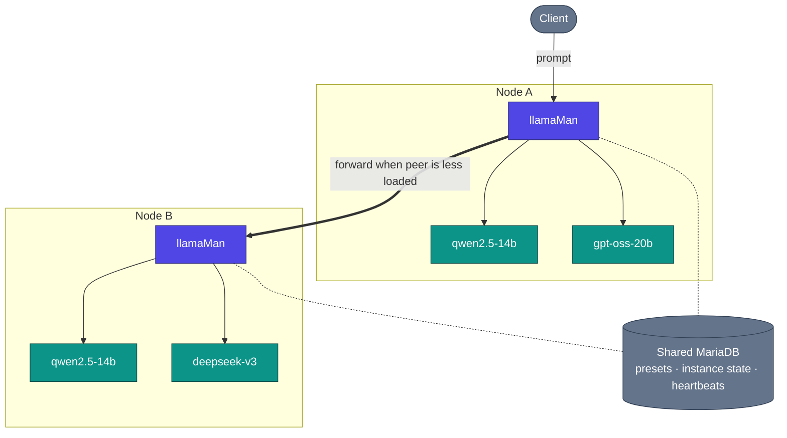

# Архитектура, поток запросов и проектные решения

Как llamaMan работает под капотом. Одноузловая картина — в [README](../../README.md#architecture); эта страница добавляет кластерный вид плюс подробности вглубь.

## Содержание

- [Вид кластера](#cluster-view) · [Как это работает](#how-it-works) · [Поток запросов](#request-flow) · [Архитектурные решения и компромиссы](#design-decisions--trade-offs)

## Вид кластера

## Как это работает

**Контейнерный режим vs bare-metal.** llamaMan по умолчанию работает в Docker (`llamaman-net`, обращаясь к соседям по имени контейнера) или bare-metal на хосте (обращаясь к порождённым контейнерам через `localhost` на их опубликованных портах). Режим определяется автоматически; принудительно задаётся через `LLAMAMAN_IN_DOCKER`.

**Гетерогенные кластеры.** У каждого узла своё железо (число/производитель GPU, VRAM), свои файлы моделей на диске, свой образ llama.cpp и свои привязанные к железу переопределения пресетов. Общая БД несёт пресеты, пользователей, API-ключи, поузловое состояние инстансов и кластерные heartbeat — но не файлы моделей. См. [Clustering](CLUSTERING.md).

**Диспетчеризация с учётом очередей + межузловой перехват работы (work stealing).** Когда два узла обслуживают одну модель (или один алиас `share_queue_group`), входящий запрос на это имя уходит тому пиру, у которого меньше запросов в полёте. Если выбранный узел перегружен, его `RequestGate` всё равно пытается передать запрос пиру со свободной ёмкостью, вместо того чтобы ставить в очередь.

**Загрузка моделей + LRU-вытеснение.** Compat-прокси на `:42069` автозапускает модели по требованию. Когда достигнут `LLAMAMAN_MAX_MODELS`, наименее недавно использованный не-админский инстанс останавливается, освобождая место. Спящие инстансы по-прежнему занимают слот; idle timeout — отдельная ось. Полные правила: [Вытеснение моделей](MODELS.md#model-eviction).

**Устойчивое хранение.** MariaDB стоит на критическом пути каждого запроса (auth читает настройки и ключи на каждый вызов). Локальное JSON-зеркало в `DATA_DIR/db_mirror/` write-through'ом пишет каждое обновление с областью «узел»; когда срабатывает circuit breaker, чтения переключаются на зеркало, а записи журналируются и проигрываются при переподключении. По умолчанию выключено, включается одной настройкой: [Surviving a database outage](CONFIGURATION.md#surviving-a-database-outage-local-mirror).

**Мультимодальность.** Визуальные модели загружают свой проектор `--mmproj` вместе с основным GGUF. Работают и OpenAI `image_url` / `file`, и Ollama `images[]`. PDF растеризуются постранично, или идут быстрым путём как извлечённый текст, когда PDF изначально цифровой. Подробности: [Ввод изображений и PDF](LAUNCH-SETTINGS.md#image--pdf-input).

**Поведение при отказах.** Мёртвый контейнер обнаруживается опрашивателем и помечается, а слот инстанса освобождается на следующем тике. Убитый процесс llamaman при перезапуске заново усыновляет помеченные контейнеры, которые ещё стоят (его гейт, sidecar-прокси и ретрансляция хвоста логов пересоздаются), так что акробатика с `--restart=always` не нужна. Узел-пир, проваливший окно heartbeat, выпадает из диспетчеризации, пока не вернётся.

**Обновляйте llama.cpp без пересборки llamaman:** подтяните более новый образ `server-*` через UI (Settings → Docker Images, см. [Управление Docker-образами](MODELS.md#docker-image-management)) или дёрните эндпоинт pull. Новые инстансы запускаются на новом образе; существующие продолжают работать, пока вы их не перезапустите.

## Поток запросов

Конкретный OpenAI-совместимый chat-запрос против двухузлового кластера:

1. Клиент шлёт `POST /v1/chat/completions` на `nodeA:42069` с моделью `qwen2.5-14b`.
2. `nodeA` ищет цель: это живая модель и на этом узле, **и** на `nodeB`. Обе принадлежат одной эффективной группе очереди.
3. Диспетчер опрашивает живую загрузку каждого кандидата (из кэша heartbeat + короткооконного счётчика in-flight). `nodeB` загружен меньше → запрос пересылается на advertise-URL узла `nodeB` (его порт UI/API `:5000`) по тому же пути.
4. `nodeB` занимает слот гейта (429, если очередь полна и ни у какого пира нет места). Если включены переопределения sampling, они инжектируются. Если существует per-instance sidecar (idle / max-concurrent / proxy-sampling), запрос сначала попадает в sidecar, который будит контейнер, если тот спит.
5. Sidecar пересылает запрос в `llama-server` на его внутреннем порту. Поток идёт обратно: sidecar → `nodeB` → `nodeA` → клиент.
6. По завершении потока: воркер request-log записывает TTFT / пропускную способность / итоговое число токенов; слот гейта освобождается; отметка LRU обновляется, чтобы этот инстанс не вытеснили следующим.

Если бы `nodeB` ушёл в офлайн между heartbeat и этим вызовом, диспетчер обнаружил бы ошибку соединения и выбрал следующего кандидата (в данном случае локально).

## Архитектурные решения и компромиссы

- **Один воркер gunicorn, `gthread`, `preload_app=False`.** Живое состояние (инстансы, гейты, загрузки, idle-прокси) — это питоновские словари в памяти; несколько воркеров фрагментировали бы его. Параллельность дают потоки (`threads=32` — размер подобран под кластерно-пересылаемые генерации, держащие поток всю свою длительность). Компромисс: нет горизонтального масштабирования внутри одного хоста; масштабируйтесь добавлением узлов кластера.
- **`LLAMAMAN_NODE_NAME` обязателен.** Это ключ партиции хранилища. Его изменение после первой загрузки осиротит строки этого узла. Компромисс: одна лишняя переменная окружения требуется даже для одноузловых установок, зато общая БД остаётся согласованной на весь кластер, а легаси-строки автоматически усыновляются при первой загрузке.
- **Входной узел держит соединение.** Пересланный запрос держит поток и на входном узле, и на цели всю генерацию — никакой диспетчеризации на стороне клиента, поэтому любой OpenAI/Ollama-клиент работает без изменений. Компромисс: пул потоков входного узла ограничивает число одновременных межузловых инференсов.
- **Сентинельная пересылка.** Значения llama.cpp вроде `-2 = all` для `--n-gpu-layers` или `-1 = --cpu-moe` передаются дословно, а не переводятся на нашей стороне. Компромисс: хрупко, если upstream поменяет смысл этих сентинелей, зато ноль дрейфа перевода, и каждый релиз llama-server приземляется в тот же день.
- **Состояние в памяти, БД — зеркало.** Истина рантайма — это модульные словари под блокировкой; БД — долговечное зеркало. Компромисс: падение между точками сохранения теряет секунды, а не запросы — каждый меняющий состояние вызов сохраняет снимок в бэкенд до возврата.
- **`ResilientBackend` по умолчанию выключен.** С общей MariaDB одна настройка включает локальное JSON-зеркало + журнал записи, чтобы сбой БД не отдавал 500 на каждом запросе и не ронял запуск. По умолчанию выключено, чтобы однобазовые развёртывания оставались на более простом пути кода. Компромисс: зеркальный режим при переподключении целиком пересверяет строки с областью «узел», поэтому он не подходит для кластера, где два узла одновременно мутируют одни и те же партиционированные данные (по дизайну они этого не делают).
