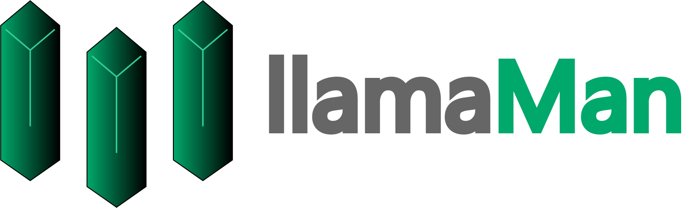
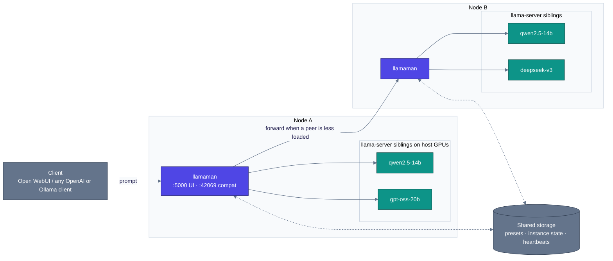

<p align="center">
  
</p>

#  llamaMan

[English](../../README.md) · [简体中文](../zh-CN/README.md) · [日本語](../ja/README.md) · [Deutsch](../de/README.md) · [Français](../fr/README.md) · [Español](../es/README.md) · [Português](../pt-BR/README.md) · **Русский**

**Что это.** Браузерный UI + API-фронтенд для запуска нескольких инстансов сервера [llama.cpp](https://github.com/ggml-org/llama.cpp), на одной машине или на небольшом кластере таких машин. В комплекте прокси, совместимый с Ollama, поэтому его можно напрямую подключить к [Open WebUI](https://github.com/open-webui/open-webui).

**Чем отличается.** В самом llamaMan **нет кода llama.cpp и нет зависимости от GPU** - он порождает контейнеры `ghcr.io/ggml-org/llama.cpp:server-*` как соседние через Docker-сокет. Обновляйте llama.cpp, не трогая llamaMan: `docker pull` более свежего образа `server-*`. Та же машинерия порождения и проксирования не зависит от движка: инстансы [Strata](STRATA.md) работают рядом с llama.cpp-инстансами — так же запускаются, мониторятся, проксируются и укладываются в сон.

> Семантика флагов llama-server — источник истины на стороне llama.cpp: **[CLI-справка сервера](https://github.com/ggml-org/llama.cpp/blob/master/tools/server/README.md)**.

## Возможности

- **Универсальный GPU-образ** - один путь для NVIDIA, AMD (ROCm), Intel Arc, CPU; вендор определяется автоматически (Vulkan включается opt-in через `GPU_TYPE=vulkan`)
- **Библиотека моделей + загрузчик** - скачивание с HuggingFace с лимитами скорости, возобновлением, автоповтором и обнаружением перевыкладки с атомарным повторным скачиванием
- **Запуск в один клик + пресеты** - каждый параметр llama.cpp (spec-decoding, MoE offload, квантование KV, mmproj, ввод PDF…) — полноправное поле UI, с живыми правками пресета для полей, не требующих перезапуска
- **Ollama + OpenAI прокси на `:42069`** - Open WebUI подключается напрямую; модели стартуют по требованию и вытесняются по LRU при достижении `LLAMAMAN_MAX_MODELS`
- **Ввод изображений и PDF** - vision-модели с `--mmproj`; PDF растеризуются постранично
- **Мониторинг инстансов** - VRAM по GPU, CPU/RAM контейнера, по-инстансные TTFT / throughput / latency
- **Auth** - учётные записи пользователей, API-ключи (bearer-токены), переключатель авторизации по эндпоинтам
- **Многоузловый кластер** *(opt-in)* - разнородные узлы как один логический кластер; сводный дашборд; балансировка общей очереди
- 🆕 **Движок Strata** *(opt-in, NVIDIA)* - запускайте инстансы [Strata](https://github.com/Niko1221/Strata) рядом с llama.cpp
- 🆕 **База знаний + MCP-сервер** *(opt-in, бэкенд MariaDB)* - храните документы как темы, ищите по смыслу своей эмбеддинг-моделью и отдавайте всё это любому MCP-клиенту — всё локально

## Требования

- Docker с доступом к `/var/run/docker.sock`
- **Одно** из:
  - [NVIDIA Container Toolkit](https://docs.nvidia.com/datacenter/cloud-native/container-toolkit/install-guide.html) для GPU NVIDIA
  - [Совместимая с ROCm сборка](https://rocm.docs.amd.com/projects/install-on-linux/en/latest/) для GPU AMD
  - Intel Arc с доступом к `/dev/dri`
  - Только CPU

## Быстрый старт

Сначала отредактируйте `docker-compose.yml`:

- Задайте `HOST_MODELS_DIR` / `HOST_LOGS_DIR` как **реальные хостовые пути**, стоящие за монтированиями томов (llamaMan передаёт их Docker-демону при порождении соседних контейнеров).
- `LLAMAMAN_NODE_NAME` (`srv1` в примерном compose; **встроенного дефолта нет** - приложение без него не запустится) **обязателен для каждой установки** - это ключ партиции сохранённого состояния данного развёртывания. Выберите один раз и не меняйте (поздняя смена осиротит сохранённое состояние).

Подтяните образ llama.cpp под свой GPU и запустите:

| GPU | `LLAMA_IMAGE` |
|---|---|
| NVIDIA | `ghcr.io/ggml-org/llama.cpp:server-cuda` |
| AMD (ROCm) | `ghcr.io/ggml-org/llama.cpp:server-rocm` |
| Intel Arc | `ghcr.io/ggml-org/llama.cpp:server-sycl` |
| Vulkan (откат AMD/Intel) | `ghcr.io/ggml-org/llama.cpp:server-vulkan` (задайте `GPU_TYPE=vulkan`) |
| Только CPU | `ghcr.io/ggml-org/llama.cpp:server` |

```bash
docker pull <LLAMA_IMAGE>          # from the table above
# For non-CUDA: also set LLAMA_IMAGE=... in docker-compose.yml
docker compose up --build
```

Для нативного мониторинга VRAM NVIDIA также раскомментируйте `deploy.resources.reservations` в `docker-compose.yml`.

- **UI управления**: <http://localhost:5000> (создайте админа на `/setup`)
- **API, совместимый с Ollama**: <http://localhost:42069>
- **Порты инстансов llama-server**: 8000-8020

> **Замечание по безопасности:** смонтированный `/var/run/docker.sock` даёт контейнеру полный контроль над Docker на хосте. Стандартные следствия доступа к Docker-сокету применимы.

Запуск на bare-metal (разработка, WSL)? См. [Запуск на bare-metal](CONFIGURATION.md#running-bare-metal).

## Ваша первая модель

1. **Достаньте модель.** Либо положите `.gguf` в каталог моделей, либо откройте UI, выберите репозиторий HuggingFace во вкладке **Downloads** и дайте llamaMan скачать его.
2. **Запустите её.** Выберите модель в сайдбаре, нажмите **Launch**. llamaMan породит контейнер llama-server, и инстанс появится со статус-бейджем. Дефолты (ctx 4096, авто GPU layers) подходят для большинства моделей; **Save Preset** запомнит ваши настройки. Каждое поле запуска задокументировано в [Настройки запуска](LAUNCH-SETTINGS.md).
3. **Создайте API-ключ.** В разделе **API Keys** создайте ключ (`llm-xxxxxxxxxx`). Модельные эндпоинты по умолчанию требуют bearer-токен.
4. **Направьте на него клиент.** Любой клиент OpenAI или Ollama работает против `:42069`. Для Open WebUI:

```yaml
open-webui:
  environment:
    - OLLAMA_BASE_URL=http://llamaman:42069
    - OPENAI_API_BASE_URLS=http://llamaman:42069/v1
    - OPENAI_API_KEYS=llm-your-api-key-here
```

Open WebUI перечисляет ваши модели через `/api/tags` (по основе имени GGUF-файла, если вы не задали **Display Name**); выбор модели запускает её автоматически, ждёт healthy-статуса, затем проксирует. Задайте **Display Name** по модели, чтобы показывать удобное имя вместо сырого имени файла кванта.

> **Оговорка про лимит:** примерный compose поставляется с `LLAMAMAN_MAX_MODELS=1`. При заданном лимите Ollama-подключение вытесняет LRU-модель при заполнении, но OpenAI-подключение (`OPENAI_API_BASE_URLS`) по умолчанию возвращает **503** - выберите один путь или поднимите лимит. Правила: [Вытеснение моделей](MODELS.md#model-eviction).

Если что-то пошло не так, раздел [Устранение неполадок](#устранение-неполадок) ниже покрывает частые сбои первого запуска.

## Аутентификация

Два типа учётных данных:

- **Сессионные cookies** для UI (создаются через `/setup` при первом запуске)
- **API-ключи** для внешних клиентов (`Authorization: Bearer llm-xxxxxxxxxx`), управляются в разделе **API Keys** в UI

Переключатель **"Require authentication for all endpoints"** (включён по умолчанию) определяет, требуют ли модельные эндпоинты bearer-токен. Подробности: [Аутентификация](CONFIGURATION.md#authentication-detail).

## Архитектура

llamaMan — маленькое Python-приложение, которое никогда не трогает код llama.cpp напрямую. Оно порождает каждый `llama-server` как соседний контейнер через Docker-сокет, мониторит парк и предоставляет единую входную точку OpenAI/Ollama.



Картина одного узла (по умолчанию) — это только верхняя половина - один контейнер llamaman, N соседних `llama-server` на локальном Docker-демоне, без кластерных пиров, JSON-файлы вместо общей БД. Кластеризация opt-in и аддитивна.

Как это работает подробно - поток запроса, dispatch с учётом очередей, поведение при отказах, компромиссы дизайна: [Архитектура](ARCHITECTURE.md).

## Документация

| Руководство | Что в нём |
|---|---|
| [Настройки запуска](LAUNCH-SETTINGS.md) | Каждое поле формы запуска и его флаг llama-server: ctx, KV-кэш, GPU layers, MoE offload, spec decoding, переопределения сэмплирования, параллелизм и очереди, живые правки пресета, [ввод изображений и PDF](LAUNCH-SETTINGS.md#image--pdf-input), [Anti-Loop](LAUNCH-SETTINGS.md#anti-loop), по-инстансный прокси, idle timeout |
| [Модели](MODELS.md) | Отображаемые имена, обновления моделей, [Decision-модели](MODELS.md#decision-models) (`/v1/systemone`), [вытеснение моделей](MODELS.md#model-eviction), настройки загрузок, управление Docker-образами, архив моделей, бэкап и восстановление, очистка |
| [Конфигурация и хранение](CONFIGURATION.md) | Bare-metal установки, детали auth, GPU-статистика, запись запросов, бэкенды JSON vs MariaDB, [жизнь при недоступности БД](CONFIGURATION.md#surviving-a-database-outage-local-mirror) и полная справка [Переменные окружения](CONFIGURATION.md#environment-variables) |
| [Кластер](CLUSTERING.md) | Многоузловая настройка: общая БД, heartbeat, балансировка общей очереди |
| [База знаний и MCP](KNOWLEDGE-BASE.md) | Темы, эмбеддинги, MCP-эндпоинт, режимы доступа |
| [Strata](STRATA.md) | Второй движок инференса: настройка, каталог, ограничения, заметки по дизайну |
| [REST API](API.md) | Основные эндпоинты: инстансы, загрузки, пресеты, настройки, журнал запросов, особенности тела запуска |
| [Устранение неполадок](TROUBLESHOOTING.md) | Полная таблица симптом → решение |

## Переменные окружения

Те, которых вы коснётесь в первый день (полная справка: [Переменные окружения](CONFIGURATION.md#environment-variables)):

| Переменная | По умолчанию | Описание |
|---|---|---|
| `LLAMAMAN_NODE_NAME` | *(обязательно)* | Уникальная стабильная идентичность - выберите один раз и не меняйте |
| `HOST_MODELS_DIR` / `HOST_LOGS_DIR` | *(= пути в контейнере)* | Реальные хостовые пути за монтированиями томов |
| `LLAMA_IMAGE` | *(авто)* | Образ llama.cpp; выбирается по вендору GPU, задайте, чтобы закрепить. Примерный compose закрепляет `server-cuda` - поменяйте для не-NVIDIA GPU |
| `LLAMAMAN_MAX_MODELS` | `0` | Максимум одновременных chat-моделей через прокси (LRU-вытеснение; 0 = без лимита). Примерный compose ставит `1` |
| `DATABASE_URL` | *(не задана)* | Строка подключения MariaDB/MySQL. Не задана = JSON-файлы |

## Устранение неполадок

| Симптом | Решение |
|---|---|
| Инстанс завис на **starting** | Проверьте логи кнопкой Logs. Частое: OOM, опечатка в пути модели, битый GGUF, образ не подтянут |
| _"Docker image not found"_ | Подтяните подходящий образ: `docker pull ghcr.io/ggml-org/llama.cpp:server-cuda` (или `server-rocm` / `server-sycl` / `server`) |
| _"Docker API error"_ при запуске | Убедитесь, что `/var/run/docker.sock` смонтирован (по умолчанию в `docker-compose.yml`) |
| Нет GPU / ошибка CUDA | Убедитесь, что NVIDIA Container Toolkit установлен и `docker run --gpus all` работает на хосте |
| GPU-статистика недоступна | NVIDIA: раскомментируйте блок `deploy.resources.reservations`. AMD/Intel: убедитесь, что `/sys/class/drm:ro` смонтирован |
| Модель не видна в OpenWebUI | Убедитесь, что `OLLAMA_BASE_URL=http://llamaman:42069`. Проверьте, что `/api/tags` возвращает модели |
| OpenWebUI получает 401 | `require_auth` включён (дефолт). Создайте API-ключ и задайте `OPENAI_API_KEYS` в OpenWebUI |
| OpenAI-клиент получает 503 при заполненных моделях | Достигнут лимит `LLAMAMAN_MAX_MODELS`, и OpenAI API по умолчанию не может вытеснять. Поднимите лимит или включите переключатели вытеснения: [Вытеснение моделей](MODELS.md#model-eviction) |
| Конфликт портов | Форма сама предлагает неиспользуемый порт; подправьте при необходимости |

Полная таблица: [Устранение неполадок](TROUBLESHOOTING.md).

## Благодарности

Эта работа была бы невозможна без [ggml-org/llama.cpp](https://github.com/ggml-org/llama.cpp).

## Лицензия

llamaMan лицензирован по [Elastic License 2.0](../../LICENSE). Вы можете использовать, копировать, распространять и модифицировать ПО при условии:

- Запрета предоставлять ПО третьим сторонам как hosted / managed-сервис, где сервис даёт пользователям доступ к существенному набору его возможностей или функциональности.
- Запрета удалять или скрывать лицензии, копирайты и другие уведомления лицензиара.

### Сторонние лицензии

- **[Font Awesome Free 7.1.0](https://fontawesome.com/)** от Fonticons, Inc. - иконки (CC BY 4.0), шрифты (SIL OFL 1.1) и код (MIT). Полный текст лицензии поставляется в [`static/fontawesome-free-7.1.0-web/LICENSE.txt`](../../static/fontawesome-free-7.1.0-web/LICENSE.txt).
