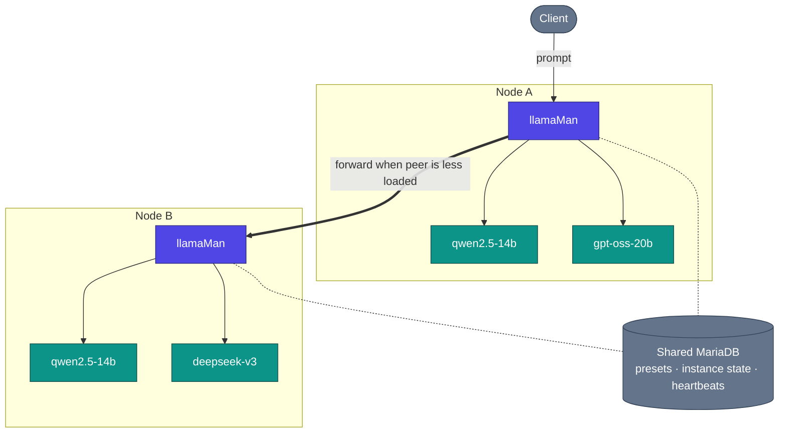

# 架构、请求流程与设计决策

深入了解 llamaMan 的底层工作原理。单节点架构图请参见 [README](../../README.md#architecture)；本页面补充了集群架构视图及深层实现细节。

## 目录

- [集群视图](#集群视图) · [工作原理](#工作原理) · [请求流程](#请求流程) · [设计决策与权衡](#设计决策与权衡)

## 集群视图

## 工作原理

**容器化 vs 裸机运行。** llamaMan 默认运行在 Docker 中（`llamaman-net` 网络，通过容器名访问同级容器），或以裸机方式直接运行在宿主机上（通过 `localhost` 及映射端口访问所创建的容器）。运行模式会自动检测；可通过 `LLAMAMAN_IN_DOCKER` 强制指定。

**异构集群。** 每个节点拥有各自独立的硬件（GPU 数量/厂商/VRAM）、磁盘上的模型文件、llama.cpp 镜像以及硬件层面的预设覆盖项。共享数据库保存预设、用户、API key、按节点划分的实例状态和集群心跳 —— 而不保存模型文件。参见 [Clustering](CLUSTERING.md)。

**感知队列的调度与跨节点工作窃取。** 当两个节点服务于同一个模型（或同一个 `share_queue_group` 别名）时，发往该名称的入站请求会被路由到当前处理中（in-flight）请求较少的对等节点。如果选中的节点已饱和，其 `RequestGate` 仍会尝试将请求移交给有空闲容量的对等节点，而不是直接排队。

**模型加载与 LRU 逐出。** `:42069` 兼容 proxy 按需自动启动模型。一旦达到 `LLAMAMAN_MAX_MODELS` 上限，最近最少使用的非管理员实例将被停止以腾出空间。休眠实例仍占用该配额槽位；空闲超时则是另一个独立维度。完整规则参见：[Model Eviction](MODELS.md#model-eviction)。

**高弹性存储。** MariaDB 处于每个请求的关键路径上（认证过程每次调用都会读取设置与密钥）。位于 `DATA_DIR/db_mirror/` 的本地 JSON 镜像会对每个节点作用域的更新执行写透（write-through）；当熔断器打开时，读取操作会回退到该镜像，写入操作则被记录到日志中并在重新连接后重放。默认关闭，只需一项设置即可开启：[Surviving a database outage](CONFIGURATION.md#surviving-a-database-outage-local-mirror)。

**多模态支持。** 视觉模型会在主 GGUF 旁加载其 `--mmproj` 投影器。同时支持 OpenAI 的 `image_url` / `file` 和 Ollama 的 `images[]` 格式。PDF 会逐页光栅化渲染，或者如果是原生电子版 PDF 则走提取文本的高速通道。详情参见：[Image & PDF Input](LAUNCH-SETTINGS.md#image--pdf-input)。

**容错行为。** 轮询器能够检测到挂掉的容器并进行标记，实例的槽位会在下一次 tick 时释放。被杀死的 llamaman 进程在重启时会重新认领带有标记且仍在运行的容器（它们的 gate、sidecar proxy 和日志追踪中继都会被重新构建），因此无需繁琐的 `--restart=always` 配置。错过心跳窗口的对等节点会暂时从调度中移除，直至恢复上线。

**无需重新构建 llamaman 即可更新 llama.cpp：** 从 UI 中拉取较新的 `server-*` 镜像（Settings → Docker Images，参见 [Docker Image Management](MODELS.md#docker-image-management)），或调用 pull endpoint。新实例将基于新镜像启动；已有实例保持运行，直到你重启它们。

## 请求流程

一个发往双节点集群的具体 OpenAI 兼容 chat 请求处理过程：

1. 客户端向 `nodeA:42069` 发送 `POST /v1/chat/completions`，指定模型 `qwen2.5-14b`。
2. `nodeA` 查找目标：该模型存在于本节点**以及** `nodeB` 上且处于存活状态。两者属于同一个有效队列分组。
3. 调度器轮询每个候选节点的实时负载（来自心跳缓存 + 短周期 in-flight 计数器）。`nodeB` 负载较低 → 请求按相同路径被转发至 `nodeB` 的宣告 URL（其 `:5000` UI/API 端口）。
4. `nodeB` 认领一个 gate 槽位（若队列已满且没有对等节点有空闲空间，则返回 429）。如果启用了采样覆盖，则会注入覆盖参数。如果存在单个实例的 sidecar（空闲检测 / 最大并发 / proxy 采样），请求首先到达 sidecar，若容器处于休眠状态，sidecar 会将其唤醒。
5. Sidecar 将请求转发给内部端口上的 `llama-server`。响应流依次通过 sidecar → `nodeB` → `nodeA` → 客户端回传。
6. 流结束时：请求日志 worker 记录 TTFT / 吞吐量 / 最终 token 数量；释放 gate 槽位；更新 LRU 时间戳，防止该实例成为下一次逐出的目标。

如果在心跳和本次调用之间 `nodeB` 已经离线，调度器会检测到连接错误并重新选择下一个候选节点（在本例中为本地节点）。

## 设计决策与权衡

- **单个 gunicorn worker、`gthread`、`preload_app=False`。** 实时状态（实例、gate、下载、空闲 proxy）保存在内存中的 Python 字典中；多 worker 会导致状态碎片化。并发能力由线程提供（`threads=32` —— 足以容纳在整个生成周期内保持占用线程的集群转发请求）。权衡：单台主机内无法横向扩展；需通过添加集群节点来进行扩展。
- **`LLAMAMAN_NODE_NAME` 为必填项。** 它是存储的分区键。首次启动后更改它会导致该节点的历史记录变成孤儿数据。权衡：即使单节点安装也需要额外配置一个环境变量，但能保证共享 DB 在集群环境下保持一致，并在首次启动时自动认领历史旧行。
- **入口节点保持连接。** 转发的请求在整个生成期间都会在入口节点和目标节点上各自保持一个线程 —— 不做客户端分发，从而确保任何 OpenAI/Ollama 客户端无需修改即可直接使用。权衡：入口节点的线程池决定了跨节点并发推理的上限。
- **原样传递标记值（Sentinel forwarding）。** llama.cpp 中的特殊标记值（如 `--n-gpu-layers` 的 `-2 = all`，或 `-1 = --cpu-moe`）会被原样透传，而不会在应用层做额外转换。权衡：如果上游改变了这些标记值的含义可能会较脆弱，但能做到零转换偏差，且每个 llama-server 新版本都能当天适配。
- **内存为主状态，DB 仅作镜像。** 运行时的事实来源是受锁保护的模块级字典；数据库只是持久化镜像。权衡：在保存点之间崩溃最多丢失数秒的状态而非请求 —— 任何修改状态的调用在返回前都会向后端持久化快照。
- **`ResilientBackend` 默认关闭。** 在使用共享 MariaDB 时，只需一项设置即可开启本地 JSON 镜像 + 写入日志，从而防止数据库故障导致每个请求都返回 500 或启动失败。默认关闭是为了让单数据库部署保持更简明的代码路径。权衡：镜像模式在重新连接时会对节点作用域的行进行全量对账，因此不适用于两个节点并发修改同一分区数据的集群架构（根据设计，它们不会这样做）。
