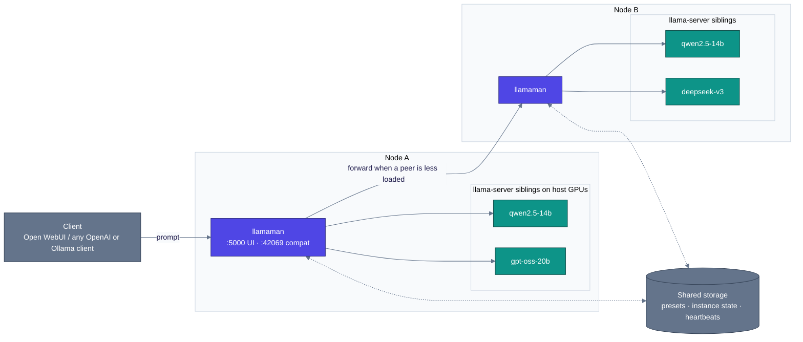

<p align="center">
  
</p>

#  llamaMan

[English](../../README.md) · **简体中文** · [日本語](../ja/README.md) · [Deutsch](../de/README.md) · [Français](../fr/README.md) · [Español](../es/README.md) · [Português](../pt-BR/README.md) · [Русский](../ru/README.md)

**这是什么。** 一个用于在单台机器或小型集群上运行多个 [llama.cpp](https://github.com/ggml-org/llama.cpp) server 实例的浏览器 UI + API 前端。内置 Ollama 兼容 proxy，可无缝接入 [Open WebUI](https://github.com/open-webui/open-webui)。

**有何不同。** llamaMan 本身**不包含 llama.cpp 代码，且无 GPU 依赖** —— 它通过 Docker socket 将 `ghcr.io/ggml-org/llama.cpp:server-*` 容器作为同级（sibling）容器拉起。无需触碰 llamaMan 即可更新 llama.cpp：执行 `docker pull` 拉取更新的 `server-*` 镜像即可。相同的容器生成与 proxy 机制完全独立于引擎：[Strata](STRATA.md) 实例与 llama.cpp 实例并存运行，以完全相同的方式启动、监控、proxy 转发与休眠。

> llama-server 命令行标志的语义以 llama.cpp 官方为准：**[server CLI reference](https://github.com/ggml-org/llama.cpp/blob/master/tools/server/README.md)**。

## 特性

- **通用 GPU 镜像** - 单套流程支持 NVIDIA、AMD (ROCm)、Intel Arc、CPU；自动检测硬件厂商（通过 `GPU_TYPE=vulkan` 手动开启 Vulkan）
- **模型库与下载器** - 从 HuggingFace 拉取模型，支持限速、断点续传、自动重试以及带原子重新拉取的重新发布检测
- **一键启动与预设** - 每个 llama.cpp 调优项（投机解码、MoE 卸载、KV 量化、mmproj、PDF 输入…）均为一等公民的 UI 字段，对于无需重启的字段支持预设实时更新
- **`:42069` 上的 Ollama + OpenAI proxy** - Open WebUI 直接接入；模型按需自动启动，达到 `LLAMAMAN_MAX_MODELS` 时按 LRU 逐出
- **图像与 PDF 输入** - 视觉模型支持 `--mmproj`；PDF 逐页光栅化渲染
- **实例监控** - 每张 GPU 的显存占用、容器 CPU/RAM，以及每实例 TTFT / 吞吐量 / 延迟
- **认证** - 用户账号、API key（bearer token）、单 endpoint 认证开关
- **多节点集群** *(可选功能)* - 异构节点组成单个逻辑集群；聚合仪表盘；共享队列负载均衡
- 🆕 **Strata 引擎** *(可选功能，NVIDIA)* - 在 llama.cpp 旁启动 [Strata](https://github.com/Niko1221/Strata) 实例
- 🆕 **知识库与 MCP 服务器** *(可选功能，MariaDB 后端)* - 将文档按主题存储，使用你自己的 embedding 模型按语义进行搜索，并向任何 MCP 客户端暴露完整接口 —— 全部本地运行

## 系统要求

- 具有访问 `/var/run/docker.sock` 权限的 Docker
- **以下之一：**
  - 用于 NVIDIA GPU 的 [NVIDIA Container Toolkit](https://docs.nvidia.com/datacenter/cloud-native/container-toolkit/install-guide.html)
  - 用于 AMD GPU 的 [ROCm 兼容配置](https://rocm.docs.amd.com/projects/install-on-linux/en/latest/)
  - 具有 `/dev/dri` 访问权限的 Intel Arc
  - 仅限 CPU

## 快速开始

首先编辑 `docker-compose.yml`：

- 将 `HOST_MODELS_DIR` / `HOST_LOGS_DIR` 设置为支撑你卷挂载的**真实宿主机路径**（llamaMan 在生成同级容器时会将它们传递给 Docker daemon）。
- `LLAMAMAN_NODE_NAME`（示例 compose 中为 `srv1`；**无内置默认值** —— 缺少该变量应用将拒绝启动）是**每次安装的必填项** —— 它是当前部署所存储状态的分区键。选定后请保持不变（后续更改会导致已存储状态变成孤儿数据）。

拉取适用于你的 GPU 的 llama.cpp 镜像并启动：

| GPU | `LLAMA_IMAGE` |
|---|---|
| NVIDIA | `ghcr.io/ggml-org/llama.cpp:server-cuda` |
| AMD (ROCm) | `ghcr.io/ggml-org/llama.cpp:server-rocm` |
| Intel Arc | `ghcr.io/ggml-org/llama.cpp:server-sycl` |
| Vulkan (AMD/Intel 回退) | `ghcr.io/ggml-org/llama.cpp:server-vulkan`（设置 `GPU_TYPE=vulkan`） |
| 仅限 CPU | `ghcr.io/ggml-org/llama.cpp:server` |

```bash
docker pull <LLAMA_IMAGE>          # from the table above
# For non-CUDA: also set LLAMA_IMAGE=... in docker-compose.yml
docker compose up --build
```

若需 NVIDIA 原生显存监控，还需取消 `docker-compose.yml` 中 `deploy.resources.reservations` 的注释。

- **管理 UI**：<http://localhost:5000>（首次通过 `/setup` 创建管理员）
- **Ollama 兼容 API**：<http://localhost:42069>
- **llama-server 实例端口**：8000-8020

> **安全提示：** 挂载的 `/var/run/docker.sock` 赋予了容器对宿主机 Docker 的完全控制权。标准 Docker socket 访问的安全注意事项均适用。

裸机运行（开发环境、WSL）？参见[裸机运行](CONFIGURATION.md#running-bare-metal)。

## 启动你的第一个模型

1. **获取模型。** 将 `.gguf` 文件放入你的模型目录，或者打开 UI，在 **Downloads** 下选择 HuggingFace 仓库由 llamaMan 进行拉取。
2. **启动模型。** 在侧边栏中选择模型，点击 **Launch**。llamaMan 会生成一个 llama-server 容器，实例随之显示状态徽章。默认设置（4096 ctx，自动 GPU 层数）适用于大多数模型；点击 **Save Preset** 可保存你的设置。每个启动字段的说明均收录在[启动设置](LAUNCH-SETTINGS.md)中。
3. **创建 API key。** 在 **API Keys** 下创建一个密钥（`llm-xxxxxxxxxx`）。模型 endpoint 默认需要 bearer token。
4. **配置客户端。** 任何 OpenAI 或 Ollama 客户端均可请求 `:42069`。对于 Open WebUI：

```yaml
open-webui:
  environment:
    - OLLAMA_BASE_URL=http://llamaman:42069
    - OPENAI_API_BASE_URLS=http://llamaman:42069/v1
    - OPENAI_API_KEYS=llm-your-api-key-here
```

Open WebUI 通过 `/api/tags` 列出你的模型（按 GGUF 文件名主干显示，除非你设置了 **Display Name**）；选中某个模型会自动按需启动，等待其健康上线后进行 proxy 转发。设置按模型的 **Display Name** 可展示友好名称，而非原始量化文件名。

> **配额限制注意：** 示例 compose 配置了 `LLAMAMAN_MAX_MODELS=1`。设置了上限后，Ollama 连接在满载时会逐出 LRU 模型，但 OpenAI 连接（`OPENAI_API_BASE_URLS`）默认返回 **503** —— 请选择其一或提高配额上限。规则参见：[模型逐出](MODELS.md#model-eviction)。

如果遇到问题，下方的[故障排除](#故障排除)涵盖了常见的首次运行故障。

## 认证机制

两种凭据类型：

- **Session cookie** 用于 UI（首次启动时通过 `/setup` 创建）
- **API key** 用于外部客户端（`Authorization: Bearer llm-xxxxxxxxxx`），在 UI 的 **API Keys** 下管理

**"Require authentication for all endpoints"** 开关（默认开启）控制模型服务 endpoint 是否要求提供 bearer token。详情参见：[认证](CONFIGURATION.md#authentication-detail)。

## 系统架构

llamaMan 是一个小型 Python 应用，从不直接触碰 llama.cpp 代码。它通过 Docker socket 将每个 `llama-server` 作为同级容器拉起，监控整个实例集群，并提供统一的 OpenAI/Ollama 入口。



单节点架构（默认）仅为上半部分 —— 单个 llamaman 容器，本地 Docker daemon 上的 N 个 `llama-server` 同级容器，无集群对等节点，使用 JSON 文件替代共享数据库。集群功能为可选且增量启用。

深度解析其工作原理 —— 请求流、感知队列的调度、故障处理机制、设计权衡：[系统架构](ARCHITECTURE.md)。

## 文档指南

| 指南 | 内容说明 |
|---|---|
| [启动设置](LAUNCH-SETTINGS.md) | 启动表单的每个字段及其 llama-server 标志：ctx、KV 缓存、GPU 层数、MoE 卸载、投机解码、采样覆盖、并发与排队、实时预设更新、[图像与 PDF 输入](LAUNCH-SETTINGS.md#image--pdf-input)、[防循环](LAUNCH-SETTINGS.md#anti-loop)、每实例 proxy、空闲超时 |
| [模型](MODELS.md) | 显示名称、模型更新、[决策模型](MODELS.md#decision-models) (`/v1/systemone`)、[模型逐出](MODELS.md#model-eviction)、下载设置、Docker 镜像管理、模型归档、备份与恢复、清理设置 |
| [配置与存储](CONFIGURATION.md) | 裸机安装、认证详情、GPU 统计、请求记录、JSON 与 MariaDB 后端、[数据库故障应对](CONFIGURATION.md#surviving-a-database-outage-local-mirror)，以及完整的[环境变量](CONFIGURATION.md#environment-variables)参考 |
| [集群](CLUSTERING.md) | 多节点设置：共享数据库、心跳检测、共享队列负载均衡 |
| [知识库与 MCP](KNOWLEDGE-BASE.md) | 主题、Embedding、MCP endpoint、访问模式 |
| [Strata](STRATA.md) | 第二推理引擎：安装设置、模型目录、限制、设计说明 |
| [REST API](API.md) | 核心 endpoint：实例、下载、预设、设置、请求日志、启动请求体边界行为 |
| [故障排除](TROUBLESHOOTING.md) | 完整的“故障现象 → 解决方法”速查表 |

## 环境变量

第一天就会用到的常用变量（完整参考：[环境变量](CONFIGURATION.md#environment-variables)）：

| 变量名 | 默认值 | 描述 |
|---|---|---|
| `LLAMAMAN_NODE_NAME` | *(必填)* | 唯一且稳定的标识符 —— 选定后请保持不变 |
| `HOST_MODELS_DIR` / `HOST_LOGS_DIR` | *(与容器路径相同)* | 支撑卷挂载的真实宿主机路径 |
| `LLAMA_IMAGE` | *(自动)* | llama.cpp 镜像；根据 GPU 厂商自动选择，可显式锁定。示例 compose 固定了 `server-cuda` —— 非 NVIDIA GPU 请相应修改 |
| `LLAMAMAN_MAX_MODELS` | `0` | 通过 proxy 运行的最大并发 chat 模型数（LRU 逐出；0 = 不限制）。示例 compose 设置为 `1` |
| `DATABASE_URL` | *(未设置)* | MariaDB/MySQL 连接字符串。未设置 = 使用 JSON 文件 |

## 故障排除

| 故障现象 | 解决方法 |
|---|---|
| 实例卡在 **starting** 状态 | 点击 Logs 按钮查看日志。常见原因：OOM（内存不足）、模型路径拼写错误、GGUF 文件损坏、镜像尚未拉取 |
| _"Docker image not found"_ | 拉取对应的镜像：`docker pull ghcr.io/ggml-org/llama.cpp:server-cuda`（或 `server-rocm` / `server-sycl` / `server`） |
| 启动时出现 _"Docker API error"_ | 确保已挂载 `/var/run/docker.sock`（`docker-compose.yml` 中的默认配置） |
| 无 GPU / CUDA 错误 | 确保已安装 NVIDIA Container Toolkit，并且在宿主机上运行 `docker run --gpus all` 正常 |
| GPU 状态统计不可用 | NVIDIA：取消 `deploy.resources.reservations` 块的注释。AMD/Intel：确保已挂载 `/sys/class/drm:ro` |
| 模型未在 OpenWebUI 中显示 | 确保 `OLLAMA_BASE_URL=http://llamaman:42069`。检查 `/api/tags` 是否能返回模型 |
| OpenWebUI 收到 401 | `require_auth` 处于开启状态（默认）。创建一个 API key 并在 OpenWebUI 中设置 `OPENAI_API_KEYS` |
| 模型满载时 OpenAI 客户端收到 503 | 已达到 `LLAMAMAN_MAX_MODELS` 上限，且 OpenAI API 默认不执行逐出。提高上限或启用逐出开关：[模型逐出](MODELS.md#model-eviction) |
| 端口冲突 | 表单会自动建议未使用的端口；如有需要可手动调整 |

完整速查表：[故障排除](TROUBLESHOOTING.md)。

## 致谢

如果没有 [ggml-org/llama.cpp](https://github.com/ggml-org/llama.cpp)，本项目将无法实现。

## 许可证

llamaMan 基于 [Elastic License 2.0](../../LICENSE) 授权。你可以使用、复制、分发和修改该软件，但须遵守：

- 不得将本软件作为托管服务向第三方提供，以致第三方可以通过该服务访问本软件的大量特性或功能。
- 不得移除或遮挡许可方的许可声明、版权声明或其他声明。

### 第三方许可证

- **[Font Awesome Free 7.1.0](https://fontawesome.com/)** by Fonticons, Inc. - 图标（CC BY 4.0），字体（SIL OFL 1.1），以及代码（MIT）。完整许可证文本位于 [`static/fontawesome-free-7.1.0-web/LICENSE.txt`](../../static/fontawesome-free-7.1.0-web/LICENSE.txt)。
